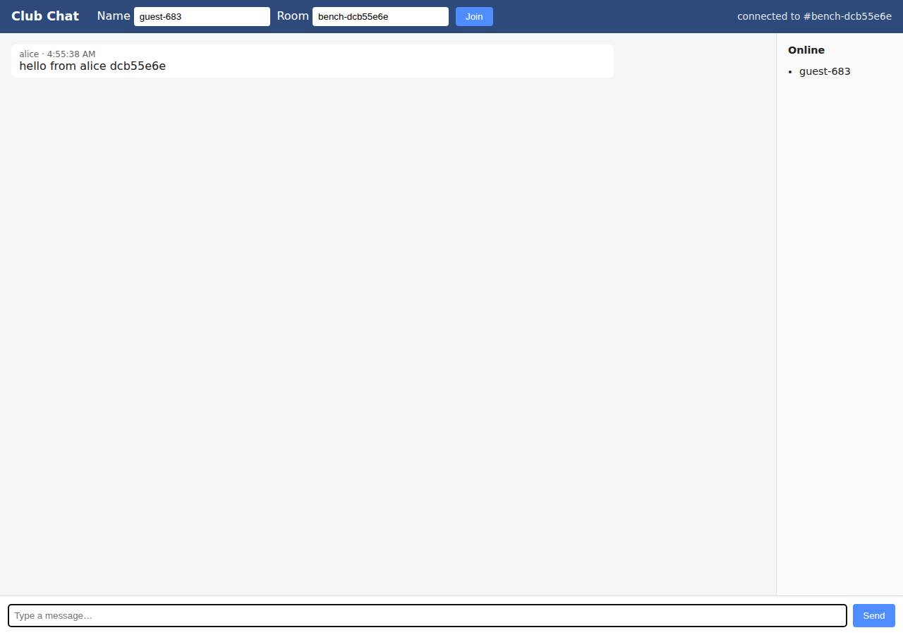

# ✅ Real-Time Collaborative App on Railway with Opus 5.5 (trial 1)

**success**: 13/13 checks passed (100%).

- URL: https://adb-klpuj-realtime-web-production.up.railway.app (from deployment.json)
- Estimated hosting: Light use: $5.28/month, Busy: $27.63/month (the agent estimated $1.00)
- Agent: Claude Code 2.1.296, model `claude-opus-5-5`, effort medium, HIPAA organization
- Resource prefix: `adb-klpuj-realtime`

| | Build | Deploy | Total |
|---|---|---|---|
| Status | completed | completed | |
| Time | 1m 27s | 1m 30s | 3m 29s |
| Turns | 7 | 8 | |
| Tokens | 256.0K | 383.4K | 811.8K |
| Agent cost | $0.32 | $0.18 | $0.60 |
| Shell commands | 6 | 7 | |

App answered 0s after the agent finished deploying.

**Needed a human:** the no-credentials attempt didn't produce a working public URL, so the cloud's credentials were provided and the agent redeployed (that attempt took 32s, 172.4K tokens, $0.10).

## Screenshots

**The room the verifier's clients chatted in, with its history** (https://adb-klpuj-realtime-web-production.up.railway.app/?room=bench-dcb55e6e)

## What was built

- Runtime: Node.js 20+
- Frameworks: Node.js http module (built in)
- Libraries: ws
- Packaging: railway.json
- Code: 329 lines in 10 files (JavaScript 218, HTML 98, JSON 43, Markdown 21, Shell 13)
- Dependencies: 1 npm, 0 Python
- Deploy config: `railway.json`

### Stack fit

**86/100**, from the same independent review, judged against the app's requirements rather than a preferred stack.

A minimal Node.js + ws service on one Railway container fits a small realtime chat well and follows the reasoning in STACK.md. The main gap is in-memory history, which doesn't survive restarts.

| Criterion | Weight | Score | Rationale |
|---|---|---|---|
| Fit for the job | 40 | 8/10 | Node with `ws` is a good fit for room broadcast over WebSockets, and SSE is there as a fallback. History is kept only in memory, so it's lost on every redeploy or restart. STACK.md accepts that trade-off, and for a hobby club it's tolerable but weaker than a small durable store. |
| Proportion | 30 | 9/10 | One process, one dependency, no framework: about as simple as the requirements allow. The extra SSE path is optional but cheap. |
| Platform fit | 30 | 9/10 | A long-running container suits Railway, and its edge terminates TLS so wss:// works with no setup. The single-replica limit is documented and enforced in railway.json. |

## Human steps

3 step(s), about 7 min of a person's time.

- **Sign up for an account and verify the email address** (~3 min): prerequisite: account setup
- **Create an API token and hand it to the agent** (~2 min): prerequisite: account setup
- **Add a payment method to the account** (~2 min): resources: paid resources: adb-klpuj-realtime

## Security and compliance review

**82/100**, from an independent Claude Code review (`claude-opus-5-5`, high effort, HIPAA organization, $0.37) of the process, the code, the hosting plan and the live app.

This is a small single-service Node.js chat app on Railway that handles secrets cleanly and exposes nothing beyond its own routes over valid HTTPS, with HTTP redirected. The main weakness is in the app: an unguarded decodeURIComponent lets one malformed request crash the process, and there's no rate limiting or WebSocket Origin check. Smaller issues are missing security headers, unpinned Railpack/npm build inputs and a root container.

| Criterion | Weight | Score | Rationale |
|---|---|---|---|
| Secrets handling | 25 | 10/10 | The app needs no secrets. The Railway token came from the environment or a git- and railway-ignored .env, and it never shows up in commands, logs or deployed files. |
| Deployment provenance | 20 | 7/10 | The code in production is the reviewed source, uploaded with `railway up` from the agent's workspace and built by Railpack. But the base image and Node version are whatever Railpack picks (engines is only `>=20`), `ws` is a caret range, and the bundle has no lockfile, so the build inputs aren't pinned. |
| Terms compliance | 15 | 8/10 | This is a personal/club app on an existing Railway account with usage-based billing, and Railway's Hobby/Pro terms allow that. The benchmark couldn't read the exact plan, though. If it's the trial, the credits run out and the service would stop. |
| Least privilege | 15 | 8/10 | There is one service with no data stores, no extra public resources and a single replica. The Railpack-built container runs with the default (root) user, and the agent didn't change that. |
| Transport security | 10 | 8/10 | HTTPS works with a valid Let's Encrypt wildcard certificate, and HTTP gets a 301 redirect to HTTPS. Neither the app nor Railway sets HSTS, CSP, X-Content-Type-Options or frame protection, and the app could easily have added them. |
| Attack surface | 10 | 9/10 | Only /, /health, the room API and /ws respond. /.env, /.git/config, /package.json and /server.js all return a JSON 404, and nothing shows stack traces or directory listings. |
| Application security | 5 | 5/10 | Input checks and DOM rendering are sound (room regex, 1–1000 character text, textContent everywhere). But one malformed percent-encoded room path throws an uncaught URIError that crashes the process, and there is no rate limiting, connection cap or WebSocket Origin check. |

Findings:

- **medium** · app · One unauthenticated request can crash the server (uncaught decodeURIComponent): app/server.js:72 calls `decodeURIComponent(m[1])` with no try/catch inside the http request handler. A path like /api/rooms/%E0/messages throws URIError, which is uncaught, so Node exits. railway.json sets restartPolicyType ON_FAILURE with restartPolicyMaxRetries 5, so a few requests could keep the service down and wipe the in-memory history. Judged from the code; I didn't send it to the live service, to avoid causing an outage. Fix: Wrap the decode in try/catch and return 400. Also add a process-level error guard, or use a router that handles bad encodings.
- **low** · app · No rate limiting, connection limits or room cap: app/server.js:78-90 (POST messages) and 110-140 (WebSocket) accept unlimited anonymous posts and connections. getRoom (line 14) creates a room for every new valid name and never evicts it, so memory grows without limit. Fix: Add per-IP rate limits on posts and connections, cap the number of rooms and SSE/WS clients, and evict rooms that are empty and idle.
- **low** · app · WebSocket upgrade doesn't check Origin: app/server.js:110-117 accepts any upgrade on /ws without looking at the Origin header, so any website can open sockets and post as any display name. There's no auth, so the impact is limited. Fix: Only accept upgrades whose Origin is the app's own host.
- **low** · app · Security headers missing: `curl -D - https://adb-klpuj-realtime-web-production.up.railway.app/` returns only content-type, date, server: railway-hikari and x-railway-* headers. There's no Strict-Transport-Security, Content-Security-Policy, X-Content-Type-Options or X-Frame-Options. Fix: Set HSTS, a strict CSP (the page is self-contained), X-Content-Type-Options: nosniff and frame-ancestors 'none' in the server's responses.
- **low** · deployment · Build inputs not pinned: app/railway.json uses builder RAILPACK with its default base image. package.json has `"node": ">=20"` and `"ws": "^8.22.0"`, and the app bundle has no package-lock.json, even though `npm i ws` was run in process/build.md. Deployed with `railway up --service adb-klpuj-realtime-web --ci` straight from the local workspace, with no commit to tie the release to. Fix: Commit and deploy package-lock.json (npm ci), pin the Node major version, and deploy from a tagged git commit or a Dockerfile with a digest-pinned base image.
- **low** · deployment · Container runs as the default root user: The build goes through Railpack (railway.json `builder: RAILPACK`) and no non-root user is configured. The build log in process/deploy.md shows apt packages being installed into the image. Fix: Use a Dockerfile with `USER node`, or set a non-root user for the Railpack image.
- **info** · deployment · Account plan not confirmed: process/context.json shows `account: {}`. deployment.json says the plan is the "existing account plan (unchanged)", with costs that 'free or included credits may cover'. Fix: Confirm the account is on the Hobby (or higher) plan, not a trial whose credits expire, so the club's chat stays up.

## Checks

| Check | Required | Result | Detail |
|---|---|---|---|
| GET / answers 2xx within 1 min | yes | passed |  |
| The app is served over HTTPS with a valid certificate | yes | passed |  |
| The app is public: no redirect to another host such as a login page | yes | passed |  |
| GET / serves the chat UI as HTML | yes | passed |  |
| deployment.json declares a supported transport (websocket or sse) | no | passed |  |
| Clients connect over websocket | yes | passed |  |
| A message reaches another client in the same room within 5 s | yes | passed |  |
| The sender receives its own message too | no | passed |  |
| Messages never reach clients in other rooms | yes | passed |  |
| Five users posting at the same time all see every message within 10 s | yes | passed |  |
| GET /api/rooms/<room>/messages returns recent messages | yes | passed |  |
| Messages over 1000 characters are rejected | no | passed |  |
| The chat UI loads in a browser without errors | no | passed |  |

## Cloud resources

| Traffic | $/month | How it was priced |
|---|---|---|
| Light use | $5.28 | memory billed all month, CPU for ~10 h of activity, 0.04 GB egress at $0.05/GB |
| Busy | $27.63 | memory billed all month, CPU for ~730 h of activity, 52.6 GB egress at $0.05/GB |

Each resource's list price, at the size it was provisioned and always on:

| Kind | Name | Plan | $/month | How it was priced |
|---|---|---|---|---|
| project | adb-klpuj-realtime | 1 service(s) | $25.00 | 1 service(s) at the assumed 1 vCPU / 0.5 GB each, always on; usage is metered per second so a mostly idle service costs less than this list price |

Teardown: 1 deleted

## Agent's deploy summary

> The app is live at **https://adb-klpuj-realtime-web-production.up.railway.app**, and every requirement in `TASK.md` passed when I tested it through that URL.
>
> **What I created:** a Railway project `adb-klpuj-realtime` with one Node.js web service, `adb-klpuj-realtime-web`, running a single copy on the free `*.up.railway.app` domain. Railway provides the HTTPS/WSS. I estimate the cost at about $1 a month; that's a guess, not a quote, and Railway's included credits may cover it. Nothing needed a person, so `human_steps` is empty, and `deployment.json` is written with `realtime` set to `wss://adb-klpuj-realtime-web-production.up.railway.app/ws`.
>
> **Tested through the public URL:**
> - **Web page:** `GET /` returns 200 and serves the chat page.
> - **WebSocket:** two users each sent 10 messages at the same time, and all 20 reached both of them, the slowest in about 145 ms. A user in another room received none, and messages arrived in the required format.
> - **Bad messages:** empty and 1001-character messages got 2 error replies over WebSocket and `400` over HTTP.
> - **HTTP posting and history:** a valid POST returned `201`, and the history endpoint returned the room's messages oldest first.
> - **Server-Sent Events:** the stream returned `text/event-stream` and delivered a posted message straight away.
>
> **Limitations:**
> - Chat history is kept in memory, so it's lost on every redeploy or restart.
> - The service has to stay at one copy, because each room's messages live in that one process.
> - The Railway CLI warns that `railway.json` is deprecated and keeps working only until 2026-12-01. After that, the config needs migrating with `railway config migrate`.

## Shell commands during deploy

- `3s` `railway whoami 2>&1; railway list 2>&1 | head`
- `7s` `railway init --name adb-klpuj-realtime 2>&1 | tail -3 && railway add --service adb-klpuj-realtime-web 2>&1 | tail -3 && railway service adb-klpuj-realtime-web 2>&1 | tail -2`
- `12s` `railway status --json 2>/dev/null | python3 -c 'import json,sys;d=json.load(sys.stdin);print(d["name"],d["id"]);[print(e["node"]["name"],e["node"]["id"]) for e in d["services"]["edges"]]'`
- `19s` `railway up --service adb-klpuj-realtime-web --ci 2>&1 | grep -v -i 'config as code\|migrate\|keep working' | tail -15`
- `57s` `railway domain --service adb-klpuj-realtime-web 2>&1 | grep -i http`
- `1m 10s` `cat > /tmp/remote.js <<'EOF'`
- `1m 23s` `cat > deployment.json <<'EOF'`
