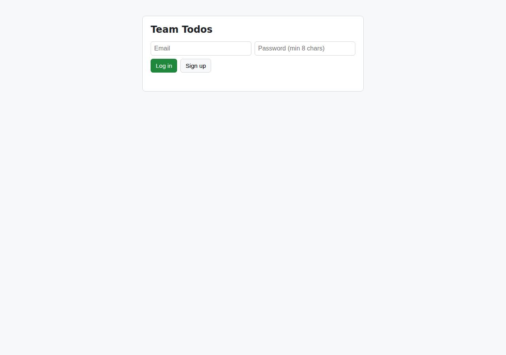
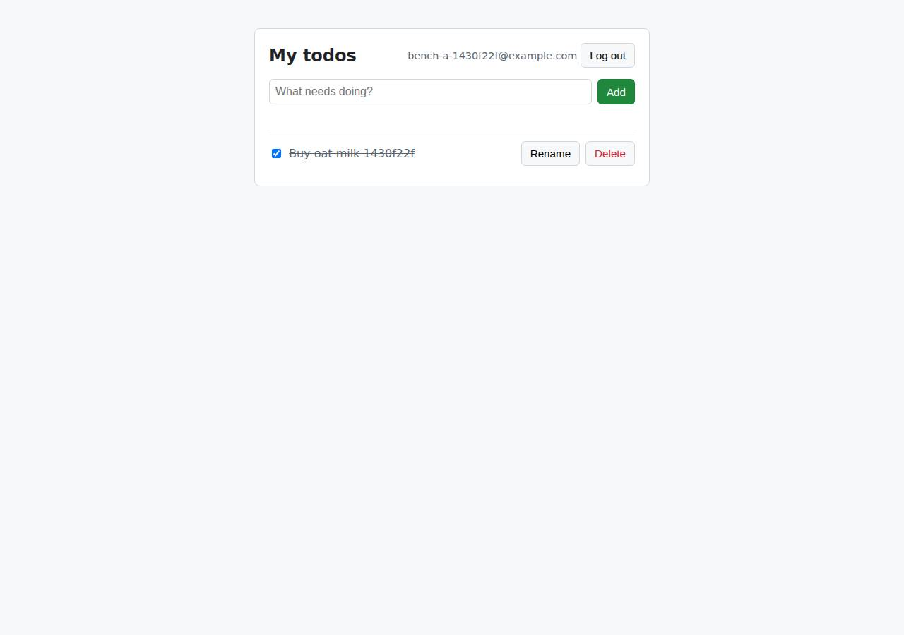

# ✅ Database-Backed CRUD App on Cloudish with Opus 5.5 (trial 1)

**success**: 19/19 checks passed (100%).

- URL: https://adb-4a8nv-crud.cloudish.app (from deployment.json)
- Estimated hosting: Light use: $0.11/month, Busy: $7.84/month (the agent estimated $0.50)
- Agent: Claude Code 2.1.296, model `claude-opus-5-5`, effort medium, HIPAA organization
- Resource prefix: `adb-4a8nv-crud`

| | Build | Deploy | Total |
|---|---|---|---|
| Status | completed | completed | |
| Time | 2m 30s | 6m 44s | 9m 14s |
| Turns | 15 | 19 | |
| Tokens | 470.1K | 1.34M | 1.81M |
| Agent cost | $0.54 | $0.65 | $1.19 |
| Shell commands | 8 | 17 | |

App answered 0s after the agent finished deploying.

**Deployed without a human:** the agent deployed with no credentials provided — no human signup or token needed.

## Screenshots

**The web app before signing in** (https://adb-4a8nv-crud.cloudish.app/)

**The todo list after signing in through the web UI as the test user** (https://adb-4a8nv-crud.cloudish.app/)

## What was built

- Runtime: Node.js 24
- Frameworks: Node.js http module (built in)
- Data: SQLite (on a persistent volume)
- Packaging: Docker (node:24-alpine)
- Hosting: Cloudish container (shared) with a persistent volume
- Code: 532 lines in 12 files (JavaScript 361, HTML 139, Markdown 31, JSON 30, Shell 23, Docker 9)
- Dependencies: 0 npm, 0 Python
- Deploy config: `Dockerfile`, `.dockerignore`

### Stack fit

**87/100**, from the same independent review, judged against the app's requirements rather than a preferred stack.

A dependency-free Node.js 24 server with node:sqlite on a Cloudish persistent volume is a lean, well-reasoned fit for a small multi-user todo app on a container cloud with no managed database, and the build follows STACK.md exactly.

| Criterion | Weight | Score | Rationale |
|---|---|---|---|
| Fit for the job | 40 | 9/10 | SQLite in WAL mode on a persistent Cloudish volume is a durable store that suits a small team's todo app, crypto.scrypt meets the slow-hash requirement, and a single static HTML page with vanilla JS covers the UI. node:sqlite is still a newer, not fully stable Node API. |
| Proportion | 30 | 9/10 | One process, Node's standard library only, no npm dependencies and a single file database. That is about as small as these requirements allow without cutting corners. |
| Platform fit | 30 | 8/10 | This matches Cloudish's model: it runs Dockerfile-built containers, offers volumes but no managed SQL, and the app runs as one instance with sleep-on-idle to save credits. The single-volume SQLite design limits it to one replica, and the volume-detach-on-redeploy quirk is handled through deploy.sh. |

## Human steps

None: the agent needed no human setup at all.

Reported but not needed, since the deployment worked without them: Claim the Cloudish key adb-4a8nv-crud and add credits. Mint a fresh single-use claim link with GET https://cloudish.ai/a

## Security and compliance review

**74/100**, from an independent Claude Code review (`claude-opus-5-5`, high effort, HIPAA organization, $0.46) of the process, the code, the hosting plan and the live app.

The app is built carefully: no secrets leaked, scrypt-hashed passwords, hashed session tokens, parameterised SQL, correct per-user authorization, and a clean attack surface behind valid HTTPS with a redirect and platform HSTS. The main weaknesses are in the deployment. A commercial app runs on an unclaimed free-grant key that runs out in about 9 hours, and the container runs as root from a base image that isn't digest-pinned. Smaller app gaps are no login rate limiting, no title length cap, and missing security headers and Secure cookie flag.

| Criterion | Weight | Score | Rationale |
|---|---|---|---|
| Secrets handling | 25 | 10/10 | The Cloudish API key was written straight to a chmod-600 .env without being printed, excluded from git and from the build tarball, and only ever referenced as $CLOUDISH_API_KEY in commands. The app itself needs no secrets. |
| Deployment provenance | 20 | 7/10 | Cloudish builds the image server-side from a tarball of the agent's own source, and the app has zero npm dependencies. The base image is a floating tag (node:24-alpine) with no digest pin, and the source isn't in version control the owner controls. |
| Terms compliance | 15 | 4/10 | A commercial app runs on an unclaimed, anonymous key funded only by the 0.1-credit free grant, which covers about 9 hours of awake time before the app stops with 402/503. Cloudish's terms for unclaimed keys and commercial use aren't published in the transcript, so I can't tell whether they allow this. In practice the business has to claim the key and pay before the app can be relied on. The agent flagged this, but marked it non-blocking. |
| Least privilege | 15 | 6/10 | The SQLite volume is private and only the app port is public. The container runs as root because the Dockerfile has no USER directive, and the volume mount is root-owned. |
| Transport security | 10 | 8/10 | Served over HTTPS with a valid Let's Encrypt wildcard certificate, HTTP gets a 308 redirect to HTTPS, and the platform adds HSTS. The app doesn't set X-Content-Type-Options, frame protection or CSP, and its session cookie has no Secure flag. |
| Attack surface | 10 | 9/10 | Only the app's routes respond. Source files, .env, .git and Dockerfile all return a JSON 404, malformed input returns clean 4xx errors with no stack traces, and /healthz returns only {ok:true}. The platform also serves the app on a second, datacenter hostname. |
| Application security | 5 | 7/10 | Strong basics: scrypt password hashes with a timing-safe compare and dummy-hash timing equalisation, hashed random session tokens, parameterised SQL, per-user ownership checks, textContent rendering with no XSS, and a SameSite=Strict HttpOnly cookie. Login and signup have no rate limiting, and todo titles have no length limit (a 60 KB title was accepted). |

Findings:

- **medium** · deployment · Commercial app runs on an unclaimed free-grant key that runs out in hours: process/deployment.json resources[0].plan = "unclaimed key, free 0.1 credit grant"; human_steps: "~0.095 credits left, about 9 hours of awake time. Once it runs out, the app answers 402/503"; process/context.json use=commercial, balance_usd=0.094806 Fix: Have the business claim the key, accept Cloudish's terms under its own account, and fund it, or set up auto top-up, before relying on the app. Treat this as blocking for a commercial launch.
- **medium** · deployment · Container runs as root: app/Dockerfile: FROM node:24-alpine ... RUN mkdir -p /data ... CMD ["node", "src/server.js"]. There is no USER directive, so the process runs as uid 0. Fix: Add `RUN mkdir -p /data && chown node:node /data` and `USER node` (and check that the volume mount is writable by uid 1000).
- **low** · deployment · Base image not pinned by digest: app/Dockerfile line 1: FROM node:24-alpine Fix: Pin the base image to an immutable digest (node:24-alpine@sha256:...) and update it on purpose.
- **low** · deployment · Deployed from a local tarball, not from version-controlled source: app/deploy.sh: tar ... -czf "$CTX" . then curl -F "context=@$CTX" https://cloudish.ai/api/v1/projects. There is no git repo or tagged revision tied to build 8e682e18529a. Fix: Keep the source in a repository the owner controls and deploy from tagged commits, recording the commit in the build.
- **low** · app · No rate limiting on login and signup: Six consecutive wrong-password POSTs to /api/auth/login all returned 401 with no throttling. src/app.js has no rate limiting. Fix: Add per-IP and per-email attempt limits, or backoff, on /api/auth/login and /api/auth/signup.
- **low** · app · No maximum length for todo titles: POST /api/todos with a 60,000-character title returned 201 (src/app.js only checks for a non-empty title; the only cap is MAX_BODY 64 KB). Fix: Cap the title length (for example 500 characters) and return 400 beyond it.
- **low** · app · Missing security headers and Secure cookie flag: GET / response headers contain only content-type, cache-control and strict-transport-security (HSTS comes from the platform). There is no X-Content-Type-Options, X-Frame-Options/frame-ancestors or CSP. Set-Cookie: token=...; HttpOnly; SameSite=Strict; Path=/; Max-Age=2592000 has no Secure flag. Fix: Set X-Content-Type-Options: nosniff, a CSP with frame-ancestors 'none', and add Secure to the session cookie.
- **info** · platform · App also reachable on the datacenter hostname: GET https://adb-4a8nv-crud.do.cloudish.app/ returned 200. The original token subdomain now returns 404. Fix: No action needed. Be aware the app has a second public hostname.
- **info** · platform · Redeploys without volume fields detach the database volume: process/deploy.md: a redeploy that omitted the volume fields left the project with the volume off; deploy.sh now always sends volumeEnabled/volumeSizeGb/volumeMountPath Fix: Always redeploy with deploy.sh. Ideally the platform would keep volume settings across redeploys.

## Checks

| Check | Required | Result | Detail |
|---|---|---|---|
| GET / answers 2xx within 1 min | yes | passed |  |
| The app is served over HTTPS with a valid certificate | yes | passed |  |
| The app is public: no redirect to another host such as a login page | yes | passed |  |
| GET / serves the web app as HTML | yes | passed |  |
| POST /api/auth/signup creates an account and returns a token | yes | passed |  |
| Signup rejects an invalid email and a short password with 400 | yes | passed |  |
| Signing up twice with the same email returns 409 | yes | passed |  |
| POST /api/auth/login returns a token | yes | passed |  |
| Login with a wrong password returns 401 | yes | passed |  |
| /api/todos requires a valid token (401) | yes | passed |  |
| POST /api/todos creates a todo | yes | passed |  |
| An empty title is rejected with 400 | yes | passed |  |
| GET /api/todos lists the caller's todos | yes | passed |  |
| Todos are listed oldest first | no | passed |  |
| PATCH /api/todos/{id} renames and completes a todo | yes | passed |  |
| Users can't see or modify each other's todos (404) | yes | passed |  |
| DELETE /api/todos/{id} removes a todo | yes | passed |  |
| Data is still there a minute later, with a fresh login | yes | passed |  |
| The web UI renders a login or signup form | no | passed |  |

## Cloud resources

| Traffic | $/month | How it was priced |
|---|---|---|
| Light use | $0.11 | containers awake 10 h at their size's hourly rate; no bandwidth charges |
| Busy | $7.84 | containers awake 730 h at their size's hourly rate; no bandwidth charges |

Each resource's list price, at the size it was provisioned and always on:

| Kind | Name | Plan | $/month | How it was priced |
|---|---|---|---|---|
| project | adb-4a8nv-crud-web | shared | $7.84 | 0.1 CPU / 0.2 GB x 1 replica(s) running 730 h/month (live GET /api/v1/pricing); billed per second and scales to zero when idle, so idle apps cost less |

Teardown: 1 deleted

## Agent's deploy summary

> The app is live at **https://adb-4a8nv-crud.cloudish.app**, and every requirement in `TASK.md` passed a test script run against that public URL. I also tested cookie login and logout, and confirmed that data survives a redeploy.
>
> **What's running**
> - **Account:** a Cloudish API key named `adb-4a8nv-crud`, which I created myself; no signup was needed. The key is saved in `.env`, which is excluded from git and from the uploaded build.
> - **App:** a project named `adb-4a8nv-crud-web`, built by Cloudish from the Dockerfile. It uses the smallest size (`shared`) and sleeps after 15 minutes without requests, so it's only billed while awake ($0.0107/hour). The first request after it sleeps takes a few extra seconds.
> - **Database:** SQLite on a 1 GB persistent volume mounted at `/data`. Volumes aren't billed.
> - **Cost:** I estimate about $0.50/month for light use; always-on would be about $7.84/month.
>
> **Problem I hit, now handled:** if you redeploy without resending the volume settings, Cloudish runs the app with no volume. My second deploy did this, so the app briefly ran without its database, and data written in that window was lost. The original data was still on the volume and came back when I redeployed with the settings included. I added `deploy.sh`, which always sends them, and confirmed with a redeploy through it that data persists. Always redeploy with that script.
>
> **One thing needs a person (not blocking now):** the key only has the free credit, with about 0.095 left, or roughly 9 hours of awake time. When it runs out, the app stops answering until credits are added; the data on the volume is kept. To keep it running, someone has to claim the key and add credits through a browser. Get a claim link with `GET https://cloudish.ai/api/v1/credits/claim` using the key from `.env`; each link works once and expires after 30 minutes. This step is listed under `human_steps` in `deployment.json`.

## Shell commands during deploy

- `3s` `cd /tmp && for u in https://cloudish.ai/llms.txt https://cloudish.ai/docs https://cloudish.ai/api/v1 https://cloudish.ai/skill.md; do echo "== $u"; curl -sL -m 20 "$u" | head -c 3000; echo; done`
- `6s` `curl -sL -m 20 https://cloudish.ai/skill.md | tail -c +3000`
- `11s` `curl -s -X POST https://cloudish.ai/api/v1/keys -H "content-type: application/json" -d '{"alias":"adb-4a8nv-crud","agent":"claude-code","model":"claude-opus-5-5"}' > /tmp/key.json && python3 - <<'EOF'`
- `18s` `set -a && . ./.env && set +a`
- `22s` `set -a && . ./.env && set +a`
- `40s` `set -a && . ./.env && set +a`
- `1m 12s` `cat > /tmp/e2e.py <<'EOF'`
- `1m 32s` `set -a && . ./.env && set +a`
- `3m 03s` `set -a && . ./.env && set +a`
- `3m 10s` `set -a && . ./.env && set +a`
- `3m 45s` `set -a && . ./.env && set +a`
- `3m 53s` `set -a && . ./.env && set +a`
- `3m 56s` `curl -sL https://cloudish.ai/changelog.md | grep -i -B2 -A4 volume | head -60`
- `4m 07s` `set -a && . ./.env && set +a`
- `5m 14s` `cat > deploy.sh <<'EOF'`
- `6m 18s` `set -a && . ./.env && set +a`
- `6m 35s` `printf '\n## Deploy (Cloudish)\n\nLive at https://adb-4a8nv-crud.cloudish.app. Redeploy with './deploy.sh' (needs 'CLOUDISH_API_KEY' in '.env').\nIt always resends the volume settings: a Cloudish rede`
