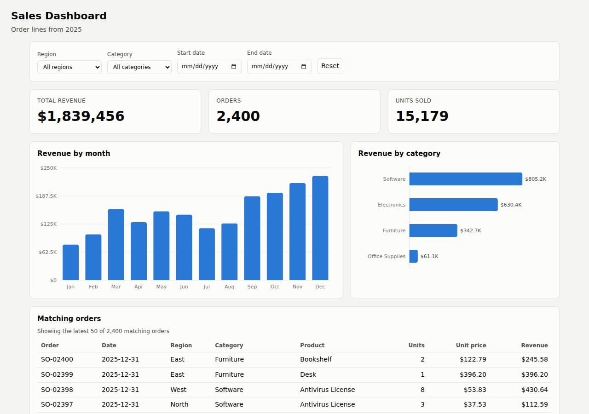

# ✅ Data / Visualization App on Cloudish with Opus 5.5 (trial 1)

**success**: 12/12 checks passed (100%).

- URL: https://adb-9jbgh-dataviz-web.cloudish.app (from deployment.json)
- Estimated hosting: Light use: $0.11/month, Busy: $7.84/month (the agent estimated $7.84)
- Agent: Claude Code 2.1.296, model `claude-opus-5-5`, effort medium, HIPAA organization
- Resource prefix: `adb-9jbgh-dataviz`

| | Build | Deploy | Total |
|---|---|---|---|
| Status | completed | completed | |
| Time | 2m 38s | 2m 19s | 4m 58s |
| Turns | 17 | 12 | |
| Tokens | 706.3K | 845.2K | 1.55M |
| Agent cost | $0.60 | $0.36 | $0.97 |
| Shell commands | 13 | 9 | |

App answered 0s after the agent finished deploying.

**Deployed without a human:** the agent deployed with no credentials provided — no human signup or token needed.

## Screenshots

**The dashboard** (https://adb-9jbgh-dataviz-web.cloudish.app/)

## What was built

- Runtime: Node.js 20
- Frameworks: Node.js http module (built in)
- Packaging: Docker (node:20-alpine)
- Hosting: Cloudish container (shared)
- Code: 505 lines in 12 files (JavaScript 398, HTML 98, Markdown 31, JSON 26, Docker 9)
- Dependencies: 0 npm, 0 Python
- Deploy config: `Dockerfile`, `.dockerignore`

### Stack fit

**97/100**, from the same independent review, judged against the app's requirements rather than a preferred stack.

A zero-dependency Node.js http server with in-memory CSV aggregation and vanilla JS/SVG charts, deployed as one small Cloudish container. It closely follows the well-reasoned STACK.md and fits a read-only dashboard.

| Criterion | Weight | Score | Rationale |
|---|---|---|---|
| Fit for the job | 40 | 10/10 | Keeping the CSV in memory is exactly right for an immutable, read-only 2,400-row dataset. Plain HTTP polling on filter change meets the no-reload requirement, and hand-drawn SVG charts cover the line and bar charts without a CDN. |
| Proportion | 30 | 10/10 | There is one process, no third-party dependencies, no database and no build step, which is as simple as the requirements allow while still working correctly. |
| Platform fit | 30 | 9/10 | Cloudish runs containers, and a single small container on the cheapest shared size with sleep-when-idle uses the platform well. The only cost is cold starts after idle periods. |

## Human steps

None: the agent needed no human setup at all.

Reported but not needed, since the deployment worked without them: Claim the Cloudish key adb-9jbgh-dataviz (mint a fresh link with GET https://cloudish.ai/api/v1/credits/claim using the 

## Security and compliance review

**82/100**, from an independent Claude Code review (`claude-opus-5-5`, high effort, HIPAA organization, $0.34) of the process, the code, the hosting plan and the live app.

A small, carefully built zero-dependency Node.js dashboard. Secrets were handled cleanly, the container runs as non-root, input is strictly validated, output is escaped, and nothing beyond the app's routes is exposed. The main weakness is fit for commercial use: the service runs on an unclaimed Cloudish key with about 9 hours of trial credits and sleeps when idle. Minor gaps are a floating base-image tag and missing CSP, nosniff and frame-protection headers.

| Criterion | Weight | Score | Rationale |
|---|---|---|---|
| Secrets handling | 25 | 10/10 | The Cloudish API key went straight from the key-creation response into a chmod 600 .env file. Only its 4-character prefix was printed, and the upload tarball and .dockerignore both exclude .env. The app itself needs no secrets. |
| Deployment provenance | 20 | 7/10 | The image was built server-side from a tarball of the agent's own sources, and the image that runs (builds/201:714638577d58) is the one that build produced, with no third-party npm dependencies. However, the base image node:20-alpine is a floating tag rather than a digest, and the Cloudish account is still an unclaimed, agent-created key that the owner doesn't control yet. |
| Terms compliance | 15 | 5/10 | This is a commercial app running on an unclaimed key with only 0.1 trial credits, which covers about 9 hours of awake time before requests fail with 402/503. It also sleeps after 15 minutes idle. The agent disclosed this but marked funding the account as non-blocking, so the business's dashboard will stop working unless a human steps in. I know of no Cloudish term that forbids commercial use on a funded account, but I'm not certain of the terms for unclaimed trial keys. |
| Least privilege | 15 | 9/10 | The container runs as the non-root node user with root-owned app files, no volume and no data store, at the smallest size. Public 'open' access is what a public dashboard needs. The only extra is that the platform also serves the app on a second datacenter hostname. |
| Transport security | 10 | 8/10 | The app is served over HTTPS with a valid Let's Encrypt wildcard certificate, HTTP gets a 308 redirect to HTTPS, and the platform adds HSTS. The app sets no X-Content-Type-Options, CSP or frame-ancestors/X-Frame-Options headers, although it could easily add them in its send() helper. |
| Attack surface | 10 | 9/10 | The server uses an explicit route allowlist, so .env, .git, source files, the Dockerfile and the CSV all return a JSON 404, and errors produce no stack traces or directory listings. The full order dataset can be read through the public /api/orders endpoint, which is consistent with the unauthenticated spec. |
| Application security | 5 | 9/10 | Dates are strictly validated (400 on malformed or impossible dates), filters are exact-match comparisons in memory with no injection surface, the client escapes all values it puts into innerHTML, non-GET methods get 405, and the orders limit is clamped to 1-500. The app has no rate limiting of its own. |

Findings:

- **medium** · deployment · Commercial app relies on unclaimed trial credits (~9 h runway): process/deployment.json human_steps: 'The key only has the 0.1 free credits, enough for about 9 hours of awake time ... After that, requests get 402/503' (marked blocking: false); process/context.json use=commercial, balance_usd 0.099239 Fix: Have the business claim the account and fund it before handing over, and treat that as a blocking step for a commercial app.
- **low** · deployment · Service sleeps after 15 minutes idle: process/deploy.md project creation: -F "sleepAfterMinutes=15"; resources: 'sleeps after 15 min idle' Fix: Accept the cold starts knowingly, or set alwaysOn once the account is funded if the dashboard must respond instantly.
- **low** · deployment · Base image not pinned to a digest: app/Dockerfile line 1: FROM node:20-alpine Fix: Pin the image as node:20-alpine@sha256:<digest> and update it deliberately.
- **low** · deployment · Deployment account is an agent-created key the owner has not claimed: process/deploy.md: POST https://cloudish.ai/api/v1/keys created alias adb-9jbgh-dataviz; deployment.json plan 'unclaimed key' Fix: Have the owner claim the key so the project is under an account they control.
- **low** · app · Missing X-Content-Type-Options, CSP and frame protection headers: curl -sI https://adb-9jbgh-dataviz-web.cloudish.app/ returns only content-type, cache-control and strict-transport-security; app/server.js send() sets only Content-Type and Cache-Control Fix: Add 'X-Content-Type-Options: nosniff', "Content-Security-Policy: default-src 'self'; frame-ancestors 'none'" and 'X-Frame-Options: DENY' in send().
- **info** · app · Full order dataset is publicly readable: GET /api/orders?limit=99999 -> 200 {"total":2400,"orders":[...]} (limit clamped to 500; date filters allow paging through all rows) Fix: This is acceptable per the spec. If the sales data is confidential, add authentication or platform access control.
- **info** · app · No rate limiting on API endpoints: app/server.js handler has no throttling; each request filters 2,400 rows in memory Fix: The cost per request is tiny, so this is low risk. Consider basic per-IP throttling if abuse appears.

## Checks

| Check | Required | Result | Detail |
|---|---|---|---|
| GET / answers 2xx within 1 min | yes | passed |  |
| The app is served over HTTPS with a valid certificate | yes | passed |  |
| The app is public: no redirect to another host such as a login page | yes | passed |  |
| GET / serves the dashboard as HTML | yes | passed |  |
| GET /api/summary (no filters) matches the dataset | yes | passed |  |
| GET /api/summary (region=West) matches the dataset | yes | passed |  |
| GET /api/summary (category=Electronics) matches the dataset | yes | passed |  |
| GET /api/summary (region=East, category=Furniture, start=2025-03-01, end=2025-06-30) matches the dataset | yes | passed |  |
| GET /api/summary (region=Atlantis) matches the dataset | yes | passed |  |
| The dashboard renders a chart (SVG or canvas) in a browser | yes | passed |  |
| The dashboard shows at least two charts | no | passed |  |
| The dashboard has filter controls | no | passed |  |

## Cloud resources

| Traffic | $/month | How it was priced |
|---|---|---|
| Light use | $0.11 | containers awake 10 h at their size's hourly rate; no bandwidth charges |
| Busy | $7.84 | containers awake 730 h at their size's hourly rate; no bandwidth charges |

Each resource's list price, at the size it was provisioned and always on:

| Kind | Name | Plan | $/month | How it was priced |
|---|---|---|---|---|
| project | adb-9jbgh-dataviz-web | shared | $7.84 | 0.1 CPU / 0.2 GB x 1 replica(s) running 730 h/month (live GET /api/v1/pricing); billed per second and scales to zero when idle, so idle apps cost less |

Teardown: 1 deleted

## Agent's deploy summary

> The dashboard is live at **https://adb-9jbgh-dataviz-web.cloudish.app** and every requirement in `TASK.md` works through that URL. One catch: the account only has the free starting credit, which covers about 9 hours of running time.
>
> **What I deployed:**
> - **API key `adb-9jbgh-dataviz`:** I created it myself with one call, no signup needed. It is saved only in `.env`, which is gitignored and left out of the upload.
> - **Project `adb-9jbgh-dataviz-web`:** Cloudish built it from the existing Dockerfile on its own servers. It runs on the cheapest size, which costs about $0.011 per hour.
> - **Subdomain:** I replaced the random URL with `adb-9jbgh-dataviz-web.cloudish.app`.
>
> **Tested through the public URL:**
> - The dashboard page loads. I loaded it in headless Chrome with filters set, and the totals, both charts and the table of latest orders all showed.
> - `/api/summary` returns the same results as locally:
>   - with no filters: $1,839,455.69, 2,400 orders, 12 months;
>   - with all four filters combined;
>   - for a single-day date range, which confirms both ends are included;
>   - with no matches, which gives zeros and empty arrays;
>   - with a badly formed date, which returns a 400 error.
> - The container logs show the server started with all 2,400 rows.
>
> **Cost and limits:**
> - **Cost:** the app sleeps after 15 minutes without requests and is only billed while awake. About $7.84 a month is the worst case under constant traffic; quiet months cost close to nothing.
> - **Cold start:** the first request after an idle period takes a few seconds while the app wakes.
> - **Credits:** the free 0.1 credits buys about 9 hours awake, minus the roughly $0.001 already used. After that the site returns 402/503 errors until someone adds credits.
>
> **For a person to do (not blocking right now):** claim the key in a browser and add credits. A claim link can be made with `GET /api/v1/credits/claim` using the key in `.env`; each link expires after 30 minutes. This step is listed under `human_steps` in `deployment.json`.

## Shell commands during deploy

- `18s` `curl -sL https://cloudish.ai/skill.md; echo ----; curl -sL https://cloudish.ai/instances.md | head -60`
- `24s` `cd /home/runner/work/_temp/adb-9jbgh-dataviz; resp=$(curl -s -X POST https://cloudish.ai/api/v1/keys -H "content-type: application/json" -d '{"alias":"adb-9jbgh-dataviz","agent":"claude-code","model":`
- `28s` `cd /home/runner/work/_temp/adb-9jbgh-dataviz; set -a; . ./.env; set +a`
- `32s` `cd /home/runner/work/_temp/adb-9jbgh-dataviz; set -a; . ./.env; set +a`
- `1m 37s` `cd /home/runner/work/_temp/adb-9jbgh-dataviz; set -a; . ./.env; set +a`
- `1m 42s` `cd /home/runner/work/_temp/adb-9jbgh-dataviz; set -a; . ./.env; set +a`
- `1m 47s` `U=https://adb-9jbgh-dataviz-web.cloudish.app`
- `1m 58s` `cd /home/runner/work/_temp/adb-9jbgh-dataviz; set -a; . ./.env; set +a`
- `2m 11s` `cd /home/runner/work/_temp/adb-9jbgh-dataviz; cat > deployment.json <<'EOF'`
