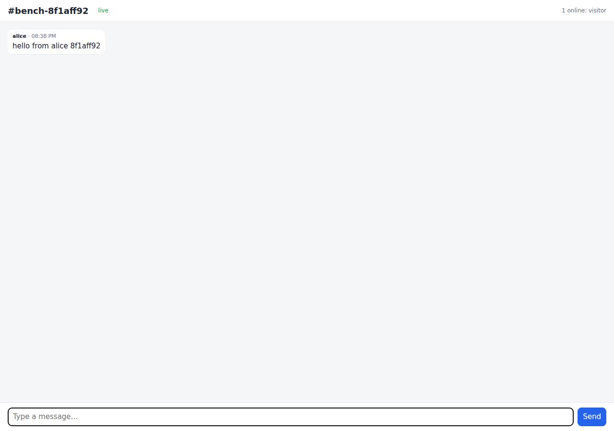

# ✅ Real-Time Collaborative App on Cloudish with Opus 5.5 (trial 1)

**success**: 13/13 checks passed (100%).

- URL: https://adb-3pi5y-realtime-web.cloudish.app (from deployment.json)
- Estimated hosting: Light use: $0.11/month, Busy: $7.84/month (the agent estimated $2.00)
- Agent: Claude Code 2.1.296, model `claude-opus-5-5`, effort medium, HIPAA organization
- Resource prefix: `adb-3pi5y-realtime`

| | Build | Deploy | Total |
|---|---|---|---|
| Status | completed | completed | |
| Time | 2m 21s | 2m 20s | 4m 41s |
| Turns | 11 | 12 | |
| Tokens | 409.2K | 749.5K | 1.16M |
| Agent cost | $0.46 | $0.40 | $0.86 |
| Shell commands | 7 | 11 | |

App answered 0s after the agent finished deploying.

**Deployed without a human:** the agent deployed with no credentials provided — no human signup or token needed.

## Screenshots

**The room the verifier's clients chatted in, with its history** (https://adb-3pi5y-realtime-web.cloudish.app/?room=bench-8f1aff92)

## What was built

- Runtime: Node.js 24
- Frameworks: Node.js http module (built in)
- Data: SQLite (on a persistent volume)
- Libraries: ws
- Packaging: Docker (node:24-slim)
- Hosting: Cloudish container (shared) with a persistent volume
- Code: 431 lines in 10 files (JavaScript 295, HTML 125, Markdown 34, JSON 29, Docker 11)
- Dependencies: 1 npm, 0 Python
- Deploy config: `Dockerfile`, `.dockerignore`

### Stack fit

**90/100**, from the same independent review, judged against the app's requirements rather than a preferred stack.

Node.js 24 with ws and built-in SQLite in a single Cloudish container fits a small realtime chat well. It provides durable history, native WebSockets and minimal dependencies, and it follows the reasoning in STACK.md without departing from it.

| Criterion | Weight | Score | Rationale |
|---|---|---|---|
| Fit for the job | 40 | 9/10 | The ws library gives the preferred WebSocket transport, with SSE as an extra. Built-in node:sqlite on a persistent volume is a durable store for message history, and in-process fan-out per room meets the 2-second delivery requirement. |
| Proportion | 30 | 9/10 | One process and one runtime dependency (ws) serve the UI, API, WebSocket and SSE, with no extra services. The optional SSE path adds a little code, but nothing needless. |
| Platform fit | 30 | 9/10 | A long-running container with WebSockets and a volume-backed SQLite file is the model Cloudish is designed for. Running one replica matches the single-attach volume, and sleep-on-idle suits light club use. |

## Human steps

None: the agent needed no human setup at all.

Reported but not needed, since the deployment worked without them: Open a claim link (mint one with GET https://cloudish.ai/api/v1/credits/claim using the key in .env) and add credits to 

## Security and compliance review

**84/100**, from an independent Claude Code review (`claude-opus-5-5`, high effort, HIPAA organization, $0.36) of the process, the code, the hosting plan and the live app.

The chat app is a small, well-built Node.js container on Cloudish. Its API key was kept out of the build context and logs, it runs as non-root with dependencies installed from the lockfile, its history sits on a private volume, and it is served only over HTTPS with nothing extra exposed. The main weakness is hosting continuity: the app runs on about 9 hours of free starter credit and stops once that is spent, unless the owner funds the account. Smaller issues are an unpinned base image, no rate limiting or history retention, and missing security headers that the app could set.

| Criterion | Weight | Score | Rationale |
|---|---|---|---|
| Secrets handling | 25 | 10/10 | The Cloudish API key was written straight to a chmod-600 .env without being printed, kept out of the uploaded build context with --exclude='.env*', and appears in no source or deployed file. The app needs no secrets at runtime. |
| Deployment provenance | 20 | 8/10 | The image was built server-side from a tarball of the agent's own source, and the transcript lists the context's contents. Dependencies are locked with package-lock.json and npm ci. The base image node:24-slim is a floating tag rather than a digest. |
| Terms compliance | 15 | 6/10 | Prepaid pay-as-you-go hosting fits personal or club use, and sleeping after 30 idle minutes is acceptable for a hobby chat. But the only funding is the 0.1 free starting credit, about 9 awake hours, after which Cloudish stops the app and returns 402. The agent labelled topping up as 'not blocking', which understates the risk. |
| Least privilege | 15 | 9/10 | There is a single container running as the non-root node user, with a private volume holding only the SQLite file and no extra public services. Public 'open' access is required for a public chat app. |
| Transport security | 10 | 8/10 | The app is served over HTTPS with a valid Let's Encrypt wildcard certificate. HTTP gets a 308 redirect to HTTPS, and the platform adds HSTS. The app sets no CSP, X-Content-Type-Options or frame protection, though it could have. |
| Attack surface | 10 | 9/10 | Source, .env, .git and package files all return the app's JSON 404, and there are no directory listings, debug endpoints or stack traces. The only extras are a trivial /healthz endpoint and the platform's generic nginx 400 page for malformed percent-encoding. |
| Application security | 5 | 7/10 | Input validation is solid: lengths are checked, SQL is parameterized, message text is rendered with textContent, and bodies and WebSocket frames are capped. The public, unauthenticated endpoints have no rate or connection limits, the WebSocket Origin is not checked, and storage can grow without bound across any number of rooms. |

Findings:

- **medium** · deployment · Hosting runs on about 9 hours of free starter credit with no funding in place: process/deployment.json human_steps: 'The free 0.1 starting credits pay for about 9 hours of awake time. After that, requests get 402 until credits are added.' Marked blocking:false. process/context.json shows balance_usd 0.098694. llms.txt (deploy.md): 'at zero ... its running apps stop within a minute'. Fix: Tell the owner plainly that the app will go offline within hours of use unless the key is claimed and funded. Mark this step as required to keep the app running.
- **low** · deployment · Base image not pinned by digest: app/Dockerfile:1 `FROM node:24-slim` Fix: Pin the base image to a digest, e.g. `FROM node:24-slim@sha256:...`, and update it deliberately.
- **low** · app · No rate limiting, connection caps or retention on public endpoints: app/server.js:134-142 (POST messages) and 182-194 (WebSocket messages) insert every valid message into SQLite with no per-client throttling. Lines 126-130 accept any room name up to 100 characters, and nothing prunes old rows (openStore, lines 18-42), so anyone can fill the 1 GB volume or flood rooms. Fix: Add per-IP or per-connection message rate limits, cap concurrent connections, and prune history beyond what the API serves (e.g. keep the last N messages per room).
- **low** · app · Missing CSP, X-Content-Type-Options and frame protection: GET https://adb-3pi5y-realtime-web.cloudish.app/?room=general -> 200 with only content-type, cache-control and strict-transport-security (HSTS added by the platform). app/server.js:121 sets no security headers. Fix: Send Content-Security-Policy (default-src 'self'; connect-src 'self' wss:), X-Content-Type-Options: nosniff and frame-ancestors 'none' / X-Frame-Options: DENY from the Node server.
- **info** · app · WebSocket upgrade does not check Origin: app/server.js:164-173 upgrades any request with a valid room and user, whatever its Origin. Any website can open sockets and post as any display name. Fix: Accept upgrades only from the app's own origin. Display-name impersonation is inherent to the spec's unauthenticated design.
- **info** · platform · Platform nginx error page on malformed URLs: GET /api/rooms/%ZZ/messages -> 400 HTML page with an 'nginx' footer, generated by the Cloudish ingress rather than the app. Fix: No action needed from the agent. The platform could serve a neutral error page.
- **info** · app · HEAD requests return 404: curl -I https://adb-3pi5y-realtime-web.cloudish.app/ -> HTTP/2 404 (server.js:120 only matches GET) Fix: Treat HEAD like GET for / and /healthz.

## Checks

| Check | Required | Result | Detail |
|---|---|---|---|
| GET / answers 2xx within 1 min | yes | passed |  |
| The app is served over HTTPS with a valid certificate | yes | passed |  |
| The app is public: no redirect to another host such as a login page | yes | passed |  |
| GET / serves the chat UI as HTML | yes | passed |  |
| deployment.json declares a supported transport (websocket or sse) | no | passed |  |
| Clients connect over websocket | yes | passed |  |
| A message reaches another client in the same room within 5 s | yes | passed |  |
| The sender receives its own message too | no | passed |  |
| Messages never reach clients in other rooms | yes | passed |  |
| Five users posting at the same time all see every message within 10 s | yes | passed |  |
| GET /api/rooms/<room>/messages returns recent messages | yes | passed |  |
| Messages over 1000 characters are rejected | no | passed |  |
| The chat UI loads in a browser without errors | no | passed |  |

## Cloud resources

| Traffic | $/month | How it was priced |
|---|---|---|
| Light use | $0.11 | containers awake 10 h at their size's hourly rate; no bandwidth charges |
| Busy | $7.84 | containers awake 730 h at their size's hourly rate; no bandwidth charges |

Each resource's list price, at the size it was provisioned and always on:

| Kind | Name | Plan | $/month | How it was priced |
|---|---|---|---|---|
| project | adb-3pi5y-realtime-web | shared | $7.84 | 0.1 CPU / 0.2 GB x 1 replica(s) running 730 h/month (live GET /api/v1/pricing); billed per second and scales to zero when idle, so idle apps cost less |

Teardown: 1 deleted

## Agent's deploy summary

> The chat app is live at **https://adb-3pi5y-realtime-web.cloudish.app**, and every requirement in `TASK.md` passed when I tested it through that public URL.
>
> **What I deployed:**
> - **Account:** a Cloudish API key named `adb-3pi5y-realtime`, which I created myself with no signup. The key is saved in `.env` and isn't in the code I uploaded or in any other file.
> - **App:** project `adb-3pi5y-realtime-web`, built on Cloudish's servers from the Dockerfile. It runs on the smallest size (0.1 CPU, 0.2 GB, about $0.0107 an hour while awake).
> - **Storage:** a free 1 GB volume at `/data` holds the message history, so it survives restarts.
> - **WebSocket:** `wss://adb-3pi5y-realtime-web.cloudish.app/ws`. Server-Sent Events also work.
>
> **What I tested on the live site:**
> - **Live messages:** 4 clients sent 20 messages at the same time, and every client got all 20. The slowest arrived in 126 ms, well under the 2-second limit.
> - **Room isolation:** a client in another room received nothing.
> - **Rejecting bad messages:** empty and over-1000-character messages got `400` over HTTP and an error reply over WebSocket.
> - **History:** returns up to 50 messages, oldest first.
> - **Server-Sent Events:** messages streamed correctly through Cloudish.
> - **Web page:** in a headless browser, two users joined the same room and saw each other's messages and who's online. HTML typed into a message showed up as plain text.
>
> **Things to know:**
> - **Waking up:** to keep costs down, the app sleeps after 30 idle minutes. The first request after that takes a few seconds while it wakes. Running it around the clock instead would cost about $7.84 a month.
> - **Cost:** I estimated about $2 a month, assuming a few awake hours a day.
> - **Credits (the one human step, not blocking):** the key's free 0.1 credits cover about 9 hours of awake time. After that the app returns `402` until someone uses a claim link to add credits. This is listed under `human_steps` in `deployment.json`.
> - **Single container:** it runs as one container, because a volume can only attach to one. That's plenty for a hobby club.
>
> Nothing failed, and I didn't leave any local servers running.

## Shell commands during deploy

- `4s` `cd /tmp && for u in https://cloudish.ai/llms.txt https://cloudish.ai/docs https://cloudish.ai/api/v1 https://cloudish.ai/skill.md; do echo "== $u"; curl -sL -w "\n[%{http_code}]\n" "$u" | head -c 6000`
- `7s` `curl -sL https://cloudish.ai/skill.md | tail -c +6000 | head -c 20000`
- `13s` `curl -s -X POST https://cloudish.ai/api/v1/keys -H "content-type: application/json" -d '{"alias":"adb-3pi5y-realtime","agent":"claude-code","model":"claude-opus-5-5"}' > /tmp/key.json && python3 -c '`
- `17s` `set -a && . ./.env && set +a && tar --exclude='.env*' --exclude='.git' --exclude=node_modules --exclude=data --exclude='*.tar.gz' -czf /tmp/context.tar.gz . && tar tzf /tmp/context.tar.gz && curl -s -`
- `22s` `. ./.env && for i in $(seq 40); do s=$(curl -s https://cloudish.ai/api/v1/images/builds/575 -H "Authorization: Bearer $CLOUDISH_API_KEY" | python3 -c 'import json,sys;d=json.load(sys.stdin)["build"];p`
- `57s` `. ./.env && sleep 5; curl -s https://cloudish.ai/api/v1/projects/$CLOUDISH_ALIAS/adb-3pi5y-realtime-web -H "Authorization: Bearer $CLOUDISH_API_KEY" | python3 -c 'import json,sys;d=json.load(sys.stdin`
- `1m 06s` `. ./.env && curl -s -X PUT https://cloudish.ai/api/v1/projects/$CLOUDISH_ALIAS/adb-3pi5y-realtime-web/subdomain -H "Authorization: Bearer $CLOUDISH_API_KEY" -H "content-type: application/json" -d '{"l`
- `1m 22s` `. ./.env && for i in 1 2 3 4 5 6; do c=$(curl -s -o /dev/null -w "%{http_code}" https://adb-3pi5y-realtime-web.cloudish.app/healthz); echo $c; [ $c = 200 ] && break; sleep 10; done; curl -s https://cl`
- `1m 38s` `cat > /tmp/e2e.mjs <<'EOF'`
- `1m 54s` `mkdir -p /tmp/pw && cd /tmp/pw && npm init -y >/dev/null && npm i -s playwright@1 >/dev/null 2>&1 && npx playwright install chromium >/dev/null 2>&1 && cat > ui.mjs <<'EOF'`
- `2m 11s` `cat > deployment.json <<'EOF'`
