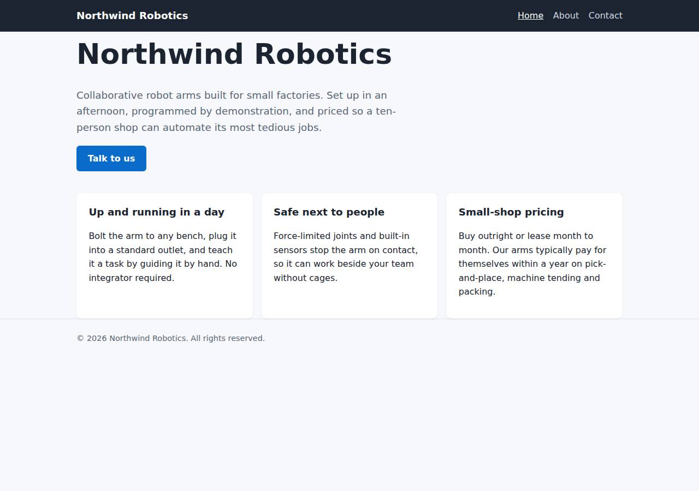
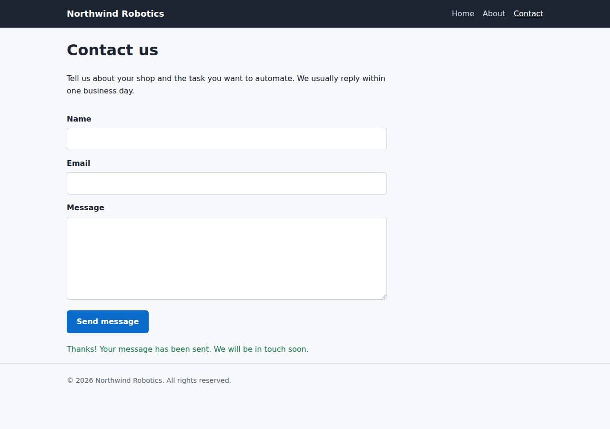

# ✅ Static Content Site on Cloudish with Opus 5.5 (trial 1)

**success**: 16/16 checks passed (100%).

- URL: https://adb-wqm8g-static-web.cloudish.app (from deployment.json)
- Estimated hosting: Light use: $0.11/month, Busy: $7.84/month (the agent estimated $7.84)
- Agent: Claude Code 2.1.296, model `claude-opus-5-5`, effort medium, HIPAA organization
- Resource prefix: `adb-wqm8g-static`

| | Build | Deploy | Total |
|---|---|---|---|
| Status | completed | completed | |
| Time | 1m 34s | 2m 18s | 3m 52s |
| Turns | 8 | 9 | |
| Tokens | 270.3K | 487.8K | 758.1K |
| Agent cost | $0.32 | $0.27 | $0.59 |
| Shell commands | 6 | 8 | |

App answered 0s after the agent finished deploying.

**Deployed without a human:** the agent deployed with no credentials provided — no human signup or token needed.

## Screenshots

**The home page** (https://adb-wqm8g-static-web.cloudish.app/)

**The contact page after the verifier submitted the form** (https://adb-wqm8g-static-web.cloudish.app/contact)

## What was built

- Runtime: Node.js 24
- Frameworks: Node.js http module (built in)
- Packaging: Docker (node:24-alpine)
- Hosting: Cloudish container (shared)
- Code: 355 lines in 15 files (JavaScript 198, HTML 121, Markdown 29, CSS 28, JSON 24, Docker 8)
- Dependencies: 0 npm, 0 Python
- Deploy config: `Dockerfile`, `.dockerignore`

### Stack fit

**93/100**, from the same independent review, judged against the app's requirements rather than a preferred stack.

A zero-dependency Node.js 24 server in a small container is a sound, minimal fit for three static pages and one validation endpoint on a container-only platform. The build matches the reasoning in STACK.md.

| Criterion | Weight | Score | Rationale |
|---|---|---|---|
| Fit for the job | 40 | 9/10 | One Node.js process with only the standard library serves the static pages from memory and handles the single JSON endpoint, which is exactly what the task needs: no storage, exact extension-less routes and 404s. |
| Proportion | 30 | 10/10 | There is about 100 lines of server code, no dependencies, no build step and no extra services. Nothing pretends to be a database or other service it isn't. |
| Platform fit | 30 | 9/10 | Cloudish offers only containers, so a small Alpine container on the shared size that sleeps after 15 minutes of idle and wakes quickly is about as close to static hosting as this platform allows. |

## Human steps

None: the agent needed no human setup at all.

Reported but not needed, since the deployment worked without them: Claim the Cloudish key 'adb-wqm8g-static' (mint a link with GET https://cloudish.ai/api/v1/credits/claim using the key i

## Security and compliance review

**84/100**, from an independent Claude Code review (`claude-opus-5-5`, high effort, HIPAA organization, $0.31) of the process, the code, the hosting plan and the live app.

The deployment is clean on the security side. It is a zero-dependency Node.js container that runs as a non-root user and serves an explicit allow-list of routes over HTTPS with platform HSTS. The API key was never exposed, and probes found nothing extra exposed. The main weakness is operational: this commercial site runs on an unclaimed key whose free credit lasts only about 9 hours, and smaller issues are an unpinned base image and missing app-set security headers.

| Criterion | Weight | Score | Rationale |
|---|---|---|---|
| Secrets handling | 25 | 10/10 | The Cloudish API key was written straight to a chmod-600 .env file. The key and claim URL were removed from the printed JSON, .env is listed in both .gitignore and .dockerignore and was left out of the uploaded tarball, and the app itself needs no secrets. |
| Deployment provenance | 20 | 8/10 | Cloudish built the image server-side from the agent's own source tarball, and the live responses match that code. The app has no dependencies, but the base image node:24-alpine is a floating tag with no digest pin, and the project belongs to an unclaimed, agent-created key rather than an account the business controls. |
| Terms compliance | 15 | 5/10 | This is a commercial site running on an unclaimed key with a 0.1-credit free grant, which the agent itself says covers only about 9 awake hours, after which the site returns 402/503. Nothing I know of in Cloudish's prepaid model forbids commercial use, but I'm not certain of its terms. The agent marked claiming the key and adding credits as non-blocking, even though the site cannot stay up without it. |
| Least privilege | 15 | 10/10 | There is a single container that runs as the non-root node user, with no volume, no data store and the smallest size. The only public access is the website, which has to be public. |
| Transport security | 10 | 8/10 | The site is HTTPS only: HTTP gets a 308 redirect, the Let's Encrypt wildcard certificate is valid and the platform adds HSTS. The app does not set X-Content-Type-Options, frame protection or a CSP, although server.js could easily have done so. |
| Attack surface | 10 | 9/10 | An explicit route table means only five static assets plus /healthz and /api/contact are served. Source files, .env, .git and path-traversal attempts all return 404, and there are no stack traces. Small details: a platform nginx error page names its software, and a public health endpoint exists. |
| Application security | 5 | 8/10 | Input is type-checked and validated, the body is capped at 64 KB, malformed JSON gets a clean 400, and the client writes messages with textContent, so there is no XSS. The endpoint does not enforce Content-Type: application/json and has no rate limiting, which matters little because nothing is stored or sent. |

Findings:

- **medium** · deployment · Commercial site runs on an unclaimed key with a free grant lasting about 9 hours: process/deployment.json human_steps: 'The free 0.1-credit grant covers only about 9 awake hours on the shared size. Once it runs out, the site returns 402/503', marked "blocking": false; process/context.json use=commercial, balance_usd=0.099122 Fix: Have the business claim the key (or deploy under its own funded Cloudish account) and add credits before treating the site as live. Mark this step as blocking.
- **low** · deployment · Base image not pinned to a digest: app/Dockerfile line 1: FROM node:24-alpine Fix: Pin the image, e.g. FROM node:24-alpine@sha256:<digest>, and update it on purpose.
- **low** · deployment · Deployment owned by an agent-created key rather than the business: process/deploy.md: POST https://cloudish.ai/api/v1/keys created alias adb-wqm8g-static with parent null and email null; the project owner is that key Fix: Transfer or claim ownership into an account the business controls, and deploy from a versioned repository.
- **low** · app · Missing security headers (nosniff, frame protection, CSP): curl -I https://adb-wqm8g-static-web.cloudish.app/ returns only content-type, content-length, cache-control and strict-transport-security (HSTS comes from the platform); app/server.js:97 sets no security headers Fix: In server.js, add X-Content-Type-Options: nosniff, X-Frame-Options: DENY (or CSP frame-ancestors 'none') and a strict CSP such as default-src 'self'.
- **low** · app · Contact endpoint ignores Content-Type and has no rate limit: POST /api/contact with Content-Type: text/plain and a JSON body -> 200 {"ok":true}; app/server.js:48-75 has no Content-Type check or throttling Fix: Reject requests whose Content-Type is not application/json. Add a simple per-IP rate limit, or a CAPTCHA if submissions are ever stored or emailed.
- **info** · platform · Platform nginx error page reveals server software: GET /..%2fserver.js -> 400 with an HTML body ending '
nginx
' Fix: Platform default; nothing the agent can change.
- **info** · app · Public health endpoint: GET /healthz -> 200 {"ok":true} (app/server.js:86) Fix: This is harmless. Remove it if the platform does not need it.

## Checks

| Check | Required | Result | Detail |
|---|---|---|---|
| GET / answers 2xx within 1 min | yes | passed |  |
| The app is served over HTTPS with a valid certificate | yes | passed |  |
| The app is public: no redirect to another host such as a login page | yes | passed |  |
| GET / returns HTML | yes | passed |  |
| GET /about returns HTML | yes | passed |  |
| GET /contact returns HTML | yes | passed |  |
| Home has an <h1> containing 'Northwind Robotics' | yes | passed |  |
| About has a heading containing 'About' | yes | passed |  |
| Contact has a form with name, email and message fields | yes | passed |  |
| Every page has a <title> and a viewport meta tag | no | passed |  |
| Home links to /about and /contact | no | passed |  |
| POST /api/contact with valid input returns {ok: true} | yes | passed |  |
| POST /api/contact rejects a bad email and an empty message with 400 | yes | passed |  |
| Unknown paths return 404 | yes | passed |  |
| Submitting the /contact form in a browser posts to /api/contact without leaving the page | yes | passed |  |
| Pages load in a browser without uncaught JavaScript errors | no | passed |  |

## Cloud resources

| Traffic | $/month | How it was priced |
|---|---|---|
| Light use | $0.11 | containers awake 10 h at their size's hourly rate; no bandwidth charges |
| Busy | $7.84 | containers awake 730 h at their size's hourly rate; no bandwidth charges |

Each resource's list price, at the size it was provisioned and always on:

| Kind | Name | Plan | $/month | How it was priced |
|---|---|---|---|---|
| project | adb-wqm8g-static-web | shared | $7.84 | 0.1 CPU / 0.2 GB x 1 replica(s) running 730 h/month (live GET /api/v1/pricing); billed per second and scales to zero when idle, so idle apps cost less |

Teardown: 1 deleted

## Agent's deploy summary

> The site is live at **https://adb-wqm8g-static-web.cloudish.app**, and every requirement in `TASK.md` works through that public HTTPS URL.
>
> **Deployed:**
> - **API key:** I created `adb-wqm8g-static` through Cloudish's no-signup endpoint. It is saved in `.env`, which is left out of git and of the uploaded build files.
> - **App:** project `adb-wqm8g-static-web`, built by Cloudish from the Dockerfile. It runs on the cheapest size (`shared`) and sleeps after 15 idle minutes, so it's only billed while awake. The first request after a sleep takes a few seconds while it wakes.
>
> **Tested through the public URL:**
> - **Pages:** `/`, `/about` and `/contact` return 200 as HTML, with the required headings, form fields and navigation links.
> - **404s:** unknown paths and `/about.html` return 404.
> - **Contact endpoint:** `POST /api/contact` returns 200 `{"ok":true}` for valid input. A missing name, invalid email or empty message each return 400 with a reason.
> - **Browser form:** at mobile width in headless Chrome, the form sent its data and showed the confirmation without reloading the page.
> - **Startup:** the container logs show the server started and is listening.
>
> **Cost:** about $7.84/month at most, if traffic keeps the app awake all the time; low traffic costs much less.
>
> **One thing a person needs to do (listed in `deployment.json`, not urgent):** the key's free 0.1 credit covers only about 9 awake hours. After that the site returns 402/503 errors until someone claims the key and adds credits. To do that, mint a claim link with `GET https://cloudish.ai/api/v1/credits/claim` using the key in `.env`, then sign in and add credits. Each link expires after 30 minutes.
>
> Nothing else failed.

## Shell commands during deploy

- `2s` `curl -s https://cloudish.ai/skill.md; echo; curl -s https://cloudish.ai/instances.md`
- `8s` `curl -s -X POST https://cloudish.ai/api/v1/keys -H "content-type: application/json" -d '{"alias":"adb-wqm8g-static","agent":"claude-code","model":"claude-opus-5-5"}' > /tmp/key.json && python3 -c "`
- `12s` `set -a && . ./.env && set +a && tar --exclude='.env*' --exclude='.git' --exclude='context.tar.gz' -czf /tmp/context.tar.gz . && tar -tzf /tmp/context.tar.gz | tr '\n' ' '; echo`
- `17s` `. ./.env && for i in $(seq 1 40); do s=$(curl -s https://cloudish.ai/api/v1/images/builds/566 -H "Authorization: Bearer $CLOUDISH_API_KEY"); st=$(echo "$s" | python3 -c 'import json,sys;print(json.loa`
- `1m 24s` `. ./.env && curl -s -X PUT https://cloudish.ai/api/v1/projects/$CLOUDISH_ALIAS/adb-wqm8g-static-web/subdomain -H "Authorization: Bearer $CLOUDISH_API_KEY" -H "content-type: application/json" -d '{"lab`
- `1m 28s` `U=https://adb-wqm8g-static-web.cloudish.app; sleep 5`
- `1m 47s` `which google-chrome chromium 2>/dev/null; mkdir -p /tmp/pw && cd /tmp/pw && npm i -s playwright-core >/dev/null 2>&1 && cat > t.js <<'EOF'`
- `2m 11s` `. ./.env && curl -s https://cloudish.ai/api/v1/docker/$CLOUDISH_ALIAS/adb-wqm8g-static-web/logs -H "Authorization: Bearer $CLOUDISH_API_KEY" | python3 -c 'import json,sys;print(json.load(sys.stdin)["l`
