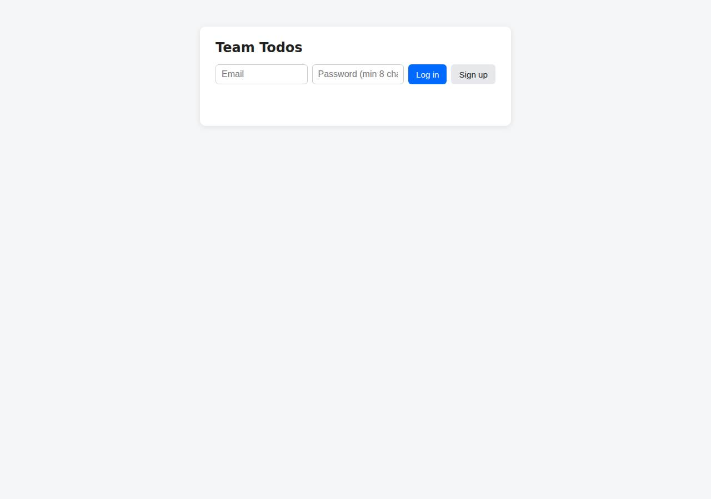
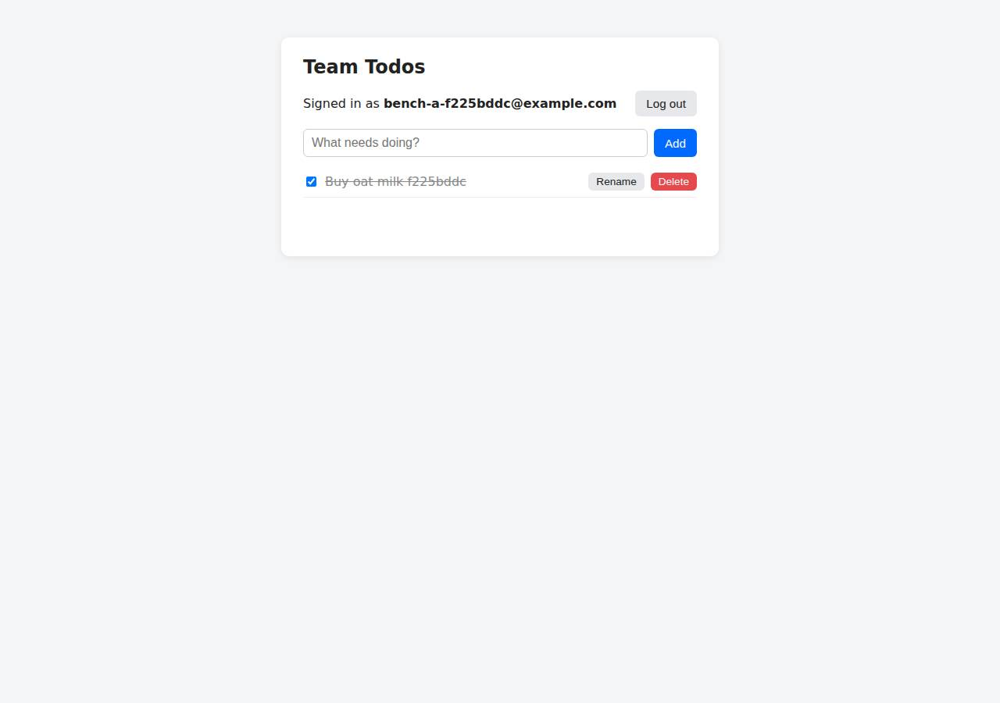

# ✅ Database-Backed CRUD App on DigitalOcean with Opus 5.5 (trial 1)

**success**: 19/19 checks passed (100%).

- URL: https://adb-oc4q0-crud-eddj4.ondigitalocean.app (from deployment.json)
- Estimated hosting: Light use: $12.00/month, Busy: $12.00/month (the agent estimated $12.00)
- Agent: Claude Code 2.1.296, model `claude-opus-5-5`, effort medium, HIPAA organization
- Resource prefix: `adb-oc4q0-crud`

| | Build | Deploy | Total |
|---|---|---|---|
| Status | completed | completed | |
| Time | 2m 24s | 7m 19s | 10m 54s |
| Turns | 14 | 6 | |
| Tokens | 491.3K | 353.6K | 1.16M |
| Agent cost | $0.49 | $0.32 | $1.05 |
| Shell commands | 9 | 5 | |

App answered 0s after the agent finished deploying.

**Needed a human:** the no-credentials attempt didn't produce a working public URL, so the cloud's credentials were provided and the agent redeployed (that attempt took 1m 10s, 316.0K tokens, $0.24).

## Screenshots

**The web app before signing in** (https://adb-oc4q0-crud-eddj4.ondigitalocean.app/)

**The todo list after signing in through the web UI as the test user** (https://adb-oc4q0-crud-eddj4.ondigitalocean.app/)

## What was built

- Runtime: Node.js 22
- Frameworks: Express
- Data: PostgreSQL (App Platform dev database)
- Libraries: node-postgres, bcrypt.js
- Packaging: Docker (node:22-alpine), App spec (.do/app.yaml)
- Hosting: App Platform service (apps-s-1vcpu-0.5gb), DigitalOcean Container Registry (starter)
- Code: 472 lines in 14 files (JavaScript 262, HTML 140, Shell 60, Markdown 36, JSON 30, YAML 26, Docker 10)
- Dependencies: 3 npm, 0 Python
- Deploy config: `Dockerfile`, `.dockerignore`, `.do/app.yaml`

### Stack fit

**87/100**, from the same independent review, judged against the app's requirements rather than a preferred stack.

Node/Express with PostgreSQL on App Platform suits a small multi-user CRUD app and is about as simple as the requirements allow. The main gap from STACK.md is that the build used a dev database rather than a managed cluster with backups.

| Criterion | Weight | Score | Rationale |
|---|---|---|---|
| Fit for the job | 40 | 9/10 | Express with pg and bcryptjs covers the JSON API, auth and static UI well, and PostgreSQL is a durable relational store that survived a forced redeploy. The only shortfall is the dev database tier: it has no backups, although STACK.md promised managed Postgres with backups and failover. |
| Proportion | 30 | 9/10 | There is one process, three dependencies, a single static HTML page and one database, with nothing extra. A local Docker build and push to DOCR adds a little machinery compared with a buildpack deploy. |
| Platform fit | 30 | 8/10 | A stateless container on App Platform with a bound Postgres database plays to the platform's managed HTTPS, health checks and binding variables. The build skipped App Platform's native git and buildpack builds in favor of a locally built :latest image. |

## Human steps

3 step(s), about 7 min of a person's time.

- **Sign up for an account and verify the email address** (~3 min): prerequisite: account setup
- **Add a payment method to the account** (~2 min): prerequisite: account setup
- **Create an API token and hand it to the agent** (~2 min): prerequisite: account setup

## Security and compliance review

**79/100**, from an independent Claude Code review (`claude-opus-5-5`, high effort, HIPAA organization, $0.36) of the process, the code, the hosting plan and the live app.

A tidy Node/Express and PostgreSQL todo app on DigitalOcean App Platform. Its secrets handling is clean (no leaked credentials, and DATABASE_URL comes from a platform binding), it runs as a non-root container over HTTPS, and its auth and data-isolation code is solid. The weaknesses are mutable image tags (node:22-alpine and :latest), a dev database without backups or network restriction holding a commercial app's data, unverified database TLS, missing security headers, and no rate limiting on the auth endpoints.

| Criterion | Weight | Score | Rationale |
|---|---|---|---|
| Secrets handling | 25 | 10/10 | The DigitalOcean token came from the agent's environment and never appeared in commands, files or logs. The app gets DATABASE_URL through an App Platform database binding (${adb-oc4q0-crud-db.DATABASE_URL}), so no credential is in the spec, the image or the source. .env is excluded by both .gitignore and .dockerignore. |
| Deployment provenance | 20 | 6/10 | The image was built on the agent's machine from the reviewed source, with a lockfile and npm ci, and pushed to the owner's private DOCR. The base image is the floating tag node:22-alpine, and the service runs the mutable tag :latest rather than a digest, so what runs can change without any change to the spec. |
| Terms compliance | 15 | 7/10 | Paid App Platform instances and DOCR allow commercial use, and the service is always on. However, this business app keeps its data in an App Platform dev database, which DigitalOcean positions for development and testing, with no backups or standby. The agent disclosed this. |
| Least privilege | 15 | 8/10 | The container runs as the non-root node user, the registry is private, and the only public component is the web service. The dev database is reached by connection string and can't be put behind trusted sources or a VPC. I'm not certain whether it is reachable from the internet, because I had no cloud access. |
| Transport security | 10 | 7/10 | HTTPS is served with a valid certificate, and HTTP returns a 301 to HTTPS. The app sets no HSTS, CSP, X-Content-Type-Options or frame protection, though it easily could have. Its TLS connection to the database has certificate verification turned off. |
| Attack surface | 10 | 9/10 | Probes for .env, .git, package.json, the source and the Dockerfile all returned 404, and errors return generic JSON without stack traces. The only leak is Express's default 'Cannot GET' page, which reveals the framework. |
| Application security | 5 | 7/10 | SQL is parameterized, every todo query is scoped to user_id, passwords use bcrypt cost 12 with timing equalization, session tokens are random and stored only as hashes, and the UI renders titles with textContent. But login and signup have no rate limiting, which allows password guessing and bcrypt CPU exhaustion on a 0.5 GB instance. Sessions also never expire, and titles have no length limit beyond the 100 KB body cap. |

Findings:

- **medium** · app · No rate limiting on login and signup: app/src/app.js:100-123: /api/auth/signup and /api/auth/login run bcrypt (cost 12) on every request, with no throttle or lockout anywhere in the app. Fix: Add per-IP and per-account rate limiting (for example express-rate-limit) on the auth endpoints, or put a rate-limit rule in front of them.
- **medium** · deployment · Mutable image tags for the base image and the deployed image: app/Dockerfile:1 `FROM node:22-alpine`; app/.do/app.yaml and resources.json: image tag `latest`. deploy.md: the redeploy used `doctl apps create-deployment --force-rebuild`, which re-pulls whatever :latest points to. Fix: Pin the base image by digest (node:22-alpine@sha256:...), push immutable tags such as the git SHA, and deploy by tag or digest. Better still, build from a git repository the owner controls through App Platform or CI.
- **medium** · deployment · Dev database used for a commercial app's production data: app/.do/app.yaml: databases `production: false`; deployment.json notes: 'dev database ... has no automated backups or standby'. Fix: Attach a DigitalOcean Managed PostgreSQL cluster (production: true, cluster_name), which has backups, trusted sources and a VPC.
- **low** · app · Database TLS certificate not verified: app/src/app.js:16-21: `ssl = ... { rejectUnauthorized: false }` unless PG_CA_CERT is set, and PG_CA_CERT is not set in .do/app.yaml. Fix: Provide the cluster's CA certificate (bindable as ${db.CA_CERT}) through PG_CA_CERT so the connection verifies the certificate.
- **low** · app · No security headers: curl -sI https://adb-oc4q0-crud-eddj4.ondigitalocean.app/ returns no strict-transport-security, content-security-policy, x-content-type-options or x-frame-options headers. Fix: Add helmet (or set the headers by hand), including HSTS and a CSP suited to the inline script.
- **low** · deployment · Dev database cannot be network-restricted: app/.do/app.yaml databases block: an App Platform dev database with no trusted-sources or VPC option. Reachability was not verified, because there were no cloud credentials. Fix: Use a managed cluster restricted by trusted sources to the app, or connected over the VPC.
- **low** · app · Sessions never expire, and titles have no length limit: app/src/app.js:34-38: the sessions table has no expiry, and the auth check at lines 85-93 ignores created_at. Lines 142-145 accept titles of any length up to the 100 KB body limit. Fix: Expire sessions after a set time (for example 30 days), and cap title length on the server.
- **info** · app · Default Express 404 page: GET /nope returns the HTML page '<pre>Cannot GET /nope</pre>', which reveals Express. Fix: Add a custom catch-all 404 handler.

## Checks

| Check | Required | Result | Detail |
|---|---|---|---|
| GET / answers 2xx within 1 min | yes | passed |  |
| The app is served over HTTPS with a valid certificate | yes | passed |  |
| The app is public: no redirect to another host such as a login page | yes | passed |  |
| GET / serves the web app as HTML | yes | passed |  |
| POST /api/auth/signup creates an account and returns a token | yes | passed |  |
| Signup rejects an invalid email and a short password with 400 | yes | passed |  |
| Signing up twice with the same email returns 409 | yes | passed |  |
| POST /api/auth/login returns a token | yes | passed |  |
| Login with a wrong password returns 401 | yes | passed |  |
| /api/todos requires a valid token (401) | yes | passed |  |
| POST /api/todos creates a todo | yes | passed |  |
| An empty title is rejected with 400 | yes | passed |  |
| GET /api/todos lists the caller's todos | yes | passed |  |
| Todos are listed oldest first | no | passed |  |
| PATCH /api/todos/{id} renames and completes a todo | yes | passed |  |
| Users can't see or modify each other's todos (404) | yes | passed |  |
| DELETE /api/todos/{id} removes a todo | yes | passed |  |
| Data is still there a minute later, with a fresh login | yes | passed |  |
| The web UI renders a login or signup form | no | passed |  |

## Cloud resources

| Traffic | $/month | How it was priced |
|---|---|---|
| Light use | $12.00 | fixed monthly prices; 0.0373 GiB out of a 50 GiB allowance |
| Busy | $12.00 | fixed monthly prices; 49 GiB out of a 50 GiB allowance |

Each resource's list price, at the size it was provisioned and always on:

| Kind | Name | Plan | $/month | How it was priced |
|---|---|---|---|---|
| app | adb-oc4q0-crud | adb-oc4q0-crud-web: apps-s-1vcpu-0.5gb x 1, adb-oc4q0-crud-db: dev database | $12.00 | adb-oc4q0-crud-web: apps-s-1vcpu-0.5gb x 1; adb-oc4q0-crud-db: dev database |
| registry | adb-oc4q0-crud | starter | $0.00 | Container Registry starter tier (one per account) |

Teardown: 2 deleted

## Agent's deploy summary

> The app is live at **https://adb-oc4q0-crud-eddj4.ondigitalocean.app**, and every `TASK.md` requirement passed when tested through that public URL.
>
> **What's running** (about $12/month in total):
> - **Container registry** `adb-oc4q0-crud`: holds the app image, on DigitalOcean's free Starter tier.
> - **App Platform app** `adb-oc4q0-crud`: runs the Express server as `adb-oc4q0-crud-web` on one $5/month instance in the nyc region, with automatic HTTPS. Plain HTTP redirects to HTTPS.
> - **PostgreSQL 16 database** `adb-oc4q0-crud-db`: App Platform's development database, about $7/month. The app connects to it over an encrypted connection.
>
> **What I checked on the live site:**
> - `scripts/smoke.sh` passed every check: signup and login with their `400`/`409`/`401` errors, todo create/list/rename/complete/uncomplete/delete, todos listed oldest first, and `404` when one user touches another's todo.
> - `GET /` serves the web page.
> - A todo I created before forcing a full redeploy was still there afterwards, so the data persists.
>
> **Limitations:**
> - **No backups:** the development database is the cheapest option that keeps data, but it has no automatic backups and no standby. For those, attach a Managed PostgreSQL cluster, from about $15/month.
> - **Database certificate not verified:** the connection is encrypted, but DigitalOcean signs the database certificate with its own authority, so the app doesn't check it.
>
> I changed one thing in `scripts/deploy.sh`: it now only reads `.env` if the file exists, since the token comes from the environment. To redeploy, run `./scripts/deploy.sh`. I didn't create any new credentials, so there is no `.env` and `human_steps` is empty. `deployment.json` is written with the URL and resource IDs.

## Shell commands during deploy

- `3s` `doctl account get --format Email,Status,DropletLimit --no-header | sed 's/^[^ ]*@/***@/'; doctl registry get 2>&1 | head -3; doctl apps list 2>&1 | head; ls -a`
- `7s` `sed -i 's/^set -a; source .env; set +a$/if [ -f .env ]; then set -a; source .env; set +a; fi/' scripts/deploy.sh && grep -n "source" scripts/deploy.sh && doctl registry create adb-oc4q0-crud --subscri`
- `15s` `timeout 1500 scripts/deploy.sh 2>&1 | grep -vE '^[a-f0-9]{12}: |Pushing|Waiting|Layer already' | tail -25`
- `5m 47s` `B=https://adb-oc4q0-crud-eddj4.ondigitalocean.app; APP=93cb9433-b527-422e-873e-e3ed2000733e`
- `7m 12s` `REGID=$(doctl registry get -o json | node -pe 'const r=JSON.parse(require("fs").readFileSync(0));(Array.isArray(r)?r[0]:r).name') && cat > deployment.json <<'EOF'`
