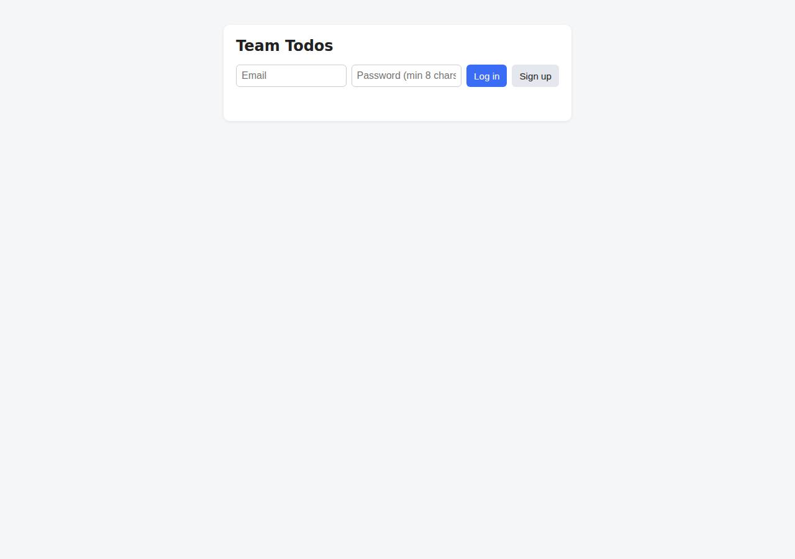
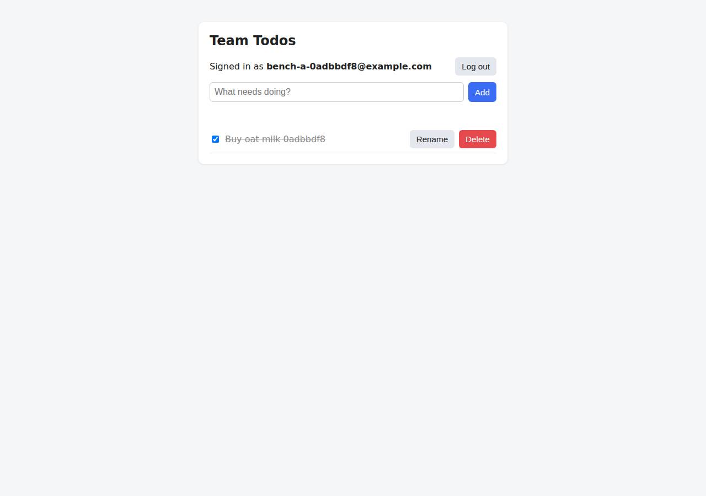

# ✅ Database-Backed CRUD App on Render with Opus 5.5 (trial 1)

**success**: 19/19 checks passed (100%).

- URL: https://adb-iqb72-crud-web.onrender.com (from deployment.json)
- Estimated hosting: Light use: $0.00/month, Busy: $7.13/month (the agent estimated $0.00)
- Agent: Claude Code 2.1.296, model `claude-opus-5-5`, effort medium, HIPAA organization
- Resource prefix: `adb-iqb72-crud`

| | Build | Deploy | Total |
|---|---|---|---|
| Status | completed | completed | |
| Time | 2m 12s | 4m 44s | 8m 21s |
| Turns | 11 | 14 | |
| Tokens | 436.5K | 920.6K | 1.71M |
| Agent cost | $0.47 | $0.43 | $1.17 |
| Shell commands | 10 | 12 | |

App answered 0s after the agent finished deploying.

**Needed a human:** the no-credentials attempt didn't produce a working public URL, so the cloud's credentials were provided and the agent redeployed (that attempt took 1m 25s, 350.4K tokens, $0.27).

## Screenshots

**The web app before signing in** (https://adb-iqb72-crud-web.onrender.com/)

**The todo list after signing in through the web UI as the test user** (https://adb-iqb72-crud-web.onrender.com/)

## What was built

- Runtime: Node.js 20+
- Frameworks: Express
- Data: PostgreSQL (Render Postgres, free)
- Libraries: node-postgres, bcrypt.js
- Packaging: Render Blueprint (render.yaml)
- Hosting: Render web service (free, built from render-examples/express-hello-world)
- Code: 498 lines in 14 files (JavaScript 290, HTML 123, Shell 85, Markdown 38, JSON 35, YAML 20)
- Dependencies: 3 npm, 0 Python
- Deploy config: `render.yaml`

### Stack fit

**80/100**, from the same independent review, judged against the app's requirements rather than a preferred stack.

Node/Express with managed PostgreSQL on Render is a well-proportioned, sensible fit for this app, and STACK.md reasons about it clearly. The build departed from the planned Blueprint and Git deploy in favor of a secret-file bundle workaround.

| Criterion | Weight | Score | Rationale |
|---|---|---|---|
| Fit for the job | 40 | 8/10 | Express with pg, bcryptjs and DB-backed opaque sessions on managed PostgreSQL suits a multi-user CRUD app with durable storage. The weak spot is that the chosen free database plan expires. |
| Proportion | 30 | 9/10 | One service, one database and three runtime dependencies, with a static HTML UI and no build step, is about as minimal as these requirements allow. |
| Platform fit | 30 | 7/10 | A native Node web service with managed Postgres over the internal network, wired up in render.yaml, is idiomatic for Render. But the actual deploy skipped the Blueprint and fought Render's Git-based model with a secret-file bundle. |

## Human steps

2 step(s), about 5 min of a person's time.

- **Sign up for an account and verify the email address** (~3 min): prerequisite: account setup
- **Create an API token and hand it to the agent** (~2 min): prerequisite: account setup

Reported but not needed, since the deployment worked without them: Optional: push this repo to a Git provider, connect it to Render, and point adb-iqb72-crud-web at it (or deploy render.y

## Security and compliance review

**64/100**, from an independent Claude Code review (`claude-opus-5-5`, high effort, HIPAA organization, $0.43) of the process, the code, the hosting plan and the live app.

The app code is solid: parameterized queries, per-user scoping, bcrypt, and hashed opaque tokens, and the live site exposes nothing beyond the app over HTTPS. The deployment is the weak part. A commercial app runs on Render's free tier, where the web service sleeps and the free Postgres expires on 2026-11-25. Production code arrives as a secret-file tarball behind a third-party placeholder repo, and the database is left open to external connections by default.

| Criterion | Weight | Score | Rationale |
|---|---|---|---|
| Secrets handling | 25 | 9/10 | No credential appears in source, transcripts or deployed files. DATABASE_URL is the internal connection string, fetched from the Render API and passed straight into the service's env vars without being printed. The app reads it from process.env. The only oddity is that Render's secret-file mechanism was used to carry code rather than secrets. |
| Deployment provenance | 20 | 4/10 | Dependencies are locked (npm ci with package-lock.json). But the service is linked to a third-party public repo (render-examples/express-hello-world) that the owner doesn't control, and the real code arrives as a base64 tarball in a secret file. Production therefore has no owner-controlled source of record, and the Node version is pinned only to major 22. |
| Terms compliance | 15 | 3/10 | This is a commercial app running on Render's Hobby-tier free web service and free Postgres. Render positions free instances for testing and hobby use, not production, though I'm not certain its terms forbid commercial use outright. The free service sleeps after 15 minutes idle, and the free database expires on 2026-11-25, which would delete the business's data. |
| Least privilege | 15 | 6/10 | The service talks to Postgres over Render's private network, and the native runtime runs nothing extra. However, the database was created through the API with no ipAllowList, so Render's default allows password-authenticated external connections from any IP. The app also connects as the database owner. |
| Transport security | 10 | 7/10 | HTTPS is served with a valid certificate, HTTP gets a 301 to HTTPS, and the session cookie is Secure, HttpOnly and SameSite=Lax. The app sets none of HSTS, CSP, X-Content-Type-Options or frame protection, even though it easily could have. |
| Attack surface | 10 | 9/10 | Source files, .env, .git, package files and node_modules all return 404, there is no directory listing, and API errors are generic JSON. The only leftovers are Express's default HTML 404 pages and a public /healthz endpoint. |
| Application security | 5 | 7/10 | Queries are parameterized, every todo query is scoped by user_id, passwords use bcrypt cost 12 with a dummy hash to even out login timing, tokens are random and stored hashed, and the UI renders titles with textContent. Weak points: auth has no rate limiting, titles have no length limit, and the bearer token is kept in localStorage. |

Findings:

- **high** · deployment · Commercial app on expiring free Postgres and sleeping free web service: process/context.json use=commercial; process/resources.json: postgres plan free, expires_at 2026-11-25T19:58:47Z; web service plan free; deployment.json notes 'free web service sleeps after 15 minutes idle' Fix: Move the database to a paid plan (e.g. basic_256mb) and the web service to at least Starter so data persists and the app stays up.
- **medium** · deployment · Service linked to third-party repo; code shipped via secret file: process/deploy.md: service created with repo https://github.com/render-examples/express-hello-world and buildCommand 'base64 -d /etc/secrets/app.tgz.b64 | tar xz -C app && cd app && npm ci --omit=dev'; resources.json source=render-examples/express-hello-world Fix: Push the code to an owner-controlled Git repo (or deploy a prebuilt image from an owner-controlled registry) and point the service or Blueprint at it.
- **medium** · deployment · Postgres reachable from the internet by default: process/deploy.md: POST /v1/postgres body has no ipAllowList; connection-info returned an externalConnectionString; the app uses only the internal URL Fix: Set the database ipAllowList to empty (internal only) or to specific admin IPs.
- **low** · deployment · Node runtime pinned only to major version: process/deploy.md envVars NODE_VERSION=22; app/package.json engines node >=20 Fix: Pin an exact Node version (e.g. 22.x.y via NODE_VERSION or .node-version).
- **low** · app · No security headers: curl -sI https://adb-iqb72-crud-web.onrender.com/ returns no strict-transport-security, content-security-policy, x-content-type-options or x-frame-options Fix: Add helmet (or set these headers manually) in app.js.
- **low** · app · No rate limiting on signup or login: app/app.js POST /api/auth/signup and /api/auth/login have no throttling; each request costs a bcrypt-12 hash Fix: Add per-IP and per-account rate limiting (e.g. express-rate-limit).
- **low** · app · Unbounded todo title length: app/app.js POST/PATCH /api/todos only trims title; the only cap is the 100kb JSON limit (the UI's maxlength=500 is client-side only) Fix: Reject titles over a reasonable length server-side.
- **info** · app · Bearer token kept in localStorage: app/public/index.html line 55: localStorage.getItem('token') (an HttpOnly cookie is also set) Fix: In the UI, rely on the HttpOnly cookie alone, and pair that with a CSP.
- **info** · app · Default Express 404 pages: GET /.env -> 404 HTML 'Cannot GET /.env' Fix: Add a custom 404 handler; this is cosmetic.

## Checks

| Check | Required | Result | Detail |
|---|---|---|---|
| GET / answers 2xx within 1 min | yes | passed |  |
| The app is served over HTTPS with a valid certificate | yes | passed |  |
| The app is public: no redirect to another host such as a login page | yes | passed |  |
| GET / serves the web app as HTML | yes | passed |  |
| POST /api/auth/signup creates an account and returns a token | yes | passed |  |
| Signup rejects an invalid email and a short password with 400 | yes | passed |  |
| Signing up twice with the same email returns 409 | yes | passed |  |
| POST /api/auth/login returns a token | yes | passed |  |
| Login with a wrong password returns 401 | yes | passed |  |
| /api/todos requires a valid token (401) | yes | passed |  |
| POST /api/todos creates a todo | yes | passed |  |
| An empty title is rejected with 400 | yes | passed |  |
| GET /api/todos lists the caller's todos | yes | passed |  |
| Todos are listed oldest first | no | passed |  |
| PATCH /api/todos/{id} renames and completes a todo | yes | passed |  |
| Users can't see or modify each other's todos (404) | yes | passed |  |
| DELETE /api/todos/{id} removes a todo | yes | passed |  |
| Data is still there a minute later, with a fresh login | yes | passed |  |
| The web UI renders a login or signup form | no | passed |  |

## Cloud resources

| Traffic | $/month | How it was priced |
|---|---|---|
| Light use | $0.00 | fixed monthly prices; 0.04 GB out of the Hobby workspace's 5 GB; free instances awake 10 h of 750 free hours |
| Busy | $7.13 | fixed monthly prices; 52.6 GB out of the Hobby workspace's 5 GB, 47.6 GB billed (with a payment method on file; without one Render suspends the services instead); free instances awake 730 h of 750 free hours |

Each resource's list price, at the size it was provisioned and always on:

| Kind | Name | Plan | $/month | How it was priced |
|---|---|---|---|---|
| service | adb-iqb72-crud-web | free | $0.00 | free x 1 instance(s) |
| postgres | adb-iqb72-crud-db | free | $0.00 | Postgres free |

Teardown: 2 deleted

## Agent's deploy summary

> The app is deployed at **https://adb-iqb72-crud-web.onrender.com**, and every `TASK.md` requirement works through that URL.
>
> **What's running (all on Render's free tier, $0/month):**
> - **Web service `adb-iqb72-crud-web`** (`srv-dbfr29mi0phs73ecj7q0`): Node 22, health check at `/healthz`.
> - **Database `adb-iqb72-crud-db`** (`dpg-dbfr1tom7kps739hsem0-a`): managed PostgreSQL 16, connected to the service by its internal address.
>
> **How the code got there:** Render can't take an upload of local files, and there was no GitHub login to push a repo. So the service clones Render's public example repo (`render-examples/express-hello-world`) only because Render requires a repo. Its build step unpacks our committed code from a Render secret file instead, so nothing runs outside Render. Because no repo is connected, pushing code won't trigger a deploy: run `scripts/update-render-bundle.sh` to ship changes.
>
> **Tested through the public URL:**
> - **`scripts/smoke.sh`:** all checks passed:
>   - sign-up and login errors (400, 409, 401)
>   - creating, listing oldest-first, renaming, completing, uncompleting and deleting todos
>   - 401 without a token
>   - 404 when one user touches another user's todos
> - **Browser:** a headless Chrome run of the web page covered sign-up, add, complete, uncomplete, rename, delete and logout.
> - **Persistence:** a todo and a login token both survived a full redeploy.
>
> **Limitations of the free tier:**
> - The web service sleeps after 15 minutes without traffic, so the first request after that takes about a minute.
> - Render deletes free databases 30 days after creation. Upgrading `adb-iqb72-crud-db` to `basic_256mb` (about $6/month) keeps the data long-term.
>
> `deployment.json` lists one optional, non-blocking human step: connect a real Git repo to Render to get automatic deploys on push. I didn't create any new credentials, so `.env` holds no secrets.
>
> Sources: [Render deploy docs](https://render.com/docs/deploys), [Render CLI docs](https://render.com/docs/cli), [Render feature request: deploy without GitHub/GitLab](https://feedback.render.com/features/p/deploy-without-githubgitlab)

## Shell commands during deploy

- `4s` `env | grep -iE 'render|token|key' | sed 's/=.*/=<set>/'; gh auth status 2>&1 | head -2; git status --short; git log --oneline | head; curl -s -o /dev/null -w '%{http_code}\n' -H "Authorization: Bearer`
- `9s` `cd /tmp && R() { curl -s -H "Authorization: Bearer $RENDER_API_KEY" -H 'Accept: application/json' "$@"; }; R https://api.render.com/v1/owners | python3 -m json.tool | grep -vE 'email' ; R "https://api`
- `38s` `git ls-remote https://github.com/render-examples/express-hello-world HEAD refs/heads/main | head`
- `42s` `grep -q RENDER_API_KEY .env 2>/dev/null || echo "# Render API key is provided via environment (RENDER_API_KEY); not stored here." > .env`
- `47s` `git archive --format=tar.gz -o /tmp/app.tgz HEAD app.js db.js server.js package.json package-lock.json public && ls -l /tmp/app.tgz && base64 -w0 /tmp/app.tgz > /tmp/app.tgz.b64 && wc -c /tmp/app.tgz.`
- `51s` `R() { curl -sS -H "Authorization: Bearer $RENDER_API_KEY" -H 'Accept: application/json' "$@"; }`
- `1m 30s` `cd /tmp && DATABASE_URL=$(curl -sS -H "Authorization: Bearer $RENDER_API_KEY" https://api.render.com/v1/postgres/dpg-dbfr1tom7kps739hsem0-a/connection-info | python3 -c 'import json,sys;print(json.loa`
- `1m 36s` `for i in $(seq 40); do s=$(curl -sS -H "Authorization: Bearer $RENDER_API_KEY" -H 'Accept: application/json' https://api.render.com/v1/services/srv-dbfr29mi0phs73ecj7q0/deploys/dep-dbfr2a6i0phs73ecj8q`
- `2m 10s` `curl -s https://adb-iqb72-crud-web.onrender.com/ | grep -o '<title>.*</title>'; curl -s https://adb-iqb72-crud-web.onrender.com/healthz; echo; scripts/smoke.sh https://adb-iqb72-crud-web.onrender.com`
- `2m 36s` `B=https://adb-iqb72-crud-web.onrender.com; E="persist$RANDOM@example.com"`
- `4m 06s` `mkdir -p /tmp/uitest && cd /tmp/uitest && npm init -y >/dev/null && npm i puppeteer-core >/dev/null 2>&1 && cat > ui.js <<'EOF'`
- `4m 35s` `cat > scripts/update-render-bundle.sh <<'EOF'`
