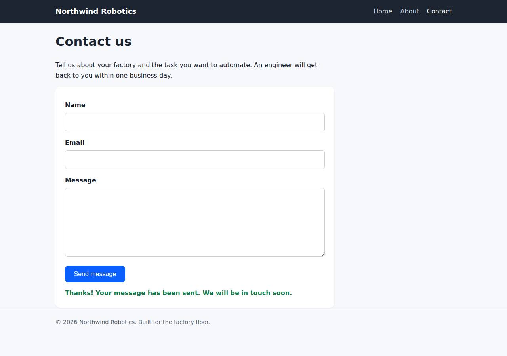

# ✅ Static Content Site on Render with Opus 5.5 (trial 1)

**success**: 16/16 checks passed (100%).

- URL: https://adb-hpd89-static-web.onrender.com (from deployment.json)
- Estimated hosting: Light use: $0.00/month, Busy: $7.13/month (the agent estimated $0.00)
- Agent: Claude Code 2.1.296, model `claude-opus-5-5`, effort medium, HIPAA organization
- Resource prefix: `adb-hpd89-static`

| | Build | Deploy | Total |
|---|---|---|---|
| Status | completed | completed | |
| Time | 1m 36s | 2m 22s | 4m 40s |
| Turns | 10 | 10 | |
| Tokens | 370.0K | 524.9K | 1.07M |
| Agent cost | $0.34 | $0.32 | $0.80 |
| Shell commands | 9 | 9 | |

App answered 0s after the agent finished deploying.

**Needed a human:** the no-credentials attempt didn't produce a working public URL, so the cloud's credentials were provided and the agent redeployed (that attempt took 42s, 179.3K tokens, $0.14).

## Screenshots

**The home page** (https://adb-hpd89-static-web.onrender.com/)

**The contact page after the verifier submitted the form** (https://adb-hpd89-static-web.onrender.com/contact)

## What was built

- Runtime: Node.js 24
- Frameworks: Node.js http module (built in)
- Packaging: Render Blueprint (render.yaml)
- Hosting: Render web service (free, running the prebuilt image node:24-alpine)
- Code: 421 lines in 18 files (JavaScript 182, HTML 172, Shell 37, CSS 30, Markdown 27, JSON 23, YAML 8)
- Dependencies: 0 npm, 0 Python
- Deploy config: `render.yaml`

### Stack fit

**81/100**, from the same independent review, judged against the app's requirements rather than a preferred stack.

A zero-dependency Node.js server on one Render web service fits this small static site with a single contact endpoint well and is about as simple as it can be. Its platform fit suffers from the image-plus-env-var workaround and from free-tier hosting.

| Criterion | Weight | Score | Rationale |
|---|---|---|---|
| Fit for the job | 40 | 9/10 | A built-in http server that serves cached static pages and validates one JSON endpoint does exactly what the spec needs. It handles extensionless paths, true 404s and the same-origin POST, and there is no data store because none is required. |
| Proportion | 30 | 9/10 | There is one file, no dependencies and no build step, the minimum the requirements allow. The only extra complexity is the env-var bundling workaround in the deploy tooling. |
| Platform fit | 30 | 6/10 | A single Render web service is a reasonable way to keep the API on the same origin, which STACK.md reasoned about soundly. But the build departed from STACK.md's native Node runtime plan: it runs an image runtime with code in env vars, which works against Render's Git-based builds, and on a free instance that sleeps. |

## Human steps

2 step(s), about 5 min of a person's time.

- **Sign up for an account and verify the email address** (~3 min): prerequisite: account setup
- **Create an API token and hand it to the agent** (~2 min): prerequisite: account setup

Reported but not needed, since the deployment worked without them: Optional: connect a GitHub/GitLab account to the Render workspace (dashboard) and push this repo there as adb-hpd89-stat

## Security and compliance review

**72/100**, from an independent Claude Code review (`claude-opus-5-5`, high effort, HIPAA organization, $0.32) of the process, the code, the hosting plan and the live app.

The Northwind Robotics site is a small, dependency-free Node server. Its code is clean: strict input validation, a capped request body, and no exposed files, so live probing turned up nothing sensitive. Deployment provenance is weak: the code is gzipped into env vars and eval'd on an unpinned node:24-alpine image running as root, with no source control behind it. The commercial site also runs on Render's free instance, which sleeps when idle, and the app sets no security headers.

| Criterion | Weight | Score | Rationale |
|---|---|---|---|
| Secrets handling | 25 | 10/10 | The app needs no secrets. The Render API key was only ever referenced as $RENDER_API_KEY, `env \| grep` output was masked, .env is gitignored, and no credential appears in the source, the transcripts or the deployed bundle. |
| Deployment provenance | 20 | 4/10 | Production code doesn't come from a repository the owner controls. It is gzip+base64 in an APP_B64 env var and runs via `node -e eval(process.env.BOOT_JS)` on an unpinned `node:24-alpine` tag. Both commits stayed local, and render.yaml describes a different, unused deploy, so nothing traceable records what runs. |
| Terms compliance | 15 | 5/10 | A commercial business's marketing site runs on Render's free web-service instance. Render positions that tier for hobby and testing use, and it spins down after about 15 minutes idle, which gives visitors 30-60s cold starts. I'm not certain the terms forbid commercial use, but the tier doesn't fit a business site that has to stay responsive. |
| Least privilege | 15 | 7/10 | There is a single public web service, which is all the app needs, and no data stores. The container runs as root (the node:24-alpine default, with no USER set), and the start command evals code taken from an env var. |
| Transport security | 10 | 7/10 | HTTPS works with a valid certificate, and HTTP returns a 301 redirect to HTTPS. The app sets none of HSTS, X-Content-Type-Options, frame protection or CSP, although server.js controls every response header and could have. |
| Attack surface | 10 | 10/10 | Only the defined routes respond. /.env, /.git/config, /server.js, /package.json, /render.yaml and a traversal attempt all return the generic 404 page, there are no directory listings or stack traces, and /healthz returns only {"ok":true}. |
| Application security | 5 | 9/10 | Input validation is strict (type checks, an email regex, rejection of non-object JSON), the body is capped at 64KB with a 413, other methods get a 405, and the client renders messages with textContent. The only gap is that the public POST endpoint has no rate limiting, which matters little because nothing is stored or sent. |

Findings:

- **medium** · deployment · App code shipped in env vars and eval'd at startup, not built from source control: process/deploy.md: PUT /services/srv-dbfqu38u01pc73begth0/env-vars with APP_B64 (output of scripts/bundle.js) and BOOT_JS, then PATCH dockerCommand to `node -e eval(process.env.BOOT_JS)`. app/scripts/boot.js unpacks the files to /tmp/app and requires server.js. The agent's final message says both commits are local only. Fix: Push the repo to a Git provider the owner controls and deploy with Render's native Node runtime (render.yaml), or build a versioned image in a controlled registry.
- **medium** · deployment · Commercial site on Render free instance that sleeps when idle: process/context.json use=commercial; process/resources.json plan=free; process/deployment.json notes: 'Free tier spins down when idle (first request after idle may take ~30-60s)' Fix: Use a paid instance type (Starter or higher) for a business's production site so it stays up and runs on a plan meant for production use.
- **low** · deployment · Base image tag not pinned: process/resources.json: source docker.io/library/node:24-alpine (mutable tag, no digest) Fix: Pin the image by digest (node:24-alpine@sha256:...) or a specific patch version.
- **low** · deployment · render.yaml doesn't describe the live service: app/render.yaml declares runtime: node and startCommand: node server.js, but the live service uses runtime image with a custom dockerCommand (process/resources.json, process/deploy.md) Fix: Keep the infrastructure config in sync with the deployed service so the deployment can be reproduced and audited.
- **low** · deployment · Container runs as root: The service runs docker.io/library/node:24-alpine (default user root) with dockerCommand `node -e eval(process.env.BOOT_JS)`. No non-root user is set anywhere (process/deploy.md). Fix: Run as the image's built-in `node` user, for example with a Dockerfile that sets USER node, or use Render's native runtime.
- **low** · app · No security headers: curl -sI https://adb-hpd89-static-web.onrender.com/ returned only content-type, cache-control, vary and Render/Cloudflare headers: no strict-transport-security, x-content-type-options, x-frame-options or content-security-policy. server.js:31-39 sets only Content-Type, Content-Length and Cache-Control. Fix: Add HSTS, X-Content-Type-Options: nosniff, frame-ancestors/X-Frame-Options and a restrictive CSP (default-src 'self') in send() and sendJson().
- **info** · app · No rate limiting on public contact endpoint: server.js:41-62 handleContact has no throttling. Repeated POSTs to /api/contact return 200 {"ok":true}. Fix: Add basic per-IP rate limiting or a honeypot field if submissions are later stored or emailed.

## Checks

| Check | Required | Result | Detail |
|---|---|---|---|
| GET / answers 2xx within 1 min | yes | passed |  |
| The app is served over HTTPS with a valid certificate | yes | passed |  |
| The app is public: no redirect to another host such as a login page | yes | passed |  |
| GET / returns HTML | yes | passed |  |
| GET /about returns HTML | yes | passed |  |
| GET /contact returns HTML | yes | passed |  |
| Home has an <h1> containing 'Northwind Robotics' | yes | passed |  |
| About has a heading containing 'About' | yes | passed |  |
| Contact has a form with name, email and message fields | yes | passed |  |
| Every page has a <title> and a viewport meta tag | no | passed |  |
| Home links to /about and /contact | no | passed |  |
| POST /api/contact with valid input returns {ok: true} | yes | passed |  |
| POST /api/contact rejects a bad email and an empty message with 400 | yes | passed |  |
| Unknown paths return 404 | yes | passed |  |
| Submitting the /contact form in a browser posts to /api/contact without leaving the page | yes | passed |  |
| Pages load in a browser without uncaught JavaScript errors | no | passed |  |

## Cloud resources

| Traffic | $/month | How it was priced |
|---|---|---|
| Light use | $0.00 | fixed monthly prices; 0.04 GB out of the Hobby workspace's 5 GB; free instances awake 10 h of 750 free hours |
| Busy | $7.13 | fixed monthly prices; 52.6 GB out of the Hobby workspace's 5 GB, 47.6 GB billed (with a payment method on file; without one Render suspends the services instead); free instances awake 730 h of 750 free hours |

Each resource's list price, at the size it was provisioned and always on:

| Kind | Name | Plan | $/month | How it was priced |
|---|---|---|---|---|
| service | adb-hpd89-static-web | free | $0.00 | free x 1 instance(s) |

Teardown: 1 deleted

## Agent's deploy summary

> The site is live at **https://adb-hpd89-static-web.onrender.com**, and every requirement in `TASK.md` passed when I tested it through that public URL.
>
> **What's deployed:** one free Render web service, `adb-hpd89-static-web` (`srv-dbfqu38u01pc73begth0`), costing $0/month.
>
> **How it gets the code:** a normal Render deploy builds from a Git repo, and there were no GitHub or GitLab credentials. Instead, the service runs the official `node:24-alpine` image, and the app files are stored in an environment variable on the service. When the service starts, it unpacks them and runs the server. This is less standard than a Git-based deploy, but everything runs on Render. The image is only pulled from Docker Hub as a base image; nothing of ours was pushed to any registry.
>
> **Tested through the public URL:**
> - `/`, `/about` and `/contact` return 200 with `text/html`, and have the required headings and form fields.
> - Unknown paths return 404.
> - `POST /api/contact` returns 200 with `{"ok":true}` for valid input, and 400 with an error for a missing name, an invalid email or an empty message.
> - In headless Chrome at phone width, the form showed its confirmation without reloading the page, and the layout had no horizontal scrolling.
> - Plain HTTP redirects to HTTPS.
>
> **What didn't work:**
> - My first start command failed because Render didn't pass the quoted shell command through intact. I switched to a start command with no quotes or spaces in its argument, and the second deploy went live.
> - `render.yaml` still describes a Git-based deploy and was not used. It only becomes relevant if someone connects a Git account.
>
> **Things to know:**
> - **Updating the site:** run `scripts/deploy.sh`. It pushes the current code to the service, redeploys and re-runs the checks.
> - **Cold starts:** the free service sleeps when idle, so the first request after a quiet period can take 30–60 seconds.
> - **Human steps:** there's one, and it's optional. Connecting a GitHub or GitLab account to Render would allow normal Git-based builds and auto-deploy on push.
>
> I didn't create any new credentials, so there's no `.env` file. Both commits are local only.

## Shell commands during deploy

- `8s` `cd /home/runner/work/_temp/adb-hpd89-static; env | grep -iE 'render|gh_|github_token|gitlab' | sed 's/=.*/=<set>/'; A=(-H "Authorization: Bearer $RENDER_API_KEY" -H "Accept: application/json"); curl -`
- `25s` `cd /home/runner/work/_temp/adb-hpd89-static; tar czf /tmp/app.tgz server.js package.json public && B64=$(base64 -w0 /tmp/app.tgz); echo "payload ${#B64} chars"`
- `34s` `A=(-H "Authorization: Bearer $RENDER_API_KEY" -H "Accept: application/json"); for i in $(seq 40); do st=$(curl -s "${A[@]}" "https://api.render.com/v1/services/srv-dbfqu38u01pc73begth0/deploys?limit=1`
- `47s` `A=(-H "Authorization: Bearer $RENDER_API_KEY" -H "Accept: application/json"); curl -s "${A[@]}" "https://api.render.com/v1/logs?ownerId=tea-db6fig0473hc73eb9aeg&resource=srv-dbfqu38u01pc73begth0&limit`
- `1m 09s` `cd /home/runner/work/_temp/adb-hpd89-static; mkdir -p scripts; cat > scripts/bundle.js <<'EOF'`
- `1m 16s` `cd /home/runner/work/_temp/adb-hpd89-static; S=srv-dbfqu38u01pc73begth0; API=https://api.render.com/v1; A=(-H "Authorization: Bearer $RENDER_API_KEY" -H "Accept: application/json" -H "Content-Type: ap`
- `1m 41s` `cd /home/runner/work/_temp/adb-hpd89-static; U=https://adb-hpd89-static-web.onrender.com; BASE_URL=$U scripts/smoke.sh; curl -s $U/ | grep -o '<h1>[^<]*</h1>'; curl -s $U/about | grep -o '<h1>[^<]*</h`
- `1m 49s` `mkdir -p /tmp/pw && cd /tmp/pw && npm init -y >/dev/null && npm i -s playwright-core@1 >/dev/null 2>&1; CH=$(which google-chrome || which chromium); cat > t.js <<EOF`
- `2m 14s` `cat > scripts/deploy.sh <<'EOF'`
