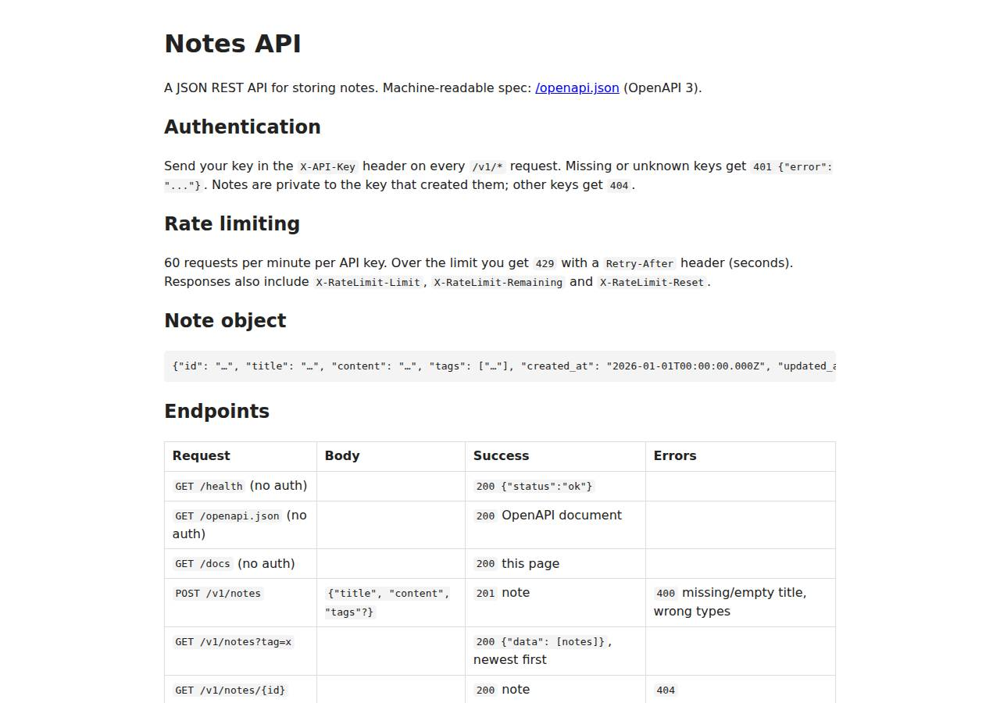

# ⚠️ API / Backend Service on Vercel with Opus 5.5 (trial 1)

**partial** (failed at human): 10/20 checks passed (50%).

- URL: https://adb-be8tp-api.vercel.app (from deployment.json)
- Estimated hosting: Light use: $0.00/month, Busy: $20.00/month (the agent estimated $0.00)
- Agent: Claude Code 2.1.296, model `claude-opus-5-5`, effort medium, HIPAA organization
- Resource prefix: `adb-be8tp-api`

| | Build | Deploy | Total |
|---|---|---|---|
| Status | completed | completed | |
| Time | 2m 41s | 3m 25s | 7m 39s |
| Turns | 13 | 18 | |
| Tokens | 560.4K | 1.46M | 2.57M |
| Agent cost | $0.59 | $0.94 | $1.84 |
| Shell commands | 12 | 14 | |

App answered 0s after the agent finished deploying.

**Needed a human:** the no-credentials attempt didn't produce a working public URL, so the cloud's credentials were provided and the agent redeployed (that attempt took 1m 33s, 545.2K tokens, $0.30).

## Screenshots

**The API documentation at /docs** (https://adb-be8tp-api.vercel.app/docs)

## What was built

- Runtime: Node.js 20+
- Frameworks: Hono
- Libraries: node-postgres
- Dev tools: @hono/node-server
- Hosting: Vercel project (hono), Vercel Functions
- Code: 688 lines in 17 files (JavaScript 637, Shell 51, Markdown 38, JSON 35)
- Dependencies: 3 npm, 0 Python
- Deploy config: none

### Stack fit

**55/100**, from the same independent review, judged against the app's requirements rather than a preferred stack.

STACK.md reasons soundly toward Node/Hono on Vercel Functions with Neon Postgres, a well-proportioned fit for a small authenticated JSON API. The build departed from it in production by falling back to in-memory storage when the Neon integration couldn't be provisioned, which undermines durability and correct rate limiting.

| Criterion | Weight | Score | Rationale |
|---|---|---|---|
| Fit for the job | 40 | 4/10 | Hono with Postgres (Neon) and a Postgres-backed shared rate limiter is the right design, but what runs is an in-memory store that loses data and splits rate limits across instances, failing the durable-storage requirement. |
| Proportion | 30 | 7/10 | Two runtime dependencies (hono, pg), no build step and one data store for both notes and limits is lean. The silent in-memory fallback is a stand-in that only appears to work. |
| Platform fit | 30 | 6/10 | A zero-config Hono app on Vercel Functions with Neon from the Marketplace matches what Vercel does well. Keeping state in function-instance memory works against the serverless model. |

## Human steps

3 step(s), about 8 min of a person's time. **Blocked:** the deploy couldn't finish without them.

- **Sign up for an account and verify the email address** (~3 min): prerequisite: account setup
- **Create an API token and hand it to the agent** (~2 min): prerequisite: account setup
- **Install a Marketplace integration and accept its terms in a browser** (~3 min): agent: In a browser, logged in to team ai-deploy-bench, accept the Neon Marketplace terms at https://vercel.com/ai-deploy-bench/~/integrations/accept-terms/neon?source=cli. Then run: vercel --scope $VERCEL_TEAM_ID --non-interactive integration add neon --name adb-be8tp-api-db --no-env-pull (from this direc; tool output: 21.0) > Installing Neon by Neon under ai-deploy-bench { "status": "action_requ

## Security and compliance review

**82/100**, from an independent Claude Code review (`claude-opus-5-5`, high effort, HIPAA organization, $0.46) of the process, the code, the hosting plan and the live app.

The Notes API is served over HTTPS on Vercel Hobby, which fits its personal use, with API keys held in a sensitive env var, no exposed files and sound validation, parameterized SQL and owner scoping. The main weakness is that the durable Postgres database was never connected, so production keeps notes in function memory, rate-limits per instance and fails the persistence requirement. Smaller issues: the deploy came from a local directory with floating dependency ranges, Postgres TLS verification is disabled, and field sizes and security headers are missing.

| Criterion | Weight | Score | Rationale |
|---|---|---|---|
| Secrets handling | 25 | 10/10 | API_KEYS is stored as a sensitive Vercel production env var piped via stdin, the token and connection strings were filtered from transcript output, and .env/.env.local (with the OIDC token) are excluded by .vercelignore; nothing secret is reachable on the live site. |
| Deployment provenance | 20 | 6/10 | Production was uploaded with `vercel deploy --prod` from the agent's local working directory rather than from an owner-controlled git repo, and dependencies use caret ranges with no lockfile in the delivered sources; the Vercel-managed build itself is trustworthy. |
| Terms compliance | 15 | 8/10 | Personal use on Vercel Hobby fits the plan's non-commercial terms at $0. But the live app relies on function-instance memory for data, and Vercel's serverless platform doesn't keep that, so the TASK.md durability requirement can't be met as deployed. |
| Least privilege | 15 | 9/10 | No public data stores or extra resources exist; preview deployments are behind Vercel Authentication and only the production alias is public. The latent Postgres client disables TLS certificate verification. |
| Transport security | 10 | 8/10 | HTTP returns 308 to HTTPS with a valid certificate and HSTS (preload) from the platform, but the app sets no X-Content-Type-Options, frame protection or CSP even though Hono/vercel.json could add them. |
| Attack surface | 10 | 9/10 | Probes for .env, .env.local, .git, package.json, source and test files all return 404, errors are generic JSON with no stack traces, and /_src redirects to the authenticated Vercel dashboard; only a minor X-Storage header reveals internal storage mode. |
| Application security | 5 | 5/10 | Input validation, parameterized SQL and per-key ownership checks are solid, but the live in-memory fallback makes notes non-durable and the rate limiter per-instance (bypassable when scaled out), and there are no size limits on title/content/tags. |

Findings:

- **high** · deployment · Production runs on non-durable in-memory storage and per-instance rate limiting: src/app.js:9-11 select src/memory.js when DATABASE_URL is unset; deploy.md: `integration add neon` returned integration_terms_acceptance_required and Blob creation failed; live smoke output shows `x-storage: memory`; deployment.json human_steps marks the DB step blocking. Fix: Connect the Neon (or another durable Postgres) integration and redeploy. Fail closed (503) on /v1 when no database is configured, instead of silently serving from memory.
- **medium** · app · Rate limit can be bypassed across instances in memory mode: src/memory.js:53-64 keeps hit counts in a module-level Map, so each Fluid compute instance enforces its own 60/min window. Fix: Use the Postgres-backed limiter (src/ratelimit.js) or a shared store such as Upstash Redis in production.
- **low** · app · No size limits on note fields or tag arrays: src/app.js:68-88 validate() checks types only. A key holder can store bodies up to Vercel's ~4.5 MB request cap, and with the in-memory store that grows instance memory without bound. Fix: Cap title, content, tag count and tag length, and reject larger bodies with 400/413.
- **low** · app · Postgres TLS certificate verification disabled: src/db.js:20 `ssl: ... { rejectUnauthorized: false }` for any non-local DATABASE_URL. Fix: Leave rejectUnauthorized at its default (true) for Neon, which presents publicly trusted certificates.
- **low** · deployment · Deployed from local directory with floating dependency ranges: deploy.md: `V deploy --prod --yes` from the working directory with no git source; package.json uses `hono ^4.6.0`, `pg ^8.13.0`; no package-lock.json in delivered sources. Fix: Commit the code and lockfile to an owner-controlled repo and deploy via Vercel's Git integration, or pin exact versions.
- **low** · app · Missing security headers beyond HSTS: curl -sD - https://adb-be8tp-api.vercel.app/docs returns only strict-transport-security; no x-content-type-options, x-frame-options/frame-ancestors or content-security-policy. Fix: Add hono/secure-headers middleware or a `headers` block in vercel.json.
- **info** · app · X-Storage header discloses backend mode: deploy.md smoke run: GET /v1/notes response contains `x-storage: memory` (src/app.js:41). Fix: Remove the header once storage is durable, or expose the mode only through internal logs.
- **info** · deployment · Hobby plan fits personal use: process/context.json use=personal, team plan hobby. Vercel Hobby is limited to non-commercial personal use, which this app is. Fix: No change needed. Move to Pro if the app ever becomes commercial.

## Checks

| Check | Required | Result | Detail |
|---|---|---|---|
| GET /health answers 2xx within 1 min | yes | passed |  |
| The app is served over HTTPS with a valid certificate | yes | passed |  |
| The app is public: no redirect to another host such as a login page | yes | passed |  |
| GET /health returns {status: ok} | yes | passed |  |
| GET /openapi.json is an OpenAPI 3 document covering /v1/notes | yes | passed |  |
| GET /docs serves human-readable documentation | no | passed |  |
| Requests without an API key get 401 | yes | passed |  |
| Requests with an unknown API key get 401 | yes | passed |  |
| POST /v1/notes creates a note | yes | failed | POST /v1/notes returned 429, expected 201 or 200: {"error":"Rate limit exceeded: 60 requests per minute. Retry in 5s."} |
| Invalid notes are rejected with 400 | yes | failed | missing title: expected 400, got 429 |
| GET /v1/notes/{id} returns the note | yes | failed | not run: depends on create |
| GET /v1/notes lists notes and filters by tag | yes | failed | not run: depends on create |
| Notes are listed newest first | no | failed | not run: depends on create |
| PATCH /v1/notes/{id} updates only the given fields | yes | failed | not run: depends on create |
| Notes are private to the API key that created them | yes | failed | not run: depends on create |
| DELETE /v1/notes/{id} removes the note | yes | failed | not run: depends on create |
| Notes are still there a minute later | yes | failed | not run: depends on create |
| Exceeding 60 requests/minute returns 429 | yes | passed |  |
| 429 responses include a Retry-After header | no | passed |  |
| One key hitting its limit doesn't throttle other keys | yes | failed | GET /v1/notes returned 429, expected 200: {"error":"Rate limit exceeded: 60 requests per minute. Retry in 1s."} |

## Cloud resources

| Traffic | $/month | How it was priced |
|---|---|---|
| Light use | $0.00 | within Hobby's included usage |
| Busy | $20.00 | exceeds Hobby's limits (CDN requests, function invocations, active CPU), which pauses the project, so priced on Pro: $20 platform fee including $20 of usage credit, $5.75 of usage |

Each resource's list price, at the size it was provisioned and always on:

| Kind | Name | Plan | $/month | How it was priced |
|---|---|---|---|---|
| project | adb-be8tp-api | — | $0.00 | no fixed fee; usage within the plan's included allowance |

Teardown: 1 deleted

## Agent's deploy summary

> The API is live at **https://adb-be8tp-api.vercel.app**, but notes are not yet stored durably. The database the app is built for (free Neon Postgres) needs its Marketplace terms accepted in a browser, which only a person can do.
>
> **What's deployed:** Vercel project `adb-be8tp-api` on the free Hobby plan, running the Node.js/Hono API in the `iad1` region. `API_KEYS` is set for production to exactly the keys in `BENCH_API_KEYS`, stored as a sensitive variable.
>
> **Tested through the public URL:** all 17 smoke checks passed. That covers:
> - `/health`, `/openapi.json` and `/docs`
> - 401 for a missing or unknown key
> - create, read, update and delete with the right status codes
> - 400 for invalid bodies, and 404 when another key tries to reach a note
> - the tag filter and newest-first ordering
> - 429 with `Retry-After` after 60 requests in a minute, with other keys unaffected
>
> **What didn't work:**
> - **Neon Postgres:** the install stopped with `integration_terms_acceptance_required`.
> - **Vercel Blob:** I tried it as a Vercel-native alternative, but the team has hit its Blob usage limit, so no store could be created.
> - **Edge Config:** on Hobby it allows too few writes to store notes.
>
> **Current stopgap:** with no database connected, the app keeps notes in the function's memory. Each instance counts rate limits on its own. Notes are lost whenever Vercel recycles the instance or the app is redeployed, and could differ between instances if Vercel scales out. This does not meet the requirement that notes survive restarts. Every `/v1` response has an `X-Storage: memory` header so the mode is visible.
>
> **To finish (one human step, listed in `deployment.json`):**
> 1. Accept the Neon terms for team `ai-deploy-bench` at https://vercel.com/ai-deploy-bench/~/integrations/accept-terms/neon?source=cli
> 2. Run `./scripts/deploy.sh`. It creates the free `adb-be8tp-api-db` database, which supplies `DATABASE_URL`. It then redeploys and runs the smoke test against the public URL.
>
> After that, the same code uses Postgres for both notes and rate-limit counters, and the header changes to `X-Storage: postgres`.
>
> I didn't create any new credentials, so there was nothing to save in `.env`. The `.env.local` file that `vercel link` created is excluded from both git and deployments. No local servers or containers are left running. Estimated cost is $0 a month.

## Shell commands during deploy

- `6s` `env | grep -E '^(VERCEL|BENCH)' | sed 's/=.*/=<set>/'; vercel --version 2>/dev/null || npm i -g vercel@latest >/dev/null 2>&1; vercel whoami --token "$VERCEL_TOKEN" --scope "$VERCEL_TEAM_ID" 2>&1 | ta`
- `12s` `V() { vercel --token "$VERCEL_TOKEN" --scope "$VERCEL_TEAM_ID" "$@"; }`
- `21s` `V() { vercel --token "$VERCEL_TOKEN" --scope "$VERCEL_TEAM_ID" "$@"; }`
- `30s` `V() { vercel --token "$VERCEL_TOKEN" --scope "$VERCEL_TEAM_ID" "$@"; }`
- `47s` `curl -s -H "Authorization: Bearer $VERCEL_TOKEN" "https://api.vercel.com/v2/teams/$VERCEL_TEAM_ID" | python3 -c 'import sys,json;d=json.load(sys.stdin);print(d.get("slug"),d.get("billing",{}).get("pla`
- `1m 02s` `f=/home/runner/.claude/projects/-home-runner-work--temp-adb-be8tp-api/22e801cc-72bc-4e18-ae2b-5b6634a699fd/tool-results/toolu_01JWxsR3PrjEbVVMGUp8D7DM.txt; grep -niE 'ifMatch|etag|useCache|cacheContro`
- `1m 27s` `f=/home/runner/.claude/projects/-home-runner-work--temp-adb-be8tp-api/22e801cc-72bc-4e18-ae2b-5b6634a699fd/tool-results/toolu_01JWxsR3PrjEbVVMGUp8D7DM.txt; sed -n 300,345p $f; sed -n 480,600p $f`
- `1m 38s` `vercel blob create-store --help 2>&1 | sed -n 3,30p`
- `1m 40s` `V() { vercel --token "$VERCEL_TOKEN" --scope "$VERCEL_TEAM_ID" "$@"; }`
- `2m 07s` `cat > src/memory.js <<'EOF'`
- `2m 18s` `V() { vercel --token "$VERCEL_TOKEN" --scope "$VERCEL_TEAM_ID" "$@"; }`
- `2m 32s` `V() { vercel --token "$VERCEL_TOKEN" --scope "$VERCEL_TEAM_ID" "$@"; }`
- `2m 46s` `B=https://adb-be8tp-api.vercel.app; curl -s -D - $B/health | grep -iE '^HTTP|x-storage|status'; ./scripts/smoke.sh $B; echo exit $?; curl -s -o /dev/null -D - $B/v1/notes -H "X-API-Key: ${BENCH_API_KE`
- `3m 15s` `sed -i 's/\${VERCEL_SCOPE:+--scope "\$VERCEL_SCOPE"}/--scope "${VERCEL_SCOPE:-${VERCEL_TEAM_ID:?set VERCEL_TEAM_ID or VERCEL_SCOPE}}"/; s/ --no-env-pull --environment/ --no-env-pull --non-interactive `
