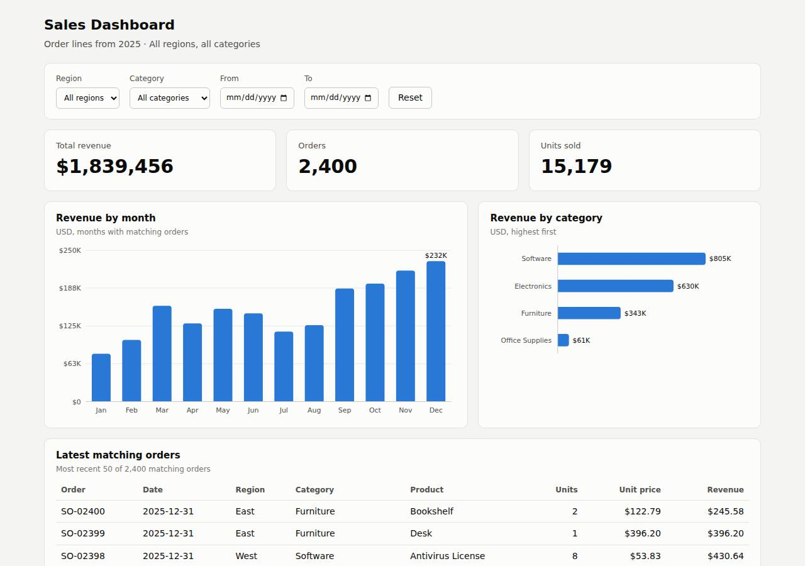

# ✅ Data / Visualization App on Vercel with Opus 5.5 (trial 1)

**success**: 12/12 checks passed (100%).

- URL: https://adb-dfzfy-dataviz-web.vercel.app (from deployment.json)
- Estimated hosting: Light use: $20.00/month, Busy: $20.00/month (the agent estimated $0.00)
- Agent: Claude Code 2.1.296, model `claude-opus-5-5`, effort medium, HIPAA organization
- Resource prefix: `adb-dfzfy-dataviz`

| | Build | Deploy | Total |
|---|---|---|---|
| Status | completed | completed | |
| Time | 2m 34s | 1m 00s | 5m 27s |
| Turns | 15 | 6 | |
| Tokens | 623.2K | 446.0K | 2.09M |
| Agent cost | $0.62 | $0.18 | $1.19 |
| Shell commands | 11 | 5 | |

App answered 0s after the agent finished deploying.

**Needed a human:** the no-credentials attempt didn't produce a working public URL, so the cloud's credentials were provided and the agent redeployed (that attempt took 1m 52s, 1.02M tokens, $0.40).

## Screenshots

**The dashboard** (https://adb-dfzfy-dataviz-web.vercel.app/)

## What was built

- Runtime: Node.js 18+
- Frameworks: Plain Vercel Functions
- Packaging: vercel.json
- Hosting: Vercel project, Vercel Functions
- Code: 475 lines in 15 files (HTML 250, JavaScript 219, JSON 32, Markdown 28, Shell 6)
- Dependencies: 0 npm, 0 Python
- Deploy config: `vercel.json`

### Stack fit

**93/100**, from the same independent review, judged against the app's requirements rather than a preferred stack.

A static page plus zero-dependency Node.js serverless functions over an in-memory CSV is about the simplest stack that meets the spec, and it fits Vercel's static-plus-functions model well.

| Criterion | Weight | Score | Rationale |
|---|---|---|---|
| Fit for the job | 40 | 9/10 | For an immutable 2,400-row dataset, a CSV bundled with the functions and cached in memory is an appropriate read-only store. Hand-rolled SVG charts and fetch-based updates cover every dashboard requirement, and summing in integer cents gets the rounding right. The naive comma-split CSV parser works only because the data has no quoted fields. |
| Proportion | 30 | 10/10 | It has no framework, no build, no npm dependencies and no database; STACK.md weighs the alternatives, and the build matches its choice. |
| Platform fit | 30 | 9/10 | It uses Vercel's strengths: static hosting for the page from `public/` and per-request serverless functions for `api/*.js`, with the CSV bundled through `includeFiles`. One missed opportunity is that the API sends `Cache-Control: no-store`, so the CDN can't cache what is effectively static output. |

## Human steps

2 step(s), about 5 min of a person's time.

- **Sign up for an account and verify the email address** (~3 min): prerequisite: account setup
- **Create an API token and hand it to the agent** (~2 min): prerequisite: account setup

## Security and compliance review

**75/100**, from an independent Claude Code review (`claude-opus-5-5`, high effort, HIPAA organization, $0.32) of the process, the code, the hosting plan and the live app.

The app is a small, zero-dependency static dashboard with Node functions over a bundled CSV. Nothing sensitive is exposed, input is validated, HTTPS is enforced and the build is clean, with only minor gaps: no extra security headers, an unpinned deploy CLI and no source repository. The main problem is compliance: a commercial app is running on a Vercel Hobby team, whose terms are limited to personal, non-commercial use, and the agent didn't flag it.

| Criterion | Weight | Score | Rationale |
|---|---|---|---|
| Secrets handling | 25 | 9/10 | The app needs no secrets, and none appear in the source, the deployed files or the transcripts. The only issue is minor: the Vercel token was passed as a `--token` command-line argument instead of being read from the VERCEL_TOKEN environment variable, which puts it in the process list. |
| Deployment provenance | 20 | 7/10 | There are no npm dependencies and no build step, so production runs the uploaded source as-is. However, it was pushed from a local directory with the Vercel CLI (version unrecorded), there is no source repository behind it, and `deploy.sh` runs the unpinned `npx -y vercel@latest`. |
| Terms compliance | 15 | 2/10 | This is a business's app (`use: commercial`), but it is deployed on a team whose plan is Hobby. Vercel's Hobby plan is limited to personal, non-commercial use. The agent left the plan unchanged and reported that usage 'fits free-tier limits' without raising the terms conflict. |
| Least privilege | 15 | 9/10 | The only resource is one Vercel project with public static files and three read-only functions over a bundled CSV. There is no database, no other cloud resource and no credential was created. The data is meant to be public, so the platform's default `Access-Control-Allow-Origin: *` is harmless here. |
| Transport security | 10 | 8/10 | Plain HTTP gets a 308 redirect to HTTPS. The certificate is a valid *.vercel.app wildcard, and the platform sends HSTS with preload. X-Content-Type-Options, frame protection and a CSP are missing; the agent could have added them through `headers` in vercel.json and didn't. |
| Attack surface | 10 | 10/10 | Every request for source files, config, .env, .env.local, .git, .vercel, the raw CSV, tests and deploy.sh returned 404. Errors come back as short JSON messages with no stack traces, and nothing beyond the dashboard and its three API endpoints is reachable. |
| Application security | 5 | 8/10 | Dates are strictly validated (400 on bad input), region and category are matched exactly against in-memory data with no injection path, `limit` is clamped to 1–500, other HTTP methods get 405, and table cells are escaped. Two minor gaps: the API has no rate limiting of its own, and the month tooltip passes unescaped server data to innerHTML, although that data comes from the trusted CSV. |

Findings:

- **high** · deployment · Commercial app hosted on Vercel Hobby (non-commercial) plan: process/context.json: use=commercial, team_plans.team_U2tHOV4fpUx18nl9EpcRQ4hO=hobby; process/deployment.json plan: "Team's existing plan (no changes); usage fits free-tier limits" Fix: Move the project to a Pro (or Enterprise) team before using it for business purposes, or tell the owner this is required as a human step.
- **low** · deployment · Unpinned deploy tooling and local-directory deploy with no source repository: app/deploy.sh:6 `npx -y vercel@latest deploy --prod ...`; process/deploy.md: `vercel deploy --prod --yes --token $VERCEL_TOKEN` run from the local working directory, with no git remote Fix: Pin the CLI version (e.g. `npx vercel@<x.y.z>`), and deploy from a git repository the owner controls through Vercel's Git integration so each deployment maps to a commit.
- **low** · deployment · Vercel token passed as a command-line argument: process/deploy.md: `vercel deploy --prod --yes --token $VERCEL_TOKEN --scope $VERCEL_TEAM_ID`; app/deploy.sh:6 `--token "$VERCEL_TOKEN"` Fix: Let the CLI read VERCEL_TOKEN from the environment and drop the `--token` flag, so the token doesn't appear in process listings or shell history.
- **low** · deployment · Missing X-Content-Type-Options, frame protection and CSP headers: curl -sI https://adb-dfzfy-dataviz-web.vercel.app/ returns strict-transport-security but no x-content-type-options, x-frame-options/frame-ancestors or content-security-policy; app/vercel.json has no `headers` block Fix: Add a `headers` entry in vercel.json setting `X-Content-Type-Options: nosniff`, `X-Frame-Options: DENY` (or CSP `frame-ancestors 'none'`) and a restrictive Content-Security-Policy.
- **info** · app · Month tooltip builds HTML without escaping: app/public/index.html:175 builds `html` from d.month without esc(), which is then assigned via `t.innerHTML = html` at line 142 (the category tooltip at line 196 does use esc()) Fix: Escape all interpolated values, or build tooltips with textContent. The risk is low because the data comes from the bundled CSV.
- **info** · app · No rate limiting on public API functions: app/api/summary.js and app/api/orders.js have no throttling; every request filters all 2,400 rows Fix: Optional: set Cache-Control with s-maxage on API responses so the CDN absorbs repeated queries, or enable Vercel Firewall rate-limit rules.

## Checks

| Check | Required | Result | Detail |
|---|---|---|---|
| GET / answers 2xx within 1 min | yes | passed |  |
| The app is served over HTTPS with a valid certificate | yes | passed |  |
| The app is public: no redirect to another host such as a login page | yes | passed |  |
| GET / serves the dashboard as HTML | yes | passed |  |
| GET /api/summary (no filters) matches the dataset | yes | passed |  |
| GET /api/summary (region=West) matches the dataset | yes | passed |  |
| GET /api/summary (category=Electronics) matches the dataset | yes | passed |  |
| GET /api/summary (region=East, category=Furniture, start=2025-03-01, end=2025-06-30) matches the dataset | yes | passed |  |
| GET /api/summary (region=Atlantis) matches the dataset | yes | passed |  |
| The dashboard renders a chart (SVG or canvas) in a browser | yes | passed |  |
| The dashboard shows at least two charts | no | passed |  |
| The dashboard has filter controls | no | passed |  |

## Cloud resources

| Traffic | $/month | How it was priced |
|---|---|---|
| Light use | $20.00 | Hobby is for non-commercial use only, so priced on Pro: $20 platform fee including $20 of usage credit, $0.00 of usage |
| Busy | $20.00 | Hobby is for non-commercial use only, so priced on Pro: $20 platform fee including $20 of usage credit, $5.75 of usage |

Each resource's list price, at the size it was provisioned and always on:

| Kind | Name | Plan | $/month | How it was priced |
|---|---|---|---|---|
| project | adb-dfzfy-dataviz-web | — | $0.00 | no fixed fee; usage within the plan's included allowance |

Teardown: 1 deleted

## Agent's deploy summary

> The sales dashboard is live at **https://adb-dfzfy-dataviz-web.vercel.app**, and everything in `TASK.md` worked when I tested it through that URL.
>
> **What I deployed:** one Vercel project, `adb-dfzfy-dataviz-web` (id `prj_zbCDTeT3svGs7OcGDUCHqjJ7jREB`), as a production deployment. The dashboard page is served as a static file. `/api/summary`, `/api/orders` and `/api/meta` run as Node.js serverless functions that load the bundled CSV into memory. There's no database and nothing else was created, so the estimated cost is $0 a month and no account plan was changed.
>
> **Checked on the public URL:**
> - **`GET /`:** returns 200 and serves the dashboard.
> - **Summary API:** returns all 2,400 orders unfiltered. With all four filters combined, the totals, monthly and category figures match a separate Python calculation from the CSV.
> - **Edge cases:** a query with no matches returns zeros and empty arrays. A malformed date returns 400, which is my addition since the spec only describes 200.
> - **In a browser:** I opened the dashboard in headless Chrome filtered to Software from July on. The KPI tiles and table showed the same figures as the API: 339 orders, $447,797.79 and 3,749 units.
>
> **Other changes:**
> - `deploy.sh` now redeploys to production using `VERCEL_TOKEN` and `VERCEL_TEAM_ID`.
> - `deployment.json` is written, with `human_steps` empty.
> - I didn't create any credentials, so `.env` isn't used.
> - `vercel link` added a `.env.local` file of its own; it's excluded from git and from uploads to Vercel.
>
> Nothing failed.

## Shell commands during deploy

- `6s` `cd /home/runner/work/_temp/adb-dfzfy-dataviz; export VERCEL_ORG_ID=$VERCEL_TEAM_ID; T="--token $VERCEL_TOKEN --scope $VERCEL_TEAM_ID"; vercel project add adb-dfzfy-dataviz-web $T 2>&1 | tail -2; unset`
- `11s` `cd /home/runner/work/_temp/adb-dfzfy-dataviz; vercel deploy --prod --yes --token $VERCEL_TOKEN --scope $VERCEL_TEAM_ID > /tmp/dep/prod.txt 2>&1; grep -E 'https://|Error|Aliased' /tmp/dep/prod.txt | ta`
- `27s` `cd /home/runner/work/_temp/adb-dfzfy-dataviz; U=https://adb-dfzfy-dataviz-web.vercel.app`
- `33s` `google-chrome --headless=new --no-sandbox --disable-gpu --virtual-time-budget=6000 --dump-dom 'https://adb-dfzfy-dataviz-web.vercel.app/?category=Software&start=2025-07-01' 2>/dev/null | grep -oE 'id=`
- `43s` `cd /home/runner/work/_temp/adb-dfzfy-dataviz; cat > deploy.sh <<'EOF'`
