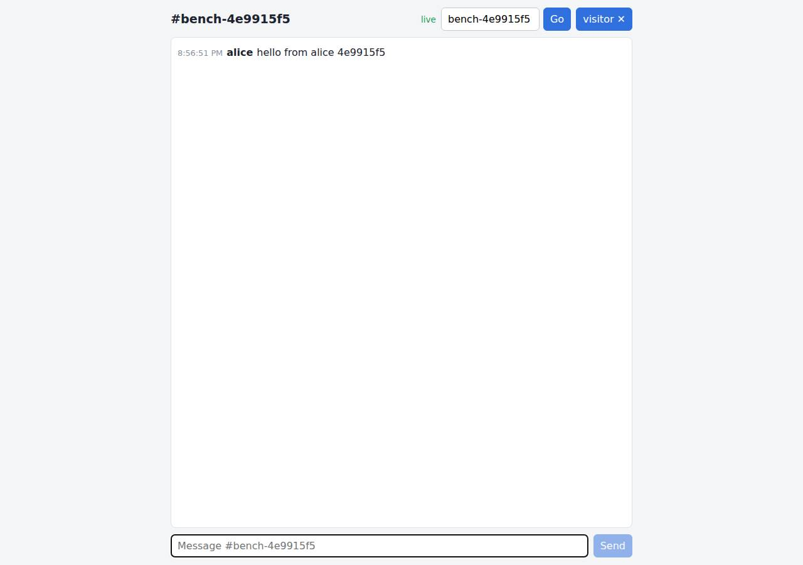

# ✅ Real-Time Collaborative App on Vercel with Opus 5.5 (trial 1)

**success**: 13/13 checks passed (100%).

- URL: https://adb-4beic-realtime-web.vercel.app (from deployment.json)
- Estimated hosting: Light use: $0.00/month, Busy: $20.00/month (the agent estimated $0.00)
- Agent: Claude Code 2.1.296, model `claude-opus-5-5`, effort medium, HIPAA organization
- Resource prefix: `adb-4beic-realtime`

| | Build | Deploy | Total |
|---|---|---|---|
| Status | completed | completed | |
| Time | 3m 05s | 4m 49s | 24m 39s |
| Turns | 14 | 11 | |
| Tokens | 564.3K | 1.51M | 6.14M |
| Agent cost | $0.55 | $0.48 | $3.14 |
| Shell commands | 13 | 10 | |

App answered 0s after the agent finished deploying.

**Needed a human:** the no-credentials attempt didn't produce a working public URL, so the cloud's credentials were provided and the agent redeployed (that attempt took 16m 46s, 4.07M tokens, $2.11).

## Screenshots

**The room the verifier's clients chatted in, with its history** (https://adb-4beic-realtime-web.vercel.app/?room=bench-4e9915f5)

## What was built

- Runtime: Node.js
- Frameworks: Next.js, React
- Libraries: ws, Upstash Redis SDK, Vercel Functions helpers
- Hosting: Vercel project (Next.js), Vercel Functions
- Code: 836 lines in 15 files (JavaScript 818, Markdown 39, JSON 32, CSS 18)
- Dependencies: 6 npm, 0 Python
- Deploy config: none

### Stack fit

**60/100**, from the same independent review, judged against the app's requirements rather than a preferred stack.

The stack (Next.js 16, Vercel Functions WebSockets and SSE) is a reasonable fit, and STACK.md explains the choice. The build departed from its preferred Redis Streams store and fell back to an eviction-capable Runtime Cache, held together by a complex multi-instance merge scheme, which hurts both durability and simplicity.

| Criterion | Weight | Score | Rationale |
|---|---|---|---|
| Fit for the job | 40 | 6/10 | Next.js on Vercel Functions with native WebSockets and SSE suits the realtime and UI needs. However, persistent history lives in Vercel Runtime Cache, which can evict entries, because Upstash Redis was blocked on a human accepting Marketplace terms. |
| Proportion | 30 | 5/10 | Working around a cache with no atomic append took a lot of code: per-instance logs, 16 registry slots, verified writes and merge-on-read. The app also keeps three interchangeable backends. A small durable store would have been far simpler. |
| Platform fit | 30 | 7/10 | It uses Vercel well: Fluid compute WebSockets via @vercel/functions, streaming responses, a 300 s maxDuration with client reconnect, and a static prerendered page. But each instance polls the shared store every 250 ms, which keeps functions busy and works against per-request billing. |

## Human steps

2 step(s), about 5 min of a person's time.

- **Sign up for an account and verify the email address** (~3 min): prerequisite: account setup
- **Create an API token and hand it to the agent** (~2 min): prerequisite: account setup

Reported but not needed, since the deployment worked without them: Optional: in a browser, accept the Upstash Marketplace terms for team ai-deploy-bench (https://vercel.com/ai-deploy-benc

## Security and compliance review

**82/100**, from an independent Claude Code review (`claude-opus-5-5`, high effort, HIPAA organization, $0.45) of the process, the code, the hosting plan and the live app.

The club chat app runs on a Vercel Hobby project, which suits personal use, and is served only over HTTPS with platform HSTS. It needs no secrets, and the live site exposes no source files, env files or stack traces. The main weaknesses are a short-lived OIDC token uploaded by the first two deploys (the agent caught it and deleted them), CLI deploys with caret-ranged dependencies, missing CSP and frame headers, and no rate limiting on the public chat endpoints.

| Criterion | Weight | Score | Rationale |
|---|---|---|---|
| Secrets handling | 25 | 8/10 | The app needs no secrets and reads optional Redis credentials only from env vars. However, `vercel link` wrote a VERCEL_OIDC_TOKEN into .env.local, and the first two production deploys uploaded it. The agent noticed, deleted the file, added a .vercelignore for .env*, redeployed and deleted both affected deployments. The token is short-lived and was only visible to the team. |
| Deployment provenance | 20 | 7/10 | Production runs a Vercel remote build of the agent's local sources, pushed with `vercel deploy --prod` from the CLI. There is no git-linked source of record. Dependencies use caret ranges in package.json, though a package-lock.json was present in the uploaded directory. |
| Terms compliance | 15 | 9/10 | A Hobby plan fits a personal or club app, and the features used (Fluid compute functions, native WebSockets, Runtime Cache) are available on Hobby. One minor point: chat history depends on an eviction-capable cache rather than a durable store. |
| Least privilege | 15 | 9/10 | There are no databases or extra public resources, and the Runtime Cache is reachable only from the project's functions. The chat endpoints are public, which the spec intends. Nothing over-privileged was found. |
| Transport security | 10 | 8/10 | HTTP returns 308 to HTTPS, and Vercel adds a valid certificate and HSTS with preload. CSP, X-Content-Type-Options and frame-protection headers are missing; next.config.mjs could have set them. |
| Attack surface | 10 | 10/10 | Probes of /.env, /.env.local, /.git/config, /package.json, /.vercel/project.json and lib sources all return 404, and source maps return 403. /_src redirects to Vercel's login-protected source viewer. Error responses are terse JSON with no stack traces. |
| Application security | 5 | 7/10 | Room names, user names and message lengths are strictly validated (400 over HTTP, error frames over WebSocket). React escapes output, so the stored HTML payload is harmless. There is no rate limiting or flood protection on the public POST and WebSocket endpoints, and anyone can create any number of rooms. |

Findings:

- **low** · deployment · Vercel OIDC token uploaded with the first two production deployments: process/deploy.md: `vercel link` output '✓ Created .env.local file' (Downloading a fresh VERCEL_OIDC_TOKEN), followed by `vercel deploy --prod` before any .vercelignore existed. The agent then ran `rm -f .env.local`, wrote .vercelignore with `.env*`, and called DELETE /v13/deployments for dpl_CjEWBfdr4wCGVSVgpSk2e6LUjvNd and dpl_BYrvo1o48LDXJdtWBcc7GtbgnA9t, which returned state DELETED. Fix: Create .vercelignore (or rely on .gitignore and git deploys) before the first deploy, so CLI-generated .env files are never uploaded.
- **low** · deployment · CLI deploy from a local directory with caret-ranged dependencies: process/deploy.md: `npx vercel deploy --prod --yes ...`, with no git repository linked. app/package.json uses `next ^16.4.3`, `@vercel/functions ^3.10.3`, `ws ^8.22.0` and similar caret ranges. Fix: Deploy from a git repository the owner controls, commit package-lock.json, and pin exact versions.
- **low** · app · Missing CSP, X-Content-Type-Options and frame-protection headers: `curl -sI https://adb-4beic-realtime-web.vercel.app/` shows strict-transport-security but no content-security-policy, x-content-type-options or x-frame-options. app/next.config.mjs defines no headers(). Fix: Add a headers() block in next.config.mjs that sets CSP, `X-Content-Type-Options: nosniff` and `frame-ancestors 'none'` (or X-Frame-Options: DENY).
- **low** · app · No rate limiting on public message endpoints: app/app/api/rooms/[room]/[action]/route.js postMessage and the app/app/ws/route.js message handler append every valid message with no per-client throttle. Any room matching /^[A-Za-z0-9_-]{1,64}$/ is created on demand (lib/validate.js:1). Fix: Add basic per-IP or per-connection throttling (for example with Vercel Firewall rate-limit rules or a counter in the store), and cap message rate per WebSocket.
- **info** · app · HTML in messages is stored verbatim but rendered safely: POST /api/rooms/review1793048265/messages with text `` returned 201 and was returned unchanged by GET. app/app/page.js has no innerHTML or dangerouslySetInnerHTML, so React escapes it. Fix: No change needed; keep rendering message text as React text nodes.
- **info** · deployment · Chat history kept in an eviction-capable cache: process/deployment.json notes: 'Messages are stored in Vercel Runtime Cache with a 7-day TTL and can be evicted'. lib/store.js runtimeCacheStore() sets ttl 7*24*3600. Fix: Complete the listed human step to attach Upstash Redis (or another durable store), so history doesn't depend on cache retention.

## Checks

| Check | Required | Result | Detail |
|---|---|---|---|
| GET / answers 2xx within 1 min | yes | passed |  |
| The app is served over HTTPS with a valid certificate | yes | passed |  |
| The app is public: no redirect to another host such as a login page | yes | passed |  |
| GET / serves the chat UI as HTML | yes | passed |  |
| deployment.json declares a supported transport (websocket or sse) | no | passed |  |
| Clients connect over websocket | yes | passed |  |
| A message reaches another client in the same room within 5 s | yes | passed |  |
| The sender receives its own message too | no | passed |  |
| Messages never reach clients in other rooms | yes | passed |  |
| Five users posting at the same time all see every message within 10 s | yes | passed |  |
| GET /api/rooms/<room>/messages returns recent messages | yes | passed |  |
| Messages over 1000 characters are rejected | no | passed |  |
| The chat UI loads in a browser without errors | no | passed |  |

## Cloud resources

| Traffic | $/month | How it was priced |
|---|---|---|
| Light use | $0.00 | within Hobby's included usage |
| Busy | $20.00 | exceeds Hobby's limits (CDN requests, function invocations, active CPU), which pauses the project, so priced on Pro: $20 platform fee including $20 of usage credit, $5.75 of usage |

Each resource's list price, at the size it was provisioned and always on:

| Kind | Name | Plan | $/month | How it was priced |
|---|---|---|---|---|
| project | adb-4beic-realtime-web | — | $0.00 | no fixed fee; usage within the plan's included allowance |

Teardown: 1 deleted

## Agent's deploy summary

> The chat app is live at **https://adb-4beic-realtime-web.vercel.app** on the free Hobby plan, and everything in `TASK.md` works through that URL. Estimated cost is $0/month.
>
> **What's deployed**
> - **Project:** `adb-4beic-realtime-web` (`prj_EZN24xIpacHmGrLNh6ARubFPdY8R`), a Next.js app on Vercel Functions.
> - **Real-time:** WebSockets at `wss://adb-4beic-realtime-web.vercel.app/ws?room=…&user=…`, recorded in `deployment.json` as `websocket`. The SSE endpoints and the history API are live too.
> - **Message store:** Vercel's built-in Runtime Cache, shared by all function instances with no setup.
> - **Connection length:** with Hobby's 300 s function limit, WebSockets now last up to 300 s and SSE streams 280 s, up from 60 s on the temporary deployment. The web page reconnects and resumes on its own.
>
> **Tested through the public URL**
> - **Integration tests:** all 7 pass. They cover message shape, the 50-message history cap, `400` on invalid input, WebSocket error replies, concurrent sends, room isolation, and delivery within 2 s.
> - **Stress test:** 40 senders at once with 7 listeners lost no messages and kept complete history. The worst delivery was 1.2–1.3 s from send, mostly POST cold starts.
> - **Browser test:** another user saw a message in about 0.3 s, a late joiner saw the history, and a different room didn't receive it.
> - **Long connection:** a WebSocket stayed open and still received a message after 90 s.
>
> **What didn't work**
> - **Upstash Redis:** installing it requires accepting the Marketplace terms in a browser. I listed it under `human_steps` as non-blocking, because everything already works without it. Until then, history sits in a cache that keeps messages for 7 days and can evict them sooner, rather than in a database.
> - **Token cleanup:** `vercel link` wrote an OIDC token into `.env.local`, which the first two production deploys may have uploaded. I deleted the file, added a `.vercelignore` that excludes `.env*`, redeployed, and deleted those two deployments.
>
> `.env` holds only the project ID, name and URL; I created no new credentials. The earlier temporary deployment was never claimed and expires on its own.

## Shell commands during deploy

- `9s` `test -n "$VERCEL_TOKEN" && echo token-set; echo team=$VERCEL_TEAM_ID; npx vercel whoami --token "$VERCEL_TOKEN" 2>&1 | tail -1; curl -s -H "Authorization: Bearer $VERCEL_TOKEN" "https://api.vercel.com`
- `15s` `rm -rf .vercel .next && export VERCEL_ORG_ID=; npx vercel link --yes --project adb-4beic-realtime-web --scope "$VERCEL_TEAM_ID" --token "$VERCEL_TOKEN" 2>&1 | tail -3; cat .vercel/project.json; echo; `
- `1m 03s` `U=https://adb-4beic-realtime-web.vercel.app; curl -s -o /dev/null -w "%{http_code}\n" $U/; BASE_URL=$U npm test 2>&1 | grep -E "^(✖|ℹ (pass|fail))|latency|rror"; node /tmp/stress/stress.mjs $U | grep `
- `1m 26s` `npx vercel integration --help --token "$VERCEL_TOKEN" 2>&1 | sed -n 1,40p`
- `1m 32s` `T="--token $VERCEL_TOKEN --scope $VERCEL_TEAM_ID"; npx vercel integration installations $T 2>&1 | tail -8; npx vercel integration add upstash/upstash-kv --name adb-4beic-realtime-redis --plan free $T `
- `1m 48s` `sed -i 's/export const maxDuration = 60;/export const maxDuration = 300;/' app/ws/route.js "app/api/rooms/[room]/[action]/route.js" && sed -i 's/SSE_STREAM_MS || 55_000/SSE_STREAM_MS || 280_000/' "app`
- `2m 11s` `U=https://adb-4beic-realtime-web.vercel.app; cat > /tmp/stress/long.mjs <<'EOF'`
- `3m 51s` `rm -f .env.local && printf '.env*\n.vercel\nnode_modules\n.next\ntest\n' > .vercelignore && printf 'VERCEL_PROJECT_ID=prj_EZN24xIpacHmGrLNh6ARubFPdY8R\nVERCEL_PROJECT_NAME=adb-4beic-realtime-web\nVERC`
- `4m 26s` `for d in dpl_CjEWBfdr4wCGVSVgpSk2e6LUjvNd dpl_BYrvo1o48LDXJdtWBcc7GtbgnA9t; do curl -s -X DELETE -H "Authorization: Bearer $VERCEL_TOKEN" "https://api.vercel.com/v13/deployments/$d?teamId=$VERCEL_TEAM`
- `4m 40s` `sed -i 's/close after about 55–60 s/close at the function duration limit (SSE after 280 s, WebSockets at the 300 s maxDuration on Hobby + Fluid compute)/; s/Function duration is capped at 60 s on the `
