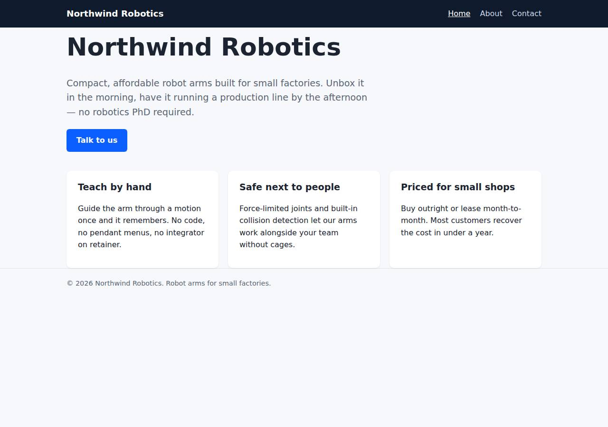
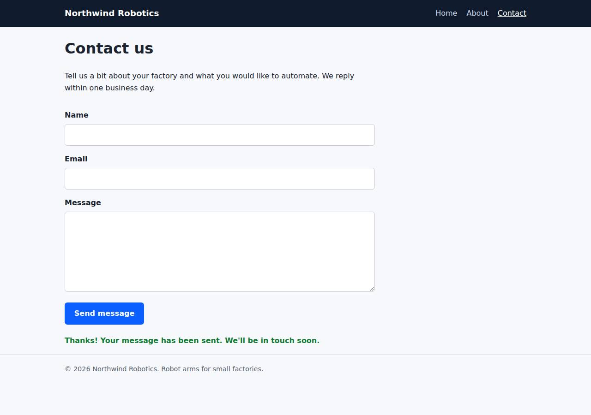

# ✅ Static Content Site on Vercel with Opus 5.5 (trial 1)

**success**: 16/16 checks passed (100%).

- URL: https://adb-8kbz7-static-web.vercel.app (from deployment.json)
- Estimated hosting: Light use: $20.00/month, Busy: $20.00/month (the agent estimated $0.00)
- Agent: Claude Code 2.1.296, model `claude-opus-5-5`, effort medium, HIPAA organization
- Resource prefix: `adb-8kbz7-static`

| | Build | Deploy | Total |
|---|---|---|---|
| Status | completed | completed | |
| Time | 1m 31s | 1m 02s | 5m 06s |
| Turns | 10 | 6 | |
| Tokens | 379.5K | 391.0K | 1.64M |
| Agent cost | $0.35 | $0.34 | $1.10 |
| Shell commands | 9 | 5 | |

App answered 0s after the agent finished deploying.

**Needed a human:** the no-credentials attempt didn't produce a working public URL, so the cloud's credentials were provided and the agent redeployed (that attempt took 2m 34s, 865.6K tokens, $0.40).

## Screenshots

**The home page** (https://adb-8kbz7-static-web.vercel.app/)

**The contact page after the verifier submitted the form** (https://adb-8kbz7-static-web.vercel.app/contact)

## What was built

- Runtime: Node.js 18+
- Frameworks: Plain Vercel Functions
- Packaging: vercel.json
- Hosting: Vercel project, Vercel Functions
- Code: 406 lines in 19 files (JavaScript 189, HTML 160, Shell 29, CSS 28, Markdown 26, JSON 26)
- Dependencies: 0 npm, 0 Python
- Deploy config: `vercel.json`

### Stack fit

**100/100**, from the same independent review, judged against the app's requirements rather than a preferred stack.

Plain static files plus one Vercel Node function is the minimal, native way to meet the spec on Vercel, and STACK.md reasons about it soundly and was followed exactly.

| Criterion | Weight | Score | Rationale |
|---|---|---|---|
| Fit for the job | 40 | 10/10 | Static HTML/CSS on the CDN suits the three pages, a small Node function suits the one validation endpoint, and cleanUrls gives the required paths and 404 handling. Nothing needs to persist, so the lack of a data store is correct. |
| Proportion | 30 | 10/10 | There is no framework, build step or npm dependency, just about 40 lines of function code. The only extra, dev-server.js, is a local-only helper that is never deployed. |
| Platform fit | 30 | 10/10 | The stack uses what Vercel does natively: CDN static output, a file-based serverless function under api/, and cleanUrls in vercel.json. app/STACK.md weighs the alternatives soundly, and the build follows it exactly. |

## Human steps

2 step(s), about 5 min of a person's time.

- **Sign up for an account and verify the email address** (~3 min): prerequisite: account setup
- **Create an API token and hand it to the agent** (~2 min): prerequisite: account setup

## Security and compliance review

**78/100**, from an independent Claude Code review (`claude-opus-5-5`, high effort, HIPAA organization, $0.30) of the process, the code, the hosting plan and the live app.

Northwind Robotics was built cleanly as plain static files plus one dependency-free Vercel function, deployed with no secrets leaked and nothing exposed beyond the public site. Its main problem is compliance: a commercial site is hosted on a Hobby team, whose terms allow only non-commercial use. The other findings are minor: missing CSP, nosniff and frame-protection headers, an unpinned `vercel@latest` CLI in the redeploy script, and no rate limiting on the contact endpoint.

| Criterion | Weight | Score | Rationale |
|---|---|---|---|
| Secrets handling | 25 | 9/10 | The Vercel token was only ever referenced as $VERCEL_TOKEN and never printed. .env, .env.* and the .env.local that `vercel link` created are excluded by .vercelignore/.gitignore, and the app needs no runtime secrets. One minor issue: the deploy script passes the token as a --token argument, so it shows up in the local process list. |
| Deployment provenance | 20 | 8/10 | The app has zero npm dependencies and no build step, and the deployment was uploaded straight from the reviewed source with the Vercel CLI, so production matches the code. Deploys come from a local directory rather than a tracked repo, though, and scripts/deploy.sh runs the unpinned `npx -y vercel@latest`. |
| Terms compliance | 15 | 2/10 | process/context.json says use is commercial, but the team is on Vercel's Hobby plan. Hobby is limited to personal, non-commercial use under Vercel's fair-use terms, so this business marketing site needs a Pro plan. The agent wrongly described the plan as fitting within Hobby limits. |
| Least privilege | 15 | 10/10 | Only one project with static files and one stateless function was created, with no data stores or extra services. Per-deployment preview URLs stay behind Vercel Authentication, and only the production alias, which has to be public, is open. |
| Transport security | 10 | 8/10 | HTTP returns a 308 redirect to HTTPS, and the platform adds HSTS with preload. The agent did not set CSP, X-Content-Type-Options or frame-protection headers, although vercel.json supports a headers block. |
| Attack surface | 10 | 10/10 | Only public/ is served. Requests for .env, .env.local, .git/config, package.json, vercel.json, README.md, lib/ and .vercel/ all return 404, and errors return no stack traces. |
| Application security | 5 | 8/10 | Input is type-checked and validated on the server, invalid JSON gets a clean 400, the client writes status text with textContent (no XSS), and the platform caps body size (413). There is no rate limiting or per-field length limit, and the endpoint also accepts cross-origin text/plain bodies. |

Findings:

- **high** · deployment · Commercial site hosted on Vercel Hobby (non-commercial) plan: process/context.json: use=commercial, team_plans.team_U2tHOV4fpUx18nl9EpcRQ4hO=hobby; process/deployment.json plan: "Team's existing plan; usage fits within free/Hobby limits" Fix: Move the project to a Vercel Pro (or Enterprise) team before using it for a business, or host it on a plan whose terms allow commercial use.
- **low** · app · No CSP, X-Content-Type-Options or frame-protection headers: curl -sI https://adb-8kbz7-static-web.vercel.app/ returns only strict-transport-security among security headers; app/vercel.json has no headers block Fix: Add a `headers` entry in vercel.json setting Content-Security-Policy (default-src 'self'; frame-ancestors 'none'), X-Content-Type-Options: nosniff and Referrer-Policy.
- **low** · deployment · Unpinned Vercel CLI and deploys from a local directory: app/scripts/deploy.sh: `npx -y vercel@latest link ...` / `npx -y vercel@latest deploy --prod`; deploy.md runs `vercel deploy --prod` from the working directory with no git source Fix: Pin the CLI version (e.g. vercel@<x.y.z>) and deploy from a version-controlled repo through Vercel's Git integration or CI.
- **low** · app · Contact endpoint has no rate limiting or field length limits: app/api/contact.js and app/lib/validate.js check only presence and format; POST with Content-Type text/plain from any origin returns {"ok":true}; a 5 MB body is rejected only by the platform (413) Fix: Limit field lengths (e.g. message ≤ 5000 chars), require Content-Type application/json, and add rate limiting (Vercel Firewall rules or a KV-based limiter) if submissions are ever acted on.
- **info** · deployment · Token passed as a CLI argument: app/scripts/deploy.sh: `--token "$VERCEL_TOKEN"`; deploy.md line 35 uses the same pattern Fix: Export VERCEL_TOKEN in the environment (the CLI reads it directly) instead of passing --token, so the token stays out of the process list.
- **info** · platform · Static assets served with Access-Control-Allow-Origin: *: curl -sI https://adb-8kbz7-static-web.vercel.app/ -> access-control-allow-origin: * Fix: No action needed for public marketing content. This is Vercel's default for static files.

## Checks

| Check | Required | Result | Detail |
|---|---|---|---|
| GET / answers 2xx within 1 min | yes | passed |  |
| The app is served over HTTPS with a valid certificate | yes | passed |  |
| The app is public: no redirect to another host such as a login page | yes | passed |  |
| GET / returns HTML | yes | passed |  |
| GET /about returns HTML | yes | passed |  |
| GET /contact returns HTML | yes | passed |  |
| Home has an <h1> containing 'Northwind Robotics' | yes | passed |  |
| About has a heading containing 'About' | yes | passed |  |
| Contact has a form with name, email and message fields | yes | passed |  |
| Every page has a <title> and a viewport meta tag | no | passed |  |
| Home links to /about and /contact | no | passed |  |
| POST /api/contact with valid input returns {ok: true} | yes | passed |  |
| POST /api/contact rejects a bad email and an empty message with 400 | yes | passed |  |
| Unknown paths return 404 | yes | passed |  |
| Submitting the /contact form in a browser posts to /api/contact without leaving the page | yes | passed |  |
| Pages load in a browser without uncaught JavaScript errors | no | passed |  |

## Cloud resources

| Traffic | $/month | How it was priced |
|---|---|---|
| Light use | $20.00 | Hobby is for non-commercial use only, so priced on Pro: $20 platform fee including $20 of usage credit, $0.00 of usage |
| Busy | $20.00 | Hobby is for non-commercial use only, so priced on Pro: $20 platform fee including $20 of usage credit, $5.75 of usage |

Each resource's list price, at the size it was provisioned and always on:

| Kind | Name | Plan | $/month | How it was priced |
|---|---|---|---|---|
| project | adb-8kbz7-static-web | — | $0.00 | no fixed fee; usage within the plan's included allowance |

Teardown: 1 deleted

## Agent's deploy summary

> The site is live at **https://adb-8kbz7-static-web.vercel.app**, and every requirement in `TASK.md` passes through that public URL.
>
> **What I deployed:** one Vercel project, `adb-8kbz7-static-web` (`prj_mWDYqfvhOg8eVgXAhRMXPwxfvvNl`), in the team you gave me. The production deployment is `dpl_CtapK5cXoAwdVSr4dh9f9jP6xQ6B`. The pages are served as static files and `/api/contact` runs as a Node.js function. It has no database, no extra services and no build step, and it should cost $0 a month.
>
> **Tests against the public URL:**
> - `/`, `/about` and `/contact` return 200 with `text/html`, a title, the viewport tag and navigation.
> - Unknown paths return 404, and `/about.html` redirects to `/about`.
> - `POST /api/contact` returns 200 `{"ok":true}` for valid input. It returns 400 with an error message for a missing name, an invalid email, an empty message or bad JSON.
> - In a headless Chromium browser at phone width, the form submitted and showed the confirmation without reloading the page.
>
> **Things to know:**
> - Each deployment's own long URL (`adb-8kbz7-static-bn86emf2i-…vercel.app`) is behind the project's default Vercel login. Use the address above, which is public.
> - Running `vercel link` created a `.env.local` file. It's excluded from git and from deploy uploads. I didn't create any new credentials, so `.env` is empty.
> - To redeploy, run `scripts/deploy.sh`; it reads the token and team ID from the environment or `.env`. To re-check a URL, run `scripts/smoke.sh <url>`.
>
> Nothing failed, so `human_steps` in `deployment.json` is empty.

## Shell commands during deploy

- `8s` `[ -n "$VERCEL_TOKEN" ] && echo token set; echo team=${VERCEL_TEAM_ID:+set}; vercel whoami --token "$VERCEL_TOKEN" 2>&1 | tail -1; ls -a`
- `15s` `S="--token $VERCEL_TOKEN --scope $VERCEL_TEAM_ID" && vercel project add adb-8kbz7-static-web $S 2>&1 | tail -2; vercel link --yes --project adb-8kbz7-static-web $S 2>&1 | tail -2; cat .vercel/project.`
- `32s` `bash scripts/smoke.sh https://adb-8kbz7-static-web.vercel.app; curl -s https://adb-8kbz7-static-web.vercel.app/about.html -o /dev/null -w "about.html %{http_code} %{redirect_url}\n"; curl -s -XPOST ht`
- `39s` `mkdir -p /tmp/pw && cd /tmp/pw && npm i -s playwright@latest >/dev/null 2>&1 && npx playwright install chromium >/dev/null 2>&1 && cat > t.mjs <<'EOF'`
- `54s` `sed -i 's#^npx -y vercel@latest link.*#npx -y vercel@latest link --yes --project adb-8kbz7-static-web --token "$VERCEL_TOKEN" $SCOPE >/dev/null#; s#VERCEL_SCOPE:+--scope $VERCEL_SCOPE#VERCEL_TEAM_ID:+`
