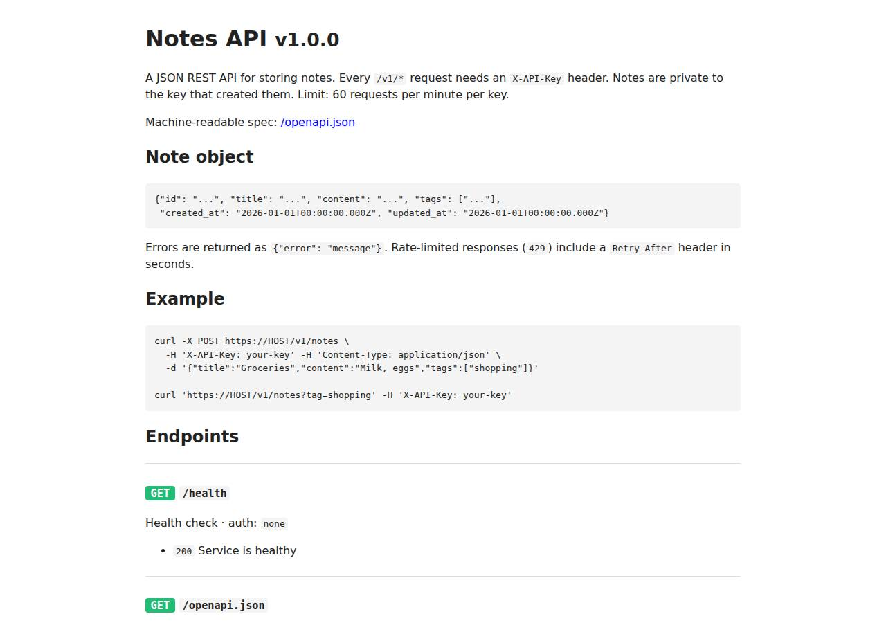

# ✅ API / Backend Service on Cloudish with Opus 5.5 (trial 1)

**success**: 20/20 checks passed (100%).

- URL: https://adb-tqjj6-api.cloudish.app (from deployment.json)
- Estimated hosting: Light use: $0.11/month, Busy: $7.84/month (the agent estimated $1.00)
- Agent: Claude Code 2.1.296, model `claude-opus-5-5`, effort medium, HIPAA organization
- Resource prefix: `adb-tqjj6-api`

| | Build | Deploy | Total |
|---|---|---|---|
| Status | completed | completed | |
| Time | 2m 23s | 4m 14s | 6m 37s |
| Turns | 13 | 18 | |
| Tokens | 467.7K | 1.17M | 1.63M |
| Agent cost | $0.52 | $0.53 | $1.06 |
| Shell commands | 9 | 17 | |

App answered 0s after the agent finished deploying.

**Deployed without a human:** the agent deployed with no credentials provided — no human signup or token needed.

## Screenshots

**The API documentation at /docs** (https://adb-tqjj6-api.cloudish.app/docs)

## What was built

- Runtime: Node.js 24
- Frameworks: Node.js http module (built in)
- Data: SQLite (on a persistent volume)
- Packaging: Docker (node:24-alpine)
- Hosting: Cloudish container (shared) with a persistent volume
- Code: 577 lines in 12 files (JavaScript 558, Markdown 41, JSON 25, Shell 12, Docker 7)
- Dependencies: 0 npm, 0 Python
- Deploy config: `Dockerfile`, `.dockerignore`

### Stack fit

**93/100**, from the same independent review, judged against the app's requirements rather than a preferred stack.

Node 24 with built-in HTTP and SQLite on a persistent volume is a lean, well-reasoned fit for a low-traffic personal notes API on a container platform without a managed database, and STACK.md's reasoning matches what was built.

| Criterion | Weight | Score | Rationale |
|---|---|---|---|
| Fit for the job | 40 | 9/10 | Node 24's built-in http and node:sqlite in WAL mode on Cloudish's persistent volume give a real durable database, and the agent verified it survives a redeploy. In-process rate limiting is exact with a single replica. node:sqlite still prints an experimental warning, which the agent suppressed. |
| Proportion | 30 | 10/10 | There are zero npm dependencies, one small service and a hand-written OpenAPI document with static docs. This is as simple as the requirements allow, with no stand-in data store. |
| Platform fit | 30 | 9/10 | This uses what Cloudish offers: a server-side Dockerfile build, a small shared container that sleeps when idle and wakes fast for light traffic, and the attached volume for SQLite. One trap, a redeploy without the volume fields detaching the volume, was caught and fixed in deploy.sh. |

## Human steps

None: the agent needed no human setup at all.

Reported but not needed, since the deployment worked without them: Claim the Cloudish key adb-tqjj6-api (mint a link with GET https://cloudish.ai/api/v1/credits/claim using CLOUDISH_API_K

## Security and compliance review

**82/100**, from an independent Claude Code review (`claude-opus-5-5`, high effort, HIPAA organization, $0.43) of the process, the code, the hosting plan and the live app.

A clean, minimal Notes API. Secrets were handled correctly: API_KEYS is in Cloudish's encrypted secret store, the Cloudish key is in a 0600 .env excluded from every upload, and nothing leaked into logs. The live app exposes nothing beyond its endpoints and is HTTPS-only with a valid certificate. The main weaknesses are the container running as root (USER node was deliberately removed), an unpinned base image deployed from a local tarball, missing app-set security headers, and hosting that depends on a free credit that runs out after about 9 awake hours unless the owner funds it.

| Criterion | Weight | Score | Rationale |
|---|---|---|---|
| Secrets handling | 25 | 10/10 | API_KEYS was piped from the environment over stdin into Cloudish's encrypted secret store and never printed. The Cloudish key was written to a 0600 .env with the claim URL removed from output, and every build context excluded it. No secrets are in the source or the image. |
| Deployment provenance | 20 | 8/10 | Cloudish builds the image server-side from the uploaded Dockerfile and source, and the app has no npm dependencies. The base image is the floating tag node:24-alpine with no digest, and the build context is a local tarball rather than a versioned repository. |
| Terms compliance | 15 | 7/10 | Prepaid Cloudish credits fit personal use, as far as I know its terms; I'm not aware of any non-commercial or other use restriction. Sleep-on-idle with fast wake suits a few friends' scripts. But the 0.1 free credit (about $0.098 left) lasts about 9 hours of awake time, after which the app stops with 402. The agent listed topping up as a non-blocking step, though the app can't stay up without it. |
| Least privilege | 15 | 6/10 | The SQLite database lives on a private attached volume and the only public surface is the API, which the task needs. But the agent deliberately removed `USER node` from the Dockerfile, so the container runs as root. |
| Transport security | 10 | 8/10 | HTTPS works with a valid Let's Encrypt wildcard certificate, HTTP gets a 308 redirect to HTTPS, and the platform adds HSTS. The app sets none of X-Content-Type-Options, frame protection or CSP, though it easily could have. |
| Attack surface | 10 | 9/10 | Probes for .env, .git, source files, the Dockerfile, the database file and admin/debug paths all return JSON 404s, with no directory listings or stack traces. The only nit is that HEAD /docs returns 404 while GET works. |
| Application security | 5 | 8/10 | Queries are parameterized, notes are scoped by a hash of the owning key (cross-key access gets 404), input types are validated, bodies are capped at 1 MB and the docs page is static. Minor gaps: failed-auth requests have no rate limit, field and tag sizes are bounded only by the body cap, and a malformed percent-encoded note id would give a 500 rather than a 400/404. |

Findings:

- **medium** · deployment · Container runs as root: app/Dockerfile has no USER instruction. process/build.md line 109 runs `sed -i '/^RUN mkdir/d;/^USER node/d' Dockerfile`, and build.md line 233 says: 'the image runs as root so it can always write to the mounted volume'. Fix: Run as the node user. Fix the volume's ownership at startup (for example a tiny entrypoint that chowns /data and then drops privileges) or use the platform's fsGroup/volume-ownership option if it has one.
- **medium** · deployment · Hosting depends on a tiny free credit that runs out within hours: process/context.json shows balance_usd 0.098084. process/deployment.json human_steps says the 0.1 credits 'cover only about 9 hours of awake time. When the balance reaches zero the app returns 402 and stops', yet marks the step blocking: false. Fix: Have the owner claim the key and fund it before relying on the API, and flag this step as needed for the app to keep running.
- **low** · deployment · Base image not pinned by digest: app/Dockerfile line 1: `FROM node:24-alpine` Fix: Pin the image as node:24-alpine@sha256:<digest> and update it on purpose.
- **low** · deployment · Deployed from a local tarball, not a versioned source: app/deploy.sh tars the working directory and POSTs it as `context=@/tmp/context.tar.gz`. There is no git commit or tag tied to the deployed image registry.do.cloudish.ai/builds/205. Fix: Keep the source in a repository the owner controls and deploy from a tagged commit, recording the commit in the build.
- **low** · app · Missing security response headers: GET https://adb-tqjj6-api.cloudish.app/docs returns only content-type, content-length and strict-transport-security (HSTS is added by the platform). There is no X-Content-Type-Options, X-Frame-Options/frame-ancestors or Content-Security-Policy. Fix: Add `X-Content-Type-Options: nosniff`, `Content-Security-Policy: default-src 'none'; style-src 'unsafe-inline'; frame-ancestors 'none'` and `X-Frame-Options: DENY` in send() in src/app.js.
- **low** · app · No throttling of unauthenticated or invalid-key requests: src/app.js authenticate() throws 401 before the limiter runs, so only valid keys are rate limited. `curl -H 'X-API-Key: nope' /v1/notes` returns 401 `{"error":"Invalid API key"}` with no rate-limit headers. Fix: Add a coarse per-IP limit on failed authentication to slow key guessing and abuse.
- **low** · app · No size limits on title, content or tags: src/app.js validate() checks only types and a non-empty title. MAX_BODY_BYTES = 1 MB is the only bound, so a key can store about 60 MB/min on the 1 GB volume. Fix: Cap the title and content lengths and the number and length of tags, and consider a per-key storage quota.
- **info** · app · Malformed percent-encoding in note id yields 500: src/app.js handleNotes: `decodeURIComponent(parts[2])` throws URIError for ids like %E0, which the outer handler turns into 500 'Internal server error'. This is reachable only with a valid key; unauthenticated it returns 401. Fix: Wrap decodeURIComponent in try/catch and return 404.
- **info** · app · HEAD /docs returns 404: `curl -I https://adb-tqjj6-api.cloudish.app/docs` returns HTTP/2 404, while GET returns 200 (src/app.js handle() allows only GET). Fix: Accept HEAD for /docs and /openapi.json, as /health already does.

## Checks

| Check | Required | Result | Detail |
|---|---|---|---|
| GET /health answers 2xx within 1 min | yes | passed |  |
| The app is served over HTTPS with a valid certificate | yes | passed |  |
| The app is public: no redirect to another host such as a login page | yes | passed |  |
| GET /health returns {status: ok} | yes | passed |  |
| GET /openapi.json is an OpenAPI 3 document covering /v1/notes | yes | passed |  |
| GET /docs serves human-readable documentation | no | passed |  |
| Requests without an API key get 401 | yes | passed |  |
| Requests with an unknown API key get 401 | yes | passed |  |
| POST /v1/notes creates a note | yes | passed |  |
| Invalid notes are rejected with 400 | yes | passed |  |
| GET /v1/notes/{id} returns the note | yes | passed |  |
| GET /v1/notes lists notes and filters by tag | yes | passed |  |
| Notes are listed newest first | no | passed |  |
| PATCH /v1/notes/{id} updates only the given fields | yes | passed |  |
| Notes are private to the API key that created them | yes | passed |  |
| DELETE /v1/notes/{id} removes the note | yes | passed |  |
| Notes are still there a minute later | yes | passed |  |
| Exceeding 60 requests/minute returns 429 | yes | passed |  |
| 429 responses include a Retry-After header | no | passed |  |
| One key hitting its limit doesn't throttle other keys | yes | passed |  |

## Cloud resources

| Traffic | $/month | How it was priced |
|---|---|---|
| Light use | $0.11 | containers awake 10 h at their size's hourly rate; no bandwidth charges |
| Busy | $7.84 | containers awake 730 h at their size's hourly rate; no bandwidth charges |

Each resource's list price, at the size it was provisioned and always on:

| Kind | Name | Plan | $/month | How it was priced |
|---|---|---|---|---|
| project | adb-tqjj6-api | shared | $7.84 | 0.1 CPU / 0.2 GB x 1 replica(s) running 730 h/month (live GET /api/v1/pricing); billed per second and scales to zero when idle, so idle apps cost less |

Teardown: 1 deleted

## Agent's deploy summary

> The Notes API is live at **https://adb-tqjj6-api.cloudish.app**, and every requirement in `TASK.md` passed when I tested it through that URL. It runs on the free starting credits, which cover only about 9 hours of awake time, so someone will need to add credits for it to keep running.
>
> **What's deployed:**
> - **Account:** I created a Cloudish key, `adb-tqjj6-api`, with no signup needed; it's saved in `.env` (permissions 600, kept out of every upload).
> - **App:** project `adb-tqjj6-api`, built by Cloudish from the Dockerfile. It uses the smallest size (0.1 CPU, 0.2 GB) and sleeps after 15 minutes without requests. The next request wakes it in a few seconds.
> - **Data:** a 1 GB persistent volume holds the SQLite database at `/data/notes.db`.
> - **Keys:** `API_KEYS` is an encrypted Cloudish secret, set to exactly `BENCH_API_KEYS` (2 keys).
> - **Cost:** about $0.011 per hour while awake, so about $1/month with light use and about $7.84/month if it never slept. The volume is free.
>
> **What I tested publicly:** health, `/openapi.json`, `/docs`, the 401s, create/read/update/delete, the 400 validation errors, 404 for another key's notes, the tag filter, and newest-first order. Rate limiting worked: request 61 got 429 with `Retry-After`, while the other key still got 200. A note survived a full redeploy.
>
> **What went wrong along the way:** my second deploy left out the volume settings, and Cloudish turned the volume off. That deploy wrote to throwaway container storage, and a test note looked lost. I fixed it with `deploy.sh`, which always sends the volume settings and sets `DATABASE_PATH=/data/notes.db`. Use it for any future redeploy. The volume had kept the earlier note, and I deleted all test notes afterwards.
>
> **Limitations:**
> - Rate-limit counts are kept in memory, so they reset whenever the container restarts or wakes from sleep.
> - I listed one non-blocking human step in `deployment.json`: claim the key and add credits. When the balance hits zero the API answers 402 and stops, though the data on the volume is kept.

## Shell commands during deploy

- `3s` `cd /home/runner/work/_temp/adb-tqjj6-api; curl -s https://cloudish.ai/llms.txt | head -200; echo; echo "BENCH set: ${BENCH_API_KEYS:+yes}"`
- `6s` `curl -s https://cloudish.ai/skill.md`
- `12s` `cd /home/runner/work/_temp/adb-tqjj6-api; umask 077; R=$(curl -s -X POST https://cloudish.ai/api/v1/keys -H "content-type: application/json" -d '{"alias":"adb-tqjj6-api","agent":"claude-code","model":`
- `16s` `cd /home/runner/work/_temp/adb-tqjj6-api; source .env; tar --exclude='.env*' --exclude='.git' --exclude=data --exclude='*.db*' -czf /tmp/context.tar.gz . && tar -tzf /tmp/context.tar.gz`
- `21s` `cd /home/runner/work/_temp/adb-tqjj6-api; source .env; A="Authorization: Bearer $CLOUDISH_API_KEY"`
- `30s` `cd /home/runner/work/_temp/adb-tqjj6-api; source .env; A="Authorization: Bearer $CLOUDISH_API_KEY"`
- `33s` `cd /home/runner/work/_temp/adb-tqjj6-api; source .env; A="Authorization: Bearer $CLOUDISH_API_KEY"`
- `42s` `cd /home/runner/work/_temp/adb-tqjj6-api; source .env; A="Authorization: Bearer $CLOUDISH_API_KEY"`
- `1m 03s` `cd /home/runner/work/_temp/adb-tqjj6-api; H=https://adb-tqjj6-api.cloudish.app`
- `1m 10s` `H=https://adb-tqjj6-api.cloudish.app; echo "keys: $(echo "$BENCH_API_KEYS" | tr , '\n' | wc -l)"`
- `1m 17s` `cd /home/runner/work/_temp/adb-tqjj6-api; source .env; A="Authorization: Bearer $CLOUDISH_API_KEY"`
- `1m 54s` `cd /home/runner/work/_temp/adb-tqjj6-api; source .env; A="Authorization: Bearer $CLOUDISH_API_KEY"; H=https://adb-tqjj6-api.cloudish.app; ID=$(cat /tmp/noteid)`
- `2m 13s` `cd /home/runner/work/_temp/adb-tqjj6-api; source .env; A="Authorization: Bearer $CLOUDISH_API_KEY"`
- `2m 23s` `cd /home/runner/work/_temp/adb-tqjj6-api; source .env; A="Authorization: Bearer $CLOUDISH_API_KEY"`
- `3m 12s` `cd /home/runner/work/_temp/adb-tqjj6-api; source .env; A="Authorization: Bearer $CLOUDISH_API_KEY"; H=https://adb-tqjj6-api.cloudish.app`
- `3m 54s` `cd /home/runner/work/_temp/adb-tqjj6-api; source .env; H=https://adb-tqjj6-api.cloudish.app; IFS=, read -r K1 K2 <<< "$BENCH_API_KEYS"`
- `4m 05s` `cd /home/runner/work/_temp/adb-tqjj6-api; cat > deployment.json <<'EOF'`
