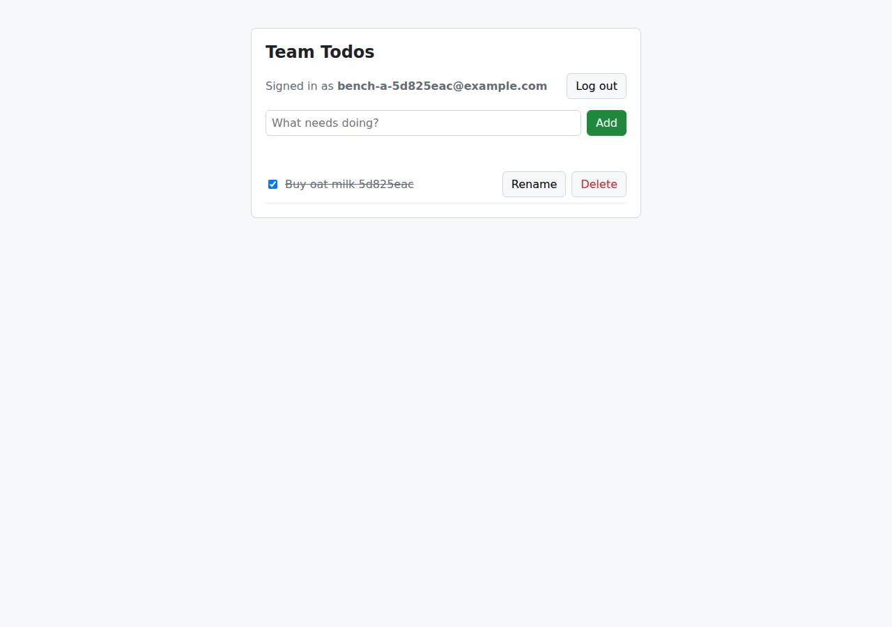

# ✅ Database-Backed CRUD App on Cloudish with Opus 5.5 (trial 1)

**success**: 19/19 checks passed (100%).

- URL: https://adb-nyvtk-crud-web.cloudish.app (from deployment.json)
- Estimated hosting: Light use: $0.11/month, Busy: $7.84/month (the agent estimated $7.84)
- Agent: Claude Code 2.1.296, model `claude-opus-5-5`, effort medium, HIPAA organization
- Resource prefix: `adb-nyvtk-crud`

| | Build | Deploy | Total |
|---|---|---|---|
| Status | completed | completed | |
| Time | 2m 07s | 4m 45s | 6m 52s |
| Turns | 11 | 17 | |
| Tokens | 406.7K | 1.05M | 1.45M |
| Agent cost | $0.45 | $0.53 | $0.97 |
| Shell commands | 9 | 16 | |

App answered 0s after the agent finished deploying.

**Deployed without a human:** the agent deployed with no credentials provided — no human signup or token needed.

## Screenshots

**The web app before signing in** (https://adb-nyvtk-crud-web.cloudish.app/)

**The todo list after signing in through the web UI as the test user** (https://adb-nyvtk-crud-web.cloudish.app/)

## What was built

- Runtime: Node.js 24
- Frameworks: Node.js http module (built in)
- Data: SQLite (on a persistent volume)
- Packaging: Docker (node:24-slim)
- Hosting: Cloudish container (shared) with a persistent volume
- Code: 454 lines in 11 files (JavaScript 292, HTML 134, Markdown 29, JSON 25, Shell 20, Docker 8)
- Dependencies: 0 npm, 0 Python
- Deploy config: `Dockerfile`, `.dockerignore`

### Stack fit

**93/100**, from the same independent review, judged against the app's requirements rather than a preferred stack.

Node 24 with built-in http, node:sqlite and scrypt, plus SQLite on a Cloudish volume, is a minimal, well-reasoned stack that matches both the requirements and Cloudish's container-plus-volume model. The build followed STACK.md exactly.

| Criterion | Weight | Score | Rationale |
|---|---|---|---|
| Fit for the job | 40 | 9/10 | SQLite in WAL mode on a persistent volume is a durable store that suits a small-team, single-instance app, scrypt meets the password-hash requirement, and node:sqlite with the built-in http module covers the whole API. Sleeping after 15 idle minutes adds a few seconds of cold-start delay, which is acceptable for a todo app. |
| Proportion | 30 | 10/10 | There are no npm dependencies, just one server file and one static HTML page, and no extra services. STACK.md sensibly rejected running Postgres in the container as excess overhead. |
| Platform fit | 30 | 9/10 | Cloudish runs long-lived containers with optional volumes and has no managed database, so a single container with SQLite on /data follows its documented pattern. The volume-detach pitfall was found and guarded against. |

## Human steps

None: the agent needed no human setup at all.

Reported but not needed, since the deployment worked without them: Claim the Cloudish key 'adb-nyvtk-crud' and add credits. Mint a single-use claim link with GET https://cloudish.ai/api/v

## Security and compliance review

**78/100**, from an independent Claude Code review (`claude-opus-5-5`, high effort, HIPAA organization, $0.42) of the process, the code, the hosting plan and the live app.

The agent built a small, carefully written Node 24 + SQLite todo app that handles secrets cleanly, validates input, uses parameterized queries, hashes passwords with scrypt and keeps each user's todos isolated. It deployed the app over HTTPS from its own source with data on a persistent volume. The main weakness is that this commercial app runs on an unclaimed key with only about 9 hours of starter credit; smaller issues are a root container, an unpinned base image, no rate limiting or session expiry, and missing security headers.

| Criterion | Weight | Score | Rationale |
|---|---|---|---|
| Secrets handling | 25 | 10/10 | The Cloudish API key went straight from the key-creation response into a chmod-600 .env file without being printed. It was sourced into the shell for curl calls and excluded from the build tarball by name, and the app itself needs no secrets. |
| Deployment provenance | 20 | 7/10 | Production runs an image that Cloudish built server-side from the agent's own source tarball, and the app has no npm dependencies. The base image is the floating tag node:24-slim with no digest, and a manual redeploy briefly shipped without the volume before deploy.sh fixed the process. |
| Terms compliance | 15 | 5/10 | This is a commercial app running on an unclaimed key that only has the 0.1-credit starter grant, about 9 hours of awake time, after which the app returns 402/503. The agent disclosed this and listed a human step to top up. As far as I know, Cloudish's prepaid credits don't prohibit commercial use, but I can't verify its terms. |
| Least privilege | 15 | 7/10 | SQLite is on a private volume and the container exposes only the app port. The container runs as root because the Dockerfile has no USER line, and the project's access mode is "open", which a public signup app needs anyway. |
| Transport security | 10 | 8/10 | HTTPS works with HSTS, and plain HTTP returns a 308 to HTTPS. The app sets no X-Content-Type-Options, frame protection or CSP, although its own server could easily have added them. |
| Attack surface | 10 | 9/10 | Requests for .env, .git/config, server.js, package.json, Dockerfile and the database all return a JSON 404. Errors never include stack traces. Only an unauthenticated /api/health endpoint, which reveals nothing, is extra. |
| Application security | 5 | 8/10 | Inputs are well validated, every SQL query is parameterized, owner checks happen in the SQL, passwords use scrypt, the dummy hash evens out login timing, tokens are random and stored only as SHA-256 hashes, and the UI uses textContent. There is no rate limiting on login or signup, and sessions never expire. |

Findings:

- **medium** · deployment · Commercial app funded only by an expiring starter credit grant: process/deployment.json human_steps: 'The key only has the free 0.1-credit grant, about 9 hours of awake time ... When it runs out the app answers 402/503'; process/context.json use=commercial, balance_usd 0.09827 Fix: Have the owner claim the key and add prepaid credits (or auto top-up) before relying on the app for business use.
- **low** · deployment · Container runs as root: app/Dockerfile has no USER directive (FROM node:24-slim ... CMD ["node", "server.js"]) Fix: Add `USER node` and chown /data to that user, or set the volume ownership accordingly.
- **low** · deployment · Base image not pinned by digest: app/Dockerfile:1 `FROM node:24-slim` Fix: Pin the base image to a digest, e.g. node:24-slim@sha256:..., and update it deliberately.
- **low** · deployment · Manual redeploy temporarily shipped without the persistent volume: process/deploy.md: a redeploy with only name/port/context resulted in volume_enabled: False and an empty database; later fixed by deploy.sh and the REQUIRE_VOLUME=1 guard at app/server.js:13 Fix: Always deploy with the scripted deploy.sh, as now documented in the README.
- **low** · app · No rate limiting on authentication endpoints: Six consecutive wrong-password POST /api/auth/login requests all returned 401 with no throttling; app/server.js:150-158 has no limiter Fix: Add per-IP and per-account throttling on login and signup, for example an in-memory token bucket, since the app runs as a single instance.
- **low** · app · Session tokens never expire: app/server.js:29-33 sessions table has created_at but requireUser (line 120-125) never checks age Fix: Reject and purge sessions older than a fixed lifetime (e.g. 30 days).
- **low** · app · Missing security headers: curl -I https://adb-nyvtk-crud-web.cloudish.app/ returns only content-type, content-length and strict-transport-security; no X-Content-Type-Options, X-Frame-Options/frame-ancestors or CSP Fix: Set X-Content-Type-Options: nosniff, a CSP with frame-ancestors 'none', and Referrer-Policy in send() and on the HTML response.
- **info** · app · Bearer token stored in localStorage: app/public/index.html:58,74 localStorage.setItem('token', t) Fix: Acceptable given there is no XSS sink (textContent is used throughout); a CSP would further reduce token-theft risk.
- **info** · app · Unauthenticated health endpoint: GET /api/health -> 200 {"ok":true} Fix: No action needed; it reveals nothing.

## Checks

| Check | Required | Result | Detail |
|---|---|---|---|
| GET / answers 2xx within 1 min | yes | passed |  |
| The app is served over HTTPS with a valid certificate | yes | passed |  |
| The app is public: no redirect to another host such as a login page | yes | passed |  |
| GET / serves the web app as HTML | yes | passed |  |
| POST /api/auth/signup creates an account and returns a token | yes | passed |  |
| Signup rejects an invalid email and a short password with 400 | yes | passed |  |
| Signing up twice with the same email returns 409 | yes | passed |  |
| POST /api/auth/login returns a token | yes | passed |  |
| Login with a wrong password returns 401 | yes | passed |  |
| /api/todos requires a valid token (401) | yes | passed |  |
| POST /api/todos creates a todo | yes | passed |  |
| An empty title is rejected with 400 | yes | passed |  |
| GET /api/todos lists the caller's todos | yes | passed |  |
| Todos are listed oldest first | no | passed |  |
| PATCH /api/todos/{id} renames and completes a todo | yes | passed |  |
| Users can't see or modify each other's todos (404) | yes | passed |  |
| DELETE /api/todos/{id} removes a todo | yes | passed |  |
| Data is still there a minute later, with a fresh login | yes | passed |  |
| The web UI renders a login or signup form | no | passed |  |

## Cloud resources

| Traffic | $/month | How it was priced |
|---|---|---|
| Light use | $0.11 | containers awake 10 h at their size's hourly rate; no bandwidth charges |
| Busy | $7.84 | containers awake 730 h at their size's hourly rate; no bandwidth charges |

Each resource's list price, at the size it was provisioned and always on:

| Kind | Name | Plan | $/month | How it was priced |
|---|---|---|---|---|
| project | adb-nyvtk-crud-web | shared | $7.84 | 0.1 CPU / 0.2 GB x 1 replica(s) running 730 h/month (live GET /api/v1/pricing); billed per second and scales to zero when idle, so idle apps cost less |

Teardown: 1 deleted

## Agent's deploy summary

> The app is live at **https://adb-nyvtk-crud-web.cloudish.app**. All 24 requirement checks pass through that URL, and data survives a redeploy. It only has about 9 hours of awake time funded, though, so someone needs to add credits to keep it up.
>
> **What's deployed:**
> - **Key:** I created a Cloudish API key named `adb-nyvtk-crud` with no signup needed. It's saved in `.env` and was never printed.
> - **App:** `adb-nyvtk-crud-web`, built on Cloudish's servers from the Dockerfile. It runs on the cheapest size, `shared`, and sleeps after 15 idle minutes, so the first request after a quiet spell takes a few seconds.
> - **Database:** SQLite on a 1 GB persistent volume mounted at `/data`. Volumes aren't billed.
> - **Cost:** at most about $7.84/month if it never sleeps; less when it does.
>
> **What I tested through the public URL:**
> - **Web page:** `GET /` returns the page.
> - **Signup:** `201` on success, `400` for a bad email or short password, `409` for a duplicate.
> - **Login:** `200`, or `401` for wrong credentials.
> - **Todos:** list oldest first, create, rename, complete and uncomplete, delete, plus the `400`, `401` and `404` error cases. Another user's todos return `404`, and the password hash never appears in a response.
> - **Redeploy:** a todo created before the redeploy was still there afterwards.
>
> **What didn't work at first:** my first redeploy left out the volume settings, and Cloudish quietly detached the volume. The app came back with an empty database. Resending the settings reattached the original volume and the data came back. To stop this recurring:
> - `deploy.sh` always sends the volume settings, so use it for every redeploy.
> - The server now refuses to start if `/data` isn't a mounted volume, rather than silently writing to temporary disk.
>
> **One step for a person** (listed under `human_steps` in `deployment.json`, not blocking right now): the key only has the free 0.1-credit starter balance. Once that runs out the app returns an error instead of loading. To fix it, mint a claim link with `GET /api/v1/credits/claim` using the key in `.env`. Then open the link, sign in to Cloudish and add credits. The link expires 30 minutes after it's minted.

## Shell commands during deploy

- `2s` `curl -s https://cloudish.ai/skill.md`
- `6s` `cd /home/runner/work/_temp/adb-nyvtk-crud; curl -s -X POST https://cloudish.ai/api/v1/keys -H "content-type: application/json" -d '{"alias":"adb-nyvtk-crud","agent":"claude-code","model":"claude-opus-`
- `10s` `cd /home/runner/work/_temp/adb-nyvtk-crud; set -a; . ./.env; set +a`
- `14s` `cd /home/runner/work/_temp/adb-nyvtk-crud; set -a; . ./.env; set +a`
- `28s` `cd /home/runner/work/_temp/adb-nyvtk-crud; set -a; . ./.env; set +a; sleep 5`
- `36s` `cd /home/runner/work/_temp/adb-nyvtk-crud; set -a; . ./.env; set +a`
- `53s` `cd /home/runner/work/_temp/adb-nyvtk-crud; set -a; . ./.env; set +a`
- `1m 22s` `cat > /tmp/e2e.sh <<'EOF'`
- `1m 28s` `cd /home/runner/work/_temp/adb-nyvtk-crud; set -a; . ./.env; set +a`
- `1m 34s` `cd /home/runner/work/_temp/adb-nyvtk-crud; set -a; . ./.env; set +a`
- `2m 22s` `cd /home/runner/work/_temp/adb-nyvtk-crud; set -a; . ./.env; set +a`
- `2m 35s` `cd /home/runner/work/_temp/adb-nyvtk-crud; python3 - <<'EOF'`
- `2m 56s` `cd /home/runner/work/_temp/adb-nyvtk-crud; set -a; . ./.env; set +a; sleep 30`
- `3m 31s` `cd /home/runner/work/_temp/adb-nyvtk-crud; B=https://adb-nyvtk-crud-web.cloudish.app`
- `4m 34s` `cd /home/runner/work/_temp/adb-nyvtk-crud; set -a; . ./.env; set +a`
- `4m 37s` `cd /home/runner/work/_temp/adb-nyvtk-crud; sed -i 's#^On Cloudish, attach.*#Deploy to Cloudish with './deploy.sh' (needs 'CLOUDISH_API_KEY' and 'CLOUDISH_ALIAS' in '.env'). It always sends the volume `
