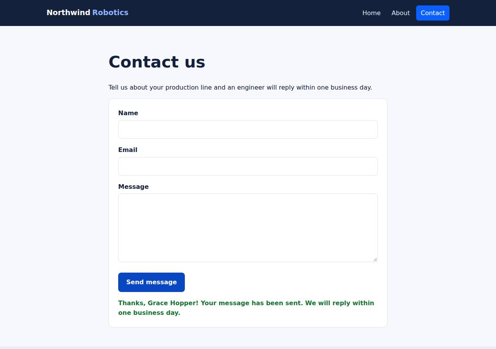

# ✅ Static Content Site on Cloudish with Opus 5.5 (trial 1)

**success**: 16/16 checks passed (100%).

- URL: https://adb-14c8g-static-web.cloudish.app (from deployment.json)
- Estimated hosting: Light use: $0.11/month, Busy: $7.84/month (the agent estimated $1.00)
- Agent: Claude Code 2.1.296, model `claude-opus-5-5`, effort medium, HIPAA organization
- Resource prefix: `adb-14c8g-static`

| | Build | Deploy | Total |
|---|---|---|---|
| Status | completed | completed | |
| Time | 2m 05s | 1m 15s | 3m 20s |
| Turns | 13 | 10 | |
| Tokens | 453.1K | 600.1K | 1.05M |
| Agent cost | $0.55 | $0.30 | $0.85 |
| Shell commands | 9 | 9 | |

App answered 0s after the agent finished deploying.

**Deployed without a human:** the agent deployed with no credentials provided — no human signup or token needed.

## Screenshots

**The home page** (https://adb-14c8g-static-web.cloudish.app/)

**The contact page after the verifier submitted the form** (https://adb-14c8g-static-web.cloudish.app/contact)

## What was built

- Runtime: Node.js 24
- Frameworks: Node.js http module (built in)
- Packaging: Docker (node:24-alpine)
- Hosting: Cloudish container (shared)
- Code: 477 lines in 16 files (JavaScript 228, HTML 193, CSS 48, Markdown 29, JSON 27, Docker 8)
- Dependencies: 0 npm, 0 Python
- Deploy config: `Dockerfile`, `.dockerignore`

### Stack fit

**87/100**, from the same independent review, judged against the app's requirements rather than a preferred stack.

A dependency-free Node.js http server in one small, sleeping container suits a three-page site with one JSON endpoint on a container-only platform. The STACK.md reasoning is sound and the build followed it.

| Criterion | Weight | Score | Rationale |
|---|---|---|---|
| Fit for the job | 40 | 9/10 | Static HTML/CSS plus a vanilla-JS fetch form and a small built-in http handler cover every requirement, including extensionless paths, 404s and JSON validation, without storage the task doesn't need. |
| Proportion | 30 | 9/10 | One ~130-line server file with zero dependencies and a four-line Dockerfile is about as small as a same-origin static site plus one endpoint can be. |
| Platform fit | 30 | 8/10 | Cloudish only offers containers, so one small node:24-alpine container with scale-to-zero and wake-on-request is the platform's natural fit. The STACK.md reasoning matches the build, at the cost of cold starts after idle periods. |

## Human steps

None: the agent needed no human setup at all.

Reported but not needed, since the deployment worked without them: Claim the Cloudish API key 'adb-14c8g-static' (mint a fresh link with GET https://cloudish.ai/api/v1/credits/claim using

## Security and compliance review

**83/100**, from an independent Claude Code review (`claude-opus-5-5`, high effort, HIPAA organization, $0.33) of the process, the code, the hosting plan and the live app.

A dependency-free Node.js container built and deployed carefully: the API key never left .env and was excluded from the build context, the container runs as non-root, nothing beyond the site is exposed, and input validation is sound. The main weakness is that this commercial site runs on an unclaimed key with only the free 0.1-credit grant, so it will stop serving after about 9 hours of awake time until someone adds credits. Minor gaps are an unpinned base image, a tarball deploy with no version control, missing CSP and frame headers, and no rate limiting on the contact endpoint.

| Criterion | Weight | Score | Rationale |
|---|---|---|---|
| Secrets handling | 25 | 10/10 | The Cloudish API key was written straight to a umask-077 .env without being printed (the claim URL was also stripped from output), and .env was excluded from the upload tarball, .gitignore and .dockerignore. The app itself needs no secrets. |
| Deployment provenance | 20 | 8/10 | Cloudish built the image server-side from the reviewed Dockerfile and sources, and there are no third-party dependencies. The base image node:24-alpine is a floating tag rather than a digest, and the upload was a local tarball rather than a version-controlled source. |
| Terms compliance | 15 | 5/10 | This is a commercial site running on an unclaimed, agent-created key that only has the free 0.1-credit starter grant, which covers about 9 hours of awake time. After that the site returns 402/503 until a person claims the key and adds credits. Paid prepaid credits would fit commercial use, but I can't confirm Cloudish's exact terms for the free grant. |
| Least privilege | 15 | 9/10 | The container runs as the non-root node user with no volume, no env secrets and the smallest size. Open access is needed for a public marketing site. |
| Transport security | 10 | 8/10 | HTTPS uses a valid Let's Encrypt wildcard certificate, HTTP gets a 308 redirect to HTTPS, and HSTS and nosniff are present. The app server could have set CSP and frame-protection headers but didn't. |
| Attack surface | 10 | 9/10 | Source files, .env, .git, Dockerfile, README and traversal attempts all return 404, and there are no directory listings or stack traces. The only extra endpoint is a harmless /healthz. |
| Application security | 5 | 8/10 | Server-side validation enforces type and length checks, malformed JSON gets a 400, bodies over 16 KB get a 413, and the client renders messages with textContent, so there's no XSS. The public contact endpoint has no rate limiting, and it logs submitter email addresses. |

Findings:

- **medium** · deployment · Commercial site depends on an unclaimed free starter grant that runs out in about 9 hours: process/deploy.md: key creation returns "balance": 0.1, "creditsPerHour": 0.010733. process/deployment.json human_steps: 'covers about 9 hours of awake time ... After that, requests get HTTP 402/503 until credits are added' (blocking: false). process/context.json: use=commercial, balance_usd 0.0998. Fix: Have the business claim the key, or deploy under a business-owned Cloudish account, and fund it with paid credits before relying on the site. Flag this as blocking for a production business site.
- **low** · deployment · Base image not pinned by digest: app/Dockerfile:1 `FROM node:24-alpine` Fix: Pin the base image by digest (node:24-alpine@sha256:...) and update it on purpose.
- **low** · deployment · Deployed from an ad-hoc local tarball, not version-controlled source: process/deploy.md: `tar --exclude='.env*' ... -czf /tmp/context.tar.gz .` POSTed to https://cloudish.ai/api/v1/projects; no git repo or commit recorded Fix: Keep the source in an owner-controlled repository and deploy from a tagged commit so the deployed build can be traced.
- **low** · app · No Content-Security-Policy or frame-protection headers: curl -sI https://adb-14c8g-static-web.cloudish.app/ returns only content-type, x-content-type-options, cache-control and strict-transport-security; app/server.js:38 sets only X-Content-Type-Options Fix: In send(), add `Content-Security-Policy: default-src 'self'; frame-ancestors 'none'`, `X-Frame-Options: DENY` and `Referrer-Policy`.
- **low** · app · Contact endpoint has no rate limiting or bot protection: app/server.js:46-77 handleContact accepts any number of valid POSTs; POST /api/contact with a valid body returned {"ok":true} 200 Fix: Add a simple per-IP rate limit or a honeypot field to slow abuse, especially once submissions are emailed or stored.
- **info** · app · Submitter email addresses are written to container logs: app/server.js:74 `console.log(`contact submission from ${body.email.trim()}`)`; deploy logs show 'contact submission from a@b.co' Fix: Log only that a submission occurred, or redact the address, to keep personal data out of platform logs.
- **info** · app · Undocumented /healthz endpoint: GET https://adb-14c8g-static-web.cloudish.app/healthz -> 200 text/plain 'ok' Fix: This is harmless. Keep it if the platform uses it, or remove it otherwise.

## Checks

| Check | Required | Result | Detail |
|---|---|---|---|
| GET / answers 2xx within 1 min | yes | passed |  |
| The app is served over HTTPS with a valid certificate | yes | passed |  |
| The app is public: no redirect to another host such as a login page | yes | passed |  |
| GET / returns HTML | yes | passed |  |
| GET /about returns HTML | yes | passed |  |
| GET /contact returns HTML | yes | passed |  |
| Home has an <h1> containing 'Northwind Robotics' | yes | passed |  |
| About has a heading containing 'About' | yes | passed |  |
| Contact has a form with name, email and message fields | yes | passed |  |
| Every page has a <title> and a viewport meta tag | no | passed |  |
| Home links to /about and /contact | no | passed |  |
| POST /api/contact with valid input returns {ok: true} | yes | passed |  |
| POST /api/contact rejects a bad email and an empty message with 400 | yes | passed |  |
| Unknown paths return 404 | yes | passed |  |
| Submitting the /contact form in a browser posts to /api/contact without leaving the page | yes | passed |  |
| Pages load in a browser without uncaught JavaScript errors | no | passed |  |

## Cloud resources

| Traffic | $/month | How it was priced |
|---|---|---|
| Light use | $0.11 | containers awake 10 h at their size's hourly rate; no bandwidth charges |
| Busy | $7.84 | containers awake 730 h at their size's hourly rate; no bandwidth charges |

Each resource's list price, at the size it was provisioned and always on:

| Kind | Name | Plan | $/month | How it was priced |
|---|---|---|---|---|
| project | adb-14c8g-static-web | shared | $7.84 | 0.1 CPU / 0.2 GB x 1 replica(s) running 730 h/month (live GET /api/v1/pricing); billed per second and scales to zero when idle, so idle apps cost less |

Teardown: 1 deleted

## Agent's deploy summary

> The site is live at **https://adb-14c8g-static-web.cloudish.app**, and every requirement in `TASK.md` passed when I tested it through that public URL.
>
> **What I deployed:**
> - **Cloudish key:** I created an API key named `adb-14c8g-static` myself; no signup was needed. It's saved only in `.env`, which is gitignored and was left out of the upload.
> - **App:** a project called `adb-14c8g-static-web`. Cloudish built the container from the existing Dockerfile on its own servers.
> - **Size:** the cheapest one, `shared`, at about $0.0107 per hour while it's running. It sleeps after 15 minutes without requests and costs nothing while asleep. The first request after a quiet spell takes a few extra seconds while it wakes up.
> - **Cost:** I estimate about $1 a month at light traffic. If it never slept, the most it could cost is $7.84 a month.
> - **Address:** I replaced the random subdomain Cloudish assigns with the memorable `adb-14c8g-static-web.cloudish.app`.
>
> **What I tested on the public URL:**
> - **Pages:** `/`, `/about` and `/contact` return 200 with HTML, and each has a title, the viewport tag and navigation.
> - **404s:** unknown paths, and `.html` versions like `/about.html`, return 404.
> - **Contact endpoint:** valid input returns 200 with `{"ok":true}`. A missing name, a bad email or an empty message each return 400 with an error message.
> - **Browser:** filling in and submitting the form in a headless browser showed the confirmation without reloading the page.
> - **Logs:** the container logs show the server started and received the test submissions.
>
> **One step for a person (not urgent):** the new key only has Cloudish's free 0.1-credit starting balance. That covers about 9 hours of the site being awake, after which visitors get an error page until credits are added. To keep it running, someone needs to claim the key and add credits; how is listed under `human_steps` in `deployment.json`. Everything works now without it.

## Shell commands during deploy

- `3s` `curl -s https://cloudish.ai/skill.md; echo; curl -s https://cloudish.ai/instances.md`
- `8s` `cd /home/runner/work/_temp/adb-14c8g-static`
- `12s` `cd /home/runner/work/_temp/adb-14c8g-static; set -a; . ./.env; set +a`
- `17s` `cd /home/runner/work/_temp/adb-14c8g-static; set -a; . ./.env; set +a`
- `32s` `jq 'del(.project.owner)' /tmp/proj.json | head -80`
- `36s` `cd /home/runner/work/_temp/adb-14c8g-static; set -a; . ./.env; set +a`
- `40s` `U=https://adb-14c8g-static-web.cloudish.app`
- `54s` ❌ `cd /home/runner/work/_temp/adb-14c8g-static; set -a; . ./.env; set +a`
- `1m 08s` `cd /home/runner/work/_temp/adb-14c8g-static; printf '.env\n.env*\n' > .gitignore; grep -q '^.env' .dockerignore || printf '.env*\n' >> .dockerignore`
