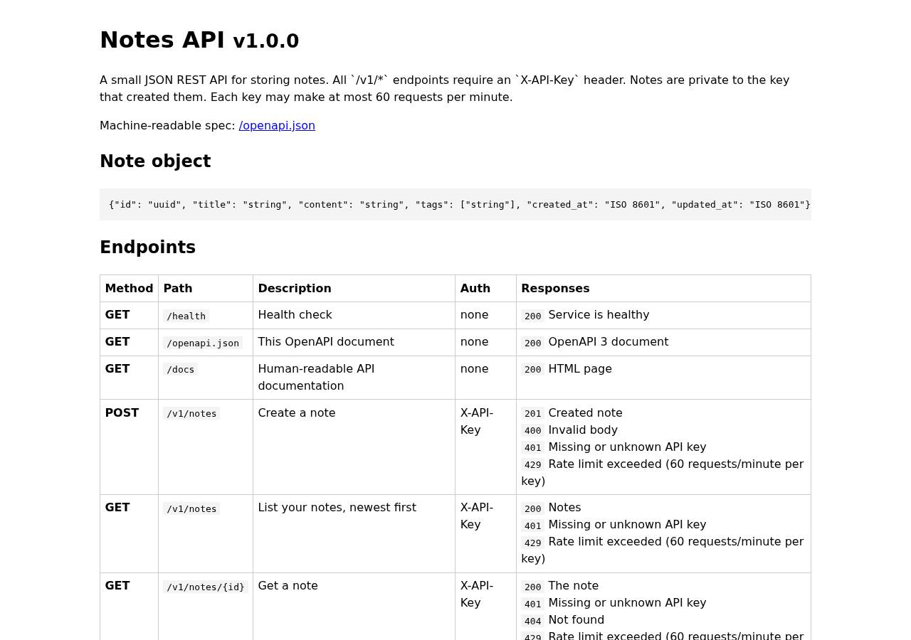

# ✅ API / Backend Service on Railway with Opus 5.5 (trial 1)

**success**: 20/20 checks passed (100%).

- URL: https://adb-8ivox-api-web-production.up.railway.app (from deployment.json)
- Estimated hosting: Light use: $10.58/month, Busy: $52.65/month (the agent estimated $5.00)
- Agent: Claude Code 2.1.296, model `claude-opus-5-5`, effort medium, HIPAA organization
- Resource prefix: `adb-8ivox-api`

| | Build | Deploy | Total |
|---|---|---|---|
| Status | completed | completed | |
| Time | 2m 10s | 4m 33s | 7m 18s |
| Turns | 10 | 18 | |
| Tokens | 408.4K | 1.07M | 1.73M |
| Agent cost | $0.48 | $0.45 | $1.07 |
| Shell commands | 9 | 17 | |

App answered 0s after the agent finished deploying.

**Needed a human:** the no-credentials attempt didn't produce a working public URL, so the cloud's credentials were provided and the agent redeployed (that attempt took 34s, 250.7K tokens, $0.14).

## Screenshots

**The API documentation at /docs** (https://adb-8ivox-api-web-production.up.railway.app/docs)

## What was built

- Runtime: Node.js 20+
- Frameworks: Express
- Libraries: node-postgres
- Packaging: railway.json
- Code: 443 lines in 14 files (JavaScript 443, JSON 44, Markdown 34)
- Dependencies: 2 npm, 0 Python
- Deploy config: `railway.json`

### Stack fit

**90/100**, from the same independent review, judged against the app's requirements rather than a preferred stack.

Node.js with Express 5 and Railway-managed Postgres is a simple, well-reasoned fit for a small persistent JSON API on Railway, and STACK.md justifies it clearly. The one departure is the unpinned Node version, which resolved to Node 20, now end-of-life.

| Criterion | Weight | Score | Rationale |
|---|---|---|---|
| Fit for the job | 40 | 9/10 | Managed Postgres is a durable store that meets the persistence requirement, Express and pg cover the HTTP and data layers, and the hand-written OpenAPI document plus a self-contained /docs page meet the spec. The in-memory limiter is adequate for a single replica. |
| Proportion | 30 | 9/10 | There are two runtime dependencies and two services, with no extra frameworks, caches or queues. That is about as lean as a persistent, authenticated API can be. |
| Platform fit | 30 | 9/10 | A long-running Node service built by Railpack, Railway's Postgres template with a volume, and reference variables over the private network are exactly what Railway does well. The build did depart from STACK.md, which said 'Node.js 22+', by landing on Node 20. |

## Human steps

3 step(s), about 7 min of a person's time.

- **Sign up for an account and verify the email address** (~3 min): prerequisite: account setup
- **Create an API token and hand it to the agent** (~2 min): prerequisite: account setup
- **Add a payment method to the account** (~2 min): resources: paid resources: adb-8ivox-api

## Security and compliance review

**80/100**, from an independent Claude Code review (`claude-opus-5-5`, high effort, HIPAA organization, $0.38) of the process, the code, the hosting plan and the live app.

The Notes API is a small Express 5 + Postgres service on Railway, and it is soundly built: secrets go through Railway variables and reference variables and were never printed, queries are parameterized, notes are isolated per key, nothing extra is exposed, and HTTPS is enforced with a valid certificate. The main weaknesses are in the deployment: it runs on Node 20, which is end-of-life, with unpinned build inputs, a root container and a database template whose public TCP proxy was never checked. The app also sets no security headers and doesn't rate limit unauthenticated requests.

| Criterion | Weight | Score | Rationale |
|---|---|---|---|
| Secrets handling | 25 | 9/10 | API keys were piped from BENCH_API_KEYS into a Railway variable without being printed. DATABASE_URL is a Railway reference variable, and the project token sits in a chmod-600 .env that .gitignore and .railwayignore exclude. The only gap: raw API keys are stored as plaintext in the owner_key column. |
| Deployment provenance | 20 | 6/10 | The running code came from the agent's own directory through `railway up`, built by Railpack with 0 audit findings. But the runtime resolved to Node 20.20.2, which has been end-of-life since April 2026, because engines says only ">=20". Dependencies use caret ranges, and the base and Postgres images are floating tags rather than digests. |
| Terms compliance | 15 | 9/10 | This is a personal side project on Railway's usage-based plan (Hobby, probably). Railway's terms allow personal use and its services don't sleep. The exact account plan wasn't visible, so this is inferred. |
| Least privilege | 15 | 7/10 | The app reaches Postgres over the private network and only the web service has a domain. The Railpack container runs as root by default. The official Postgres template usually adds a public TCP proxy, and the agent didn't check or remove it; this couldn't be verified without credentials. |
| Transport security | 10 | 8/10 | Plain HTTP gets a 301 to HTTPS, and the Let's Encrypt certificate is valid. The app sets no HSTS, X-Content-Type-Options, frame protection or CSP, and Railway's edge doesn't add them. |
| Attack surface | 10 | 10/10 | Probes for .env, .git, package.json, source files, /admin and /debug all returned a JSON 404. Malformed JSON gets a generic 400 with no stack trace, and the only public routes are the ones the spec requires. |
| Application security | 5 | 8/10 | Queries are parameterized, input types are validated, notes are scoped to their owner (other keys get 404), docs HTML is escaped, and a per-key limit of 60 requests a minute returns Retry-After. The weak spots: requests with a missing or invalid key aren't rate limited, JSON bodies up to 1 MB are parsed before authentication, and title, content and tags have no length limits. |

Findings:

- **medium** · deployment · Production runs end-of-life Node.js 20: process/deploy.md `railway up` output: 'mise ✓ node@20.20.2'. app/package.json engines: "node": ">=20". app/STACK.md says 'Node.js 22+'. Node 20 reached end-of-life on 2026-04-30. Fix: Pin a supported LTS, e.g. "engines": {"node": "22.x"} or a .node-version file, and redeploy.
- **low** · deployment · Build inputs not pinned by digest or exact version: app/package.json uses "express": "^5.3.0" and "pg": "^8.23.1". The Railpack base image is platform-chosen, and the Postgres template uses ghcr.io/railwayapp-templates/postgres-ssl:18 (tag, not digest). A package-lock.json was generated during the build (process/build.md) but isn't in the reviewed app/ tree. Fix: Commit package-lock.json so the build runs npm ci, and pin the Postgres image (and ideally the builder image) by digest.
- **low** · deployment · Postgres template may expose a public TCP proxy: process/deploy.md: the DB was deployed from template 'postgres' via templateDeployV2 with an unmodified serializedConfig (truncated in the log), and no networking settings were checked afterward. The official template usually adds a public TCP proxy (DATABASE_PUBLIC_URL). The app only uses the private DATABASE_URL. Fix: Remove the TCP proxy from adb-8ivox-api-db so Postgres is reachable only over Railway's private network.
- **low** · deployment · App container runs as root: Railpack build with no user configuration (app/railway.json builder RAILPACK, no Dockerfile). Railpack images run as root by default. Fix: Use a Dockerfile with a non-root USER (e.g. node), or configure the builder to run the process as an unprivileged user.
- **low** · app · Missing security headers: curl -sI https://adb-8ivox-api-web-production.up.railway.app/docs returns only content-type, etag, server and x-railway-* headers: no Strict-Transport-Security, X-Content-Type-Options, X-Frame-Options or Content-Security-Policy. Fix: Add helmet, or set these headers in a small Express middleware.
- **low** · app · Unauthenticated requests are not rate limited and bodies are parsed before auth: app/src/app.js:47 runs express.json({limit:'1mb'}) globally before the /v1 auth middleware, and the rate limiter (app/src/app.js:62) only runs for valid keys. `curl -X POST /v1/notes -d '{bad'` with no key returned 400 'Malformed JSON body' instead of 401, so the body was parsed first. Fix: Mount the JSON parser after authentication, add a coarse per-IP limit for 401s, and cap title, content and tag lengths.
- **info** · app · API keys stored in plaintext as note owner: app/src/db.js: owner_key TEXT NOT NULL, filled with req.apiKey in app/src/app.js (INSERT ... owner_key). Anyone who can read the database learns the valid API keys. Fix: Store a SHA-256 hash, or another stable identifier for each key, instead of the raw key.
- **info** · app · Rate limit state is in memory: app/src/rateLimit.js keeps a Map of timestamps per key. Counters reset on redeploy and wouldn't be shared across replicas (noted in process/deployment.json). Fix: Fine for one replica. Move the counters to Postgres or Redis if the service is ever scaled out.

## Checks

| Check | Required | Result | Detail |
|---|---|---|---|
| GET /health answers 2xx within 1 min | yes | passed |  |
| The app is served over HTTPS with a valid certificate | yes | passed |  |
| The app is public: no redirect to another host such as a login page | yes | passed |  |
| GET /health returns {status: ok} | yes | passed |  |
| GET /openapi.json is an OpenAPI 3 document covering /v1/notes | yes | passed |  |
| GET /docs serves human-readable documentation | no | passed |  |
| Requests without an API key get 401 | yes | passed |  |
| Requests with an unknown API key get 401 | yes | passed |  |
| POST /v1/notes creates a note | yes | passed |  |
| Invalid notes are rejected with 400 | yes | passed |  |
| GET /v1/notes/{id} returns the note | yes | passed |  |
| GET /v1/notes lists notes and filters by tag | yes | passed |  |
| Notes are listed newest first | no | passed |  |
| PATCH /v1/notes/{id} updates only the given fields | yes | passed |  |
| Notes are private to the API key that created them | yes | passed |  |
| DELETE /v1/notes/{id} removes the note | yes | passed |  |
| Notes are still there a minute later | yes | passed |  |
| Exceeding 60 requests/minute returns 429 | yes | passed |  |
| 429 responses include a Retry-After header | no | passed |  |
| One key hitting its limit doesn't throttle other keys | yes | passed |  |

## Cloud resources

| Traffic | $/month | How it was priced |
|---|---|---|
| Light use | $10.58 | memory billed all month, CPU for ~10 h of activity, 0.04 GB egress at $0.05/GB |
| Busy | $52.65 | memory billed all month, CPU for ~730 h of activity, 52.6 GB egress at $0.05/GB |

Each resource's list price, at the size it was provisioned and always on:

| Kind | Name | Plan | $/month | How it was priced |
|---|---|---|---|---|
| project | adb-8ivox-api | 2 service(s) + 0.178 GB volume | $50.03 | 2 service(s) at the assumed 1 vCPU / 0.5 GB each, always on; usage is metered per second so a mostly idle service costs less than this list price |

Teardown: 1 deleted

## Agent's deploy summary

> The Notes API is live at **https://adb-8ivox-api-web-production.up.railway.app**. I tested every requirement in `TASK.md` through that URL and all of them passed. No step needed a person, so `human_steps` is empty.
>
> **What's running in the Railway project `adb-8ivox-api`:**
> - **`adb-8ivox-api-web`:** the Node app, built from this directory and served over HTTPS on a Railway domain. `API_KEYS` is set to exactly the 2 keys in `BENCH_API_KEYS`.
> - **`adb-8ivox-api-db`:** Railway's standard Postgres, storing its data on the volume `adb-8ivox-api-db-volume`. The app reaches it over Railway's private network.
> - **`adb-8ivox-api-token`:** a project token I created and saved to `.env` (along with the project and environment IDs). That file isn't deployed and no secrets were printed.
>
> Estimated cost is about $5/month, which is usage-based and usually covered by the Hobby plan's included usage.
>
> **Checked through the public URL:**
> - `/health`, `/openapi.json` and `/docs` respond without a key.
> - A missing or unknown key gets `401`.
> - Creating, listing, filtering by tag, getting, updating and deleting notes all work.
> - An empty title gets `400`.
> - One key gets `404` for another key's notes.
> - The 61st request in a minute gets `429` with `Retry-After`, and the other key is unaffected.
> - A note I created was still there after a redeploy.
>
> **Things to know:**
> - **Rate limit memory:** the per-key counts are kept in memory, so keep the web service at one instance. The counts also reset whenever it redeploys.
> - **Limit used up in testing:** testing used the second benchmark key's full minute of requests, around 00:54 UTC. It reset a minute later.
> - **Extra database cleaned up:** the Railway CLI can't work with the workspace token, so I created everything through Railway's API and uploaded the code with the project token. An early CLI attempt reported an error but still created a stray `Postgres` service. I deleted it and its volume.
> - **`deploy.sh` removed:** I deleted the `deploy.sh` from the previous step, because it relied on that CLI path and no longer matched how the deploy works.

## Shell commands during deploy

- `2s` `railway whoami 2>&1; railway list 2>&1 | head; [ -n "$BENCH_API_KEYS" ] && echo bench set`
- `6s` `q(){ curl -s https://backboard.railway.com/graphql/v2 -H "Authorization: Bearer $RAILWAY_API_TOKEN" -H 'Content-Type: application/json' -d "$1"; echo; }`
- `10s` `cat > /tmp/q.sh <<'EOF'`
- `18s` `. /tmp/q.sh`
- `21s` `set -a; . ./.env; set +a; export -n RAILWAY_API_TOKEN; unset RAILWAY_API_TOKEN`
- `29s` `railway link --project c23bea46-108c-498e-bfeb-a8fc54d10d6b --environment production 2>&1 | tail -2`
- `33s` `. /tmp/q.sh; q '{"query":"{ template(code:\"postgres\") { id serializedConfig } }"}' > /tmp/tpl.json; python3 -c '`
- `38s` `. /tmp/q.sh; python3 - <<'EOF' > /tmp/deploy.json`
- `41s` `. /tmp/q.sh; P=c23bea46-108c-498e-bfeb-a8fc54d10d6b E=8ab6b0c5-eeed-4195-a9cf-2fadf69f1ffe`
- `45s` `. /tmp/q.sh; P=c23bea46-108c-498e-bfeb-a8fc54d10d6b`
- `48s` `. /tmp/q.sh`
- `1m 57s` `. /tmp/q.sh; python3 - <<'EOF' > /tmp/vars.json`
- `2m 02s` `(set -a; . ./.env; set +a; unset RAILWAY_API_TOKEN; railway up --service adb-8ivox-api-web --environment production --ci 2>&1 | grep -viE 'agent tooling|railway setup' | tail -25)`
- `3m 06s` `B=https://adb-8ivox-api-web-production.up.railway.app; K1=$(echo "$BENCH_API_KEYS"|cut -d, -f1); K2=$(echo "$BENCH_API_KEYS"|cut -d, -f2); echo "nkeys=$(echo "$BENCH_API_KEYS"|tr , '\n'|wc -l)"`
- `3m 15s` `. /tmp/q.sh; B=https://adb-8ivox-api-web-production.up.railway.app; K1=$(echo "$BENCH_API_KEYS"|cut -d, -f1); K2=$(echo "$BENCH_API_KEYS"|cut -d, -f2)`
- `3m 22s` `. /tmp/q.sh; for i in $(seq 1 40); do s=$(q '{"query":"{ deployments(first:1, input:{serviceId:\"ff0ed537-c693-4955-b0b7-9b176e4894ae\"}) { edges { node { id status createdAt } } } }"}'); echo "$s" | `
- `4m 25s` `rm -f deploy.sh && cat > deployment.json <<'EOF'`
