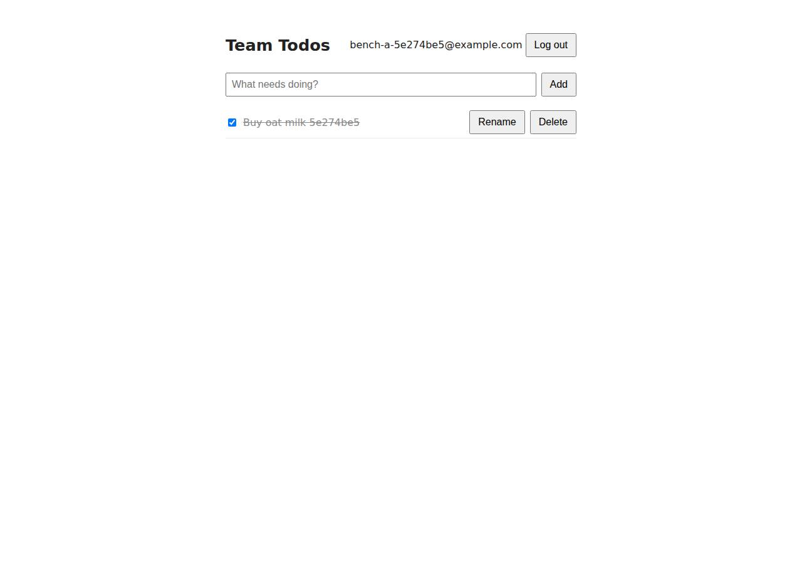

# ✅ Database-Backed CRUD App on Railway with Opus 5.5 (trial 1)

**success**: 19/19 checks passed (100%).

- URL: https://adb-yauc8-crud-web-production.up.railway.app (from deployment.json)
- Estimated hosting: Light use: $10.57/month, Busy: $52.65/month (the agent estimated $4.00)
- Agent: Claude Code 2.1.296, model `claude-opus-5-5`, effort medium, HIPAA organization
- Resource prefix: `adb-yauc8-crud`

| | Build | Deploy | Total |
|---|---|---|---|
| Status | completed | completed | |
| Time | 2m 22s | 5m 27s | 9m 05s |
| Turns | 14 | 18 | |
| Tokens | 572.6K | 1.12M | 2.09M |
| Agent cost | $0.49 | $0.49 | $1.17 |
| Shell commands | 13 | 17 | |

App answered 0s after the agent finished deploying.

**Needed a human:** the no-credentials attempt didn't produce a working public URL, so the cloud's credentials were provided and the agent redeployed (that attempt took 1m 16s, 405.3K tokens, $0.19).

## Screenshots

**The web app before signing in** (https://adb-yauc8-crud-web-production.up.railway.app/)

**The todo list after signing in through the web UI as the test user** (https://adb-yauc8-crud-web-production.up.railway.app/)

## What was built

- Runtime: Node.js 20+
- Frameworks: Express
- Libraries: node-postgres, bcrypt.js
- Packaging: railway.json
- Code: 378 lines in 11 files (JavaScript 250, HTML 112, JSON 49, Markdown 33, Shell 16)
- Dependencies: 3 npm, 0 Python
- Deploy config: `railway.json`

### Stack fit

**90/100**, from the same independent review, judged against the app's requirements rather than a preferred stack.

Node.js/Express 5 with Railway-managed PostgreSQL is a simple, well-reasoned fit for a multi-user CRUD app and plays to Railway's strengths. Its main departure from best practice is running on an end-of-life Node version.

| Criterion | Weight | Score | Rationale |
|---|---|---|---|
| Fit for the job | 40 | 9/10 | Managed PostgreSQL on a persistent volume is a durable store for users and todos, bcryptjs meets the slow-hash requirement, and Express with pg serves the JSON API and static UI well. Node 20 being end-of-life is the only blemish. |
| Proportion | 30 | 9/10 | One small server file, three dependencies, a vanilla-JS page and one database: about as minimal as the requirements allow, with no needless services or build step. |
| Platform fit | 30 | 9/10 | This is the standard Railway pattern: a Railpack-built Node service plus the official Postgres template, wired by a service-variable reference over private networking, with a health check. STACK.md's reasoning matches the build (Express 4 was corrected to 5). |

## Human steps

3 step(s), about 7 min of a person's time.

- **Sign up for an account and verify the email address** (~3 min): prerequisite: account setup
- **Create an API token and hand it to the agent** (~2 min): prerequisite: account setup
- **Add a payment method to the account** (~2 min): resources: paid resources: adb-yauc8-crud

## Security and compliance review

**76/100**, from an independent Claude Code review (`claude-opus-5-5`, high effort, HIPAA organization, $0.46) of the process, the code, the hosting plan and the live app.

The Express/PostgreSQL todo app on Railway is solidly built: no secrets leaked, queries are parameterized, passwords use bcrypt, ownership is enforced, HTTPS redirects work and nothing beyond the app is exposed. The weaknesses are deployment hardening: the Postgres template's likely public TCP proxy was left in place, the app connects as the database superuser, the container runs as root, Node 20 is end-of-life and unpinned, and the code went up as a local upload. The app also lacks security headers, auth rate limiting and session expiry.

| Criterion | Weight | Score | Rationale |
|---|---|---|---|
| Secrets handling | 25 | 9/10 | No credentials appear in source, logs or deployed files. DATABASE_URL is injected through a Railway service-variable reference, and the project token was written to a umask-077 .env that .railwayignore excludes. The only gap: a long-lived project deploy token was left active and stored on disk. |
| Deployment provenance | 20 | 7/10 | Production runs the reviewed code, uploaded with `railway up` from the agent's workspace and built by Railpack with a lockfile (npm ci). The Node version is only constrained to `>=20` and resolved to Node 20.20.2, which is past end-of-life. Base and template images use tags, not digests, and there is no git-backed source of record. |
| Terms compliance | 15 | 7/10 | A usage-based Railway workspace runs always-on services that don't sleep, which suits the app. context.json doesn't name the plan, though, and Railway steers commercial and team workloads toward Pro rather than Hobby, so I couldn't confirm the plan fits commercial use. |
| Least privilege | 15 | 6/10 | The app reaches Postgres over private networking. However, the official Postgres template usually adds a public TCP proxy, which the agent never checked or removed. The app also connects as the database superuser, and the Railpack container runs as root by default. |
| Transport security | 10 | 8/10 | HTTPS has a valid Let's Encrypt certificate, and HTTP gets a 301 redirect to HTTPS. There is no HSTS, CSP, X-Content-Type-Options or frame protection, and the app could easily have set them. |
| Attack surface | 10 | 9/10 | Only public/ is served statically. Probes for .env, .git, package.json, server.js and path traversal all returned 404, errors return generic JSON without stack traces, and /healthz returns only {ok:true}. |
| Application security | 5 | 7/10 | Queries are parameterized, passwords are hashed with bcrypt (cost 10), ownership is enforced in every todo query, input types are validated, and the UI renders with textContent. There is no rate limiting on login or signup, sessions never expire, and titles have no length limit. |

Findings:

- **medium** · deployment · Postgres template likely exposes a public TCP proxy: process/deploy.md: templateDeployV2 deployed the unmodified 'postgres' template serializedConfig (only the name was changed via jq). Railway's Postgres template normally includes a tcpProxies entry for 5432 and a DATABASE_PUBLIC_URL, and the agent never inspected or removed it. The app only needs private networking (DATABASE_URL=${{adb-yauc8-crud-db.DATABASE_URL}}). Fix: Delete the database service's TCP proxy and public networking so Postgres is reachable only over the private network.
- **low** · deployment · App uses the database superuser: The web service's DATABASE_URL references the template's POSTGRES_USER (superuser) credentials. server.js:14 connects with them and runs DDL at startup (server.js:184). Fix: Create a dedicated role limited to the app's tables and run migrations separately.
- **low** · deployment · Container runs as root: railway.json uses builder RAILPACK with no Dockerfile or USER directive. Railpack images run as root by default. Fix: Use a Dockerfile with a non-root USER (for example node), or configure the builder to drop privileges.
- **low** · deployment · Runtime unpinned and end-of-life: package.json engines: "node": ">=20". The deploy log shows `mise node@20.20.2`. Node 20 reached end-of-life in April 2026, and the review date is 2026-10-27. Fix: Pin a supported LTS (for example "node": "22.x" or 24.x) and pin builder and base images by digest.
- **low** · deployment · Deployed from a local directory upload, not a controlled repo: process/deploy.md: `railway up --service adb-yauc8-crud-web --ci` uploads the working directory. deploy.sh doesn't reproduce the deployment the agent actually ran, as its own comment admits. Fix: Deploy from a git repository the owner controls, with a reproducible deploy script or IaC.
- **low** · app · Security headers missing: `curl -sI https://adb-yauc8-crud-web-production.up.railway.app/` returns no strict-transport-security, content-security-policy, x-content-type-options or x-frame-options headers. Fix: Add helmet (or set these headers manually) in server.js.
- **low** · app · No rate limiting on authentication endpoints: server.js:78-108 has no throttling. Six wrong-password logins in a row from my probe all returned 401 without slowing down. Each attempt also runs a bcrypt hash or compare, so the endpoints are exposed to CPU exhaustion. Fix: Add per-IP and per-account rate limiting (for example express-rate-limit) on /api/auth/*.
- **low** · app · Sessions never expire; token kept in localStorage: server.js:23-27: the sessions table has no expiry check, and auth() (server.js:54-62) accepts any stored token forever. public/index.html:45,56 stores the bearer token in localStorage. Fix: Add a session TTL and prune expired sessions. Consider HttpOnly SameSite cookies for the web UI.
- **info** · app · No title length limit: server.js:129-133 accepts any non-empty title up to the 100kb JSON body limit. Fix: Cap title length (for example 500 characters) and return 400 when it's exceeded.
- **info** · deployment · Long-lived project deploy token left active: process/deploy.md: projectTokenCreate 'adb-yauc8-crud-deploy' was saved to .env (umask 077, excluded by .railwayignore) and never revoked. Fix: Revoke the project token after deploying, or keep it in a secrets manager or CI secret store.
- **info** · deployment · Plan not verified for commercial use; config-as-code deprecation: process/context.json has use=commercial and an empty account object. deployment.json says 'existing workspace plan (unchanged)'. The deploy log warns that railway.json stops working on 2026-12-01. Fix: Confirm the workspace is on a plan suitable for business use (Pro). Migrate railway.json to the supported config before 2026-12-01.

## Checks

| Check | Required | Result | Detail |
|---|---|---|---|
| GET / answers 2xx within 1 min | yes | passed |  |
| The app is served over HTTPS with a valid certificate | yes | passed |  |
| The app is public: no redirect to another host such as a login page | yes | passed |  |
| GET / serves the web app as HTML | yes | passed |  |
| POST /api/auth/signup creates an account and returns a token | yes | passed |  |
| Signup rejects an invalid email and a short password with 400 | yes | passed |  |
| Signing up twice with the same email returns 409 | yes | passed |  |
| POST /api/auth/login returns a token | yes | passed |  |
| Login with a wrong password returns 401 | yes | passed |  |
| /api/todos requires a valid token (401) | yes | passed |  |
| POST /api/todos creates a todo | yes | passed |  |
| An empty title is rejected with 400 | yes | passed |  |
| GET /api/todos lists the caller's todos | yes | passed |  |
| Todos are listed oldest first | no | passed |  |
| PATCH /api/todos/{id} renames and completes a todo | yes | passed |  |
| Users can't see or modify each other's todos (404) | yes | passed |  |
| DELETE /api/todos/{id} removes a todo | yes | passed |  |
| Data is still there a minute later, with a fresh login | yes | passed |  |
| The web UI renders a login or signup form | no | passed |  |

## Cloud resources

| Traffic | $/month | How it was priced |
|---|---|---|
| Light use | $10.57 | memory billed all month, CPU for ~10 h of activity, 0.04 GB egress at $0.05/GB |
| Busy | $52.65 | memory billed all month, CPU for ~730 h of activity, 52.6 GB egress at $0.05/GB |

Each resource's list price, at the size it was provisioned and always on:

| Kind | Name | Plan | $/month | How it was priced |
|---|---|---|---|---|
| project | adb-yauc8-crud | 2 service(s) + 0.164 GB volume | $50.02 | 2 service(s) at the assumed 1 vCPU / 0.5 GB each, always on; usage is metered per second so a mostly idle service costs less than this list price |

Teardown: 1 deleted

## Agent's deploy summary

> The app is live at **https://adb-yauc8-crud-web-production.up.railway.app**, and every requirement in `TASK.md` passed when I tested it through that URL. No human steps were needed.
>
> **What's deployed** (all in the Railway project `adb-yauc8-crud`):
> - **`adb-yauc8-crud-web`:** the Node.js app, one instance, with a health check at `/healthz`.
> - **`adb-yauc8-crud-db`:** Postgres from Railway's official template, stored on the persistent volume `adb-yauc8-crud-db-volume`. The web service connects to it over Railway's private network.
> - **Cost:** about $4 a month in usage, probably covered by the plan's included usage. I didn't change the plan.
>
> **What I tested through the public URL:**
> - **Web UI:** a headless-Chrome run of the full flow passed: sign up, add, complete, rename, delete, log out.
> - **Signup and login:** `201`, `400` for a bad email or short password, `409` for a duplicate, `200` and `401` on login.
> - **Todos:** create, list oldest first, rename, complete, uncomplete and delete all work. Requests with no token or a bad token get `401`, an empty title gets `400`, and another user's todo gets `404`.
> - **Persistence:** a todo was still there after a full redeploy of the web service.
> - **HTTPS:** plain HTTP redirects to HTTPS.
>
> **What didn't go to plan:**
> - **CLI and workspace tokens:** the provided `RAILWAY_API_TOKEN` is a workspace token, which the CLI rejects when creating projects or databases. I created the project, database and web service through Railway's API instead. Then I uploaded the code with a project token named `adb-yauc8-crud-deploy`, saved in `.env`, which is never committed or deployed.
> - **Stray database:** an early CLI attempt reported failure but still created a misnamed `Postgres` service and volume. I deleted both, so nothing is left over.
> - **`deploy.sh` doesn't match what I did:** it only works with a personal account token, and I added a comment saying so.
> - **Config file deadline:** Railway warns that `railway.json` is deprecated and keeps working until 2026-12-01. The running deployment is unaffected, but deploys after that date may ignore the start command and health check settings unless it's migrated with `railway config migrate`.
>
> Details and resource IDs are in `deployment.json`.

## Shell commands during deploy

- `3s` `test -n "$RAILWAY_API_TOKEN" && echo token-set; railway --version || npm i -g @railway/cli >/dev/null 2>&1; railway whoami 2>&1 | head -3; railway list 2>&1 | head`
- `8s` `q(){ curl -s https://backboard.railway.com/graphql/v2 -H "Authorization: Bearer $RAILWAY_API_TOKEN" -H 'content-type: application/json' -d "$1"; echo; }`
- `11s` `railway init --name adb-yauc8-crud --json 2>&1 | tail -5`
- `15s` `q(){ curl -s https://backboard.railway.com/graphql/v2 -H "Authorization: Bearer $RAILWAY_API_TOKEN" -H 'content-type: application/json' -d "$1"; echo; }`
- `22s` `cd /home/runner/work/_temp/adb-yauc8-crud`
- `31s` `q(){ curl -s https://backboard.railway.com/graphql/v2 -H "Authorization: Bearer $RAILWAY_API_TOKEN" -H 'content-type: application/json' -d "$1"; echo; }`
- `36s` `P=b6ab6a9b-f819-491c-bb05-40dc46c205e3; E=4342023a-efe5-4d0d-a9c6-cf4bff55e5f6`
- `41s` `P=b6ab6a9b-f819-491c-bb05-40dc46c205e3; E=4342023a-efe5-4d0d-a9c6-cf4bff55e5f6`
- `1m 02s` `P=b6ab6a9b-f819-491c-bb05-40dc46c205e3`
- `1m 07s` `g(){ curl -s https://backboard.railway.com/graphql/v2 -H "Authorization: Bearer $RAILWAY_API_TOKEN" -H 'content-type: application/json' -d "$1"; echo; }`
- `2m 14s` `set -a && . ./.env && set +a && unset RAILWAY_API_TOKEN && timeout 600 railway up --service adb-yauc8-crud-web --ci 2>&1 | tail -25`
- `3m 18s` `set -a && . ./.env && set +a && unset RAILWAY_API_TOKEN && railway domain --service adb-yauc8-crud-web --json 2>&1 | tail -5; railway logs --service adb-yauc8-crud-web 2>&1 | tail -5`
- `3m 30s` `B=https://adb-yauc8-crud-web-production.up.railway.app`
- `3m 43s` `B=https://adb-yauc8-crud-web-production.up.railway.app; E="e2f$(date +%s)@example.com"`
- `3m 55s` ❌ `B=https://adb-yauc8-crud-web-production.up.railway.app`
- `5m 04s` `cd /home/runner/work/_temp/adb-yauc8-crud; curl -s https://backboard.railway.com/graphql/v2 -H "Authorization: Bearer $RAILWAY_API_TOKEN" -H 'content-type: application/json' -d '{"query":"{ deployment`
- `5m 18s` `sed -i '2s#.*#\# Deploys to Railway with the CLI. Needs a *personal account* RAILWAY_API_TOKEN: workspace tokens\n\# fail on CLI init/add (the actual deploy created the project, DB template and servic`
