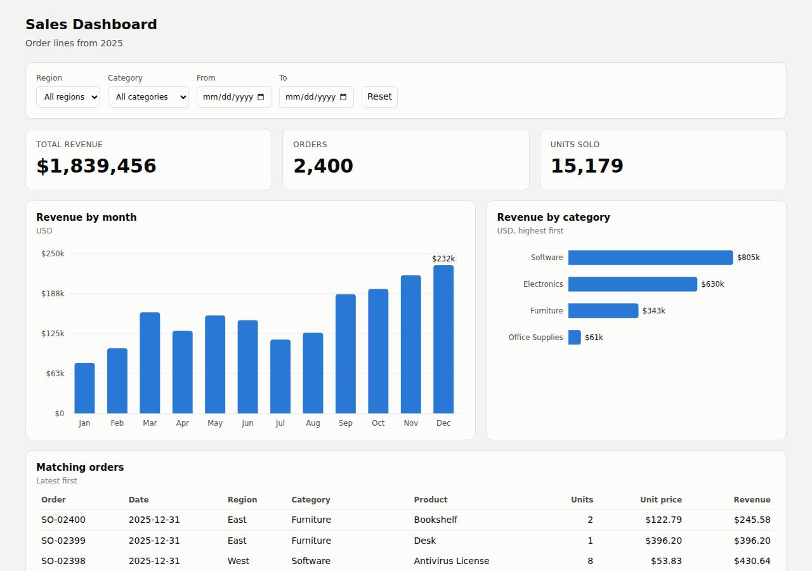

# ✅ Data / Visualization App on Railway with Opus 5.5 (trial 1)

**success**: 12/12 checks passed (100%).

- URL: https://adb-kmn4q-dataviz-web-production.up.railway.app (from deployment.json)
- Estimated hosting: Light use: $5.28/month, Busy: $27.63/month (the agent estimated $1.00)
- Agent: Claude Code 2.1.296, model `claude-opus-5-5`, effort medium, HIPAA organization
- Resource prefix: `adb-kmn4q-dataviz`

| | Build | Deploy | Total |
|---|---|---|---|
| Status | completed | completed | |
| Time | 2m 13s | 2m 26s | 5m 27s |
| Turns | 15 | 13 | |
| Tokens | 596.1K | 743.6K | 1.62M |
| Agent cost | $0.54 | $0.29 | $0.96 |
| Shell commands | 11 | 11 | |

App answered 0s after the agent finished deploying.

**Needed a human:** the no-credentials attempt didn't produce a working public URL, so the cloud's credentials were provided and the agent redeployed (that attempt took 48s, 280.5K tokens, $0.13).

## Screenshots

**The dashboard** (https://adb-kmn4q-dataviz-web-production.up.railway.app/)

## What was built

- Runtime: Node.js 20+
- Frameworks: Node.js http module (built in)
- Packaging: railway.json
- Code: 472 lines in 11 files (HTML 277, JavaScript 185, JSON 35, Markdown 18, Shell 10)
- Dependencies: 0 npm, 0 Python
- Deploy config: `railway.json`

### Stack fit

**90/100**, from the same independent review, judged against the app's requirements rather than a preferred stack.

A dependency-free Node server with in-memory CSV data and hand-built SVG charts matches the small, read-only dataset and the API requirements exactly. It is proportionate and fits Railway's long-running service model, and the build followed STACK.md as written.

| Criterion | Weight | Score | Rationale |
|---|---|---|---|
| Fit for the job | 40 | 9/10 | The 2,400 rows are read-only and bundled, so keeping them in memory is a sound data store choice. Built-in http plus vanilla JS and SVG charts cover the filters, KPIs, charts and paginated table, and integer-cent sums meet the rounding requirement. |
| Proportion | 30 | 10/10 | One process, no npm dependencies, no build step and no database: as simple as the requirements allow, without any stand-in that only appears to work. |
| Platform fit | 30 | 8/10 | It suits Railway's container model: it listens on $PORT, has a health check and restart policy, uses the generated HTTPS domain and costs very little. The service is always on, which fits a dynamic API but is more than the static parts strictly need. |

## Human steps

3 step(s), about 7 min of a person's time.

- **Sign up for an account and verify the email address** (~3 min): prerequisite: account setup
- **Create an API token and hand it to the agent** (~2 min): prerequisite: account setup
- **Add a payment method to the account** (~2 min): resources: paid resources: adb-kmn4q-dataviz

## Security and compliance review

**78/100**, from an independent Claude Code review (`claude-opus-5-5`, high effort, HIPAA organization, $0.36) of the process, the code, the hosting plan and the live app.

A zero-dependency Node.js dashboard on a single Railway service. It handles secrets cleanly (the token is kept in a chmod-600, upload-ignored .env, and the app needs no secrets), exposes nothing beyond the app, validates input and escapes output, and serves HTTPS with an HTTP-to-HTTPS redirect. The weaknesses are minor: no security headers, a default root Railpack container, unpinned Node and builder versions, and an account plan that wasn't checked against commercial, always-on use.

| Criterion | Weight | Score | Rationale |
|---|---|---|---|
| Secrets handling | 25 | 9/10 | The app needs no secrets. The project token was captured into a shell variable, never printed, and written to a chmod-600 .env. .env is listed in .gitignore and .railwayignore, so it should stay out of the upload. The transcripts don't show when .railwayignore was written, so whether it was in place for the first `railway up` can't be confirmed. |
| Deployment provenance | 20 | 7/10 | Production runs the reviewed code, uploaded by `railway up` from the owner's local directory and built by Railpack. The app has zero npm dependencies. The Node version is only constrained by `engines: >=20`, which mise resolved to 20.20.2, and the Railpack builder and base image are not pinned. The deploy came from an unversioned local folder rather than a commit. |
| Terms compliance | 15 | 7/10 | This is a commercial app on a usage-based, always-on Railway service, and Railway's paid plans permit commercial use as far as I know. The account plan is unknown (context.json shows an empty account). The agent didn't check whether the workspace is on a trial or free tier, where limited credits could run out and stop the service. |
| Least privilege | 15 | 7/10 | There is one public web service, with no data stores or extra services. The deploy token is scoped to the project and environment. The Railpack image runs as root by default and the agent didn't set a non-root user. The broader workspace token was used only to create resources. |
| Transport security | 10 | 7/10 | HTTPS works with a valid Let's Encrypt wildcard certificate, and HTTP returns a 301 redirect to HTTPS. The app sets none of HSTS, CSP, X-Content-Type-Options or frame protection, although it controls its own response headers. |
| Attack surface | 10 | 9/10 | There is no static file serving: requests for .env, .git, source files, the CSV and path traversal all return a JSON 404. Errors are generic, with no stack traces. The only extras are /health, which reports the row count, and /api/options. |
| Application security | 5 | 8/10 | Dates are checked against a regex, filters use exact matching on in-memory data so there is no injection path, the orders page size is capped at 500, and non-GET methods return 405. The client escapes data before using innerHTML. The public API has no rate limiting, and calendar-invalid dates such as 2025-02-30 may pass Date.parse. |

Findings:

- **low** · app · No security headers set: server.js send() sets only Content-Type and Cache-Control. `curl -sI https://adb-kmn4q-dataviz-web-production.up.railway.app/` returned no strict-transport-security, content-security-policy, x-content-type-options or x-frame-options headers. Fix: Add HSTS, X-Content-Type-Options: nosniff, frame-ancestors 'none' or X-Frame-Options: DENY, and a CSP in send().
- **low** · deployment · Container runs as root by default: railway.json uses the RAILPACK builder with no user configuration. The deploy.md build log shows the default Railpack image built with mise and no USER step. Fix: Use a Dockerfile with a non-root USER (for example node:20-alpine with USER node), or configure the Railpack image to drop root.
- **low** · deployment · Runtime and builder versions not pinned: package.json has "engines": { "node": ">=20" }, and railway.json has builder RAILPACK with no version. The deploy.md log shows mise resolving node@20.20.2 at build time. Fix: Pin an exact Node version (.node-version or engines "20.20.2") or use a Dockerfile with a digest-pinned base image. Deploy from a committed git revision.
- **low** · deployment · Account plan not verified for commercial, always-on use: process/context.json has "account": {}. deployment.json lists the plan as "existing workspace plan (unchanged)" without saying which plan it is. Fix: Confirm the workspace is on a paid Railway plan (Hobby or Pro) rather than a trial or free-credit tier, so the business dashboard doesn't stop when credits run out.
- **info** · deployment · Creation of the upload ignore file not shown in transcripts: app/.railwayignore lists .env, but no command in build.md or deploy.md creates it. The build-time .gitignore (build.md line 218) listed only node_modules/ and *.log. deploy.md line 65 writes RAILWAY_TOKEN to .env before `railway up`. Fix: Create .railwayignore and .gitignore entries for .env before the first `railway up`, and confirm the uploaded snapshot doesn't contain .env. Rotate the project token if there is any doubt.
- **info** · app · No rate limiting on public API: server.js handler() has no throttling. GET /api/orders?limit=99999 is capped at limit 500, but repeated calls are unrestricted. Fix: Acceptable for small read-only data. Optionally add a simple per-IP limiter, or rely on an edge or CDN rate limit.
- **info** · app · Health endpoint discloses row count: GET /health returned {"status":"ok","rows":2400} with status 200. Fix: Return only {"status":"ok"}. This is a minor disclosure.

## Checks

| Check | Required | Result | Detail |
|---|---|---|---|
| GET / answers 2xx within 1 min | yes | passed |  |
| The app is served over HTTPS with a valid certificate | yes | passed |  |
| The app is public: no redirect to another host such as a login page | yes | passed |  |
| GET / serves the dashboard as HTML | yes | passed |  |
| GET /api/summary (no filters) matches the dataset | yes | passed |  |
| GET /api/summary (region=West) matches the dataset | yes | passed |  |
| GET /api/summary (category=Electronics) matches the dataset | yes | passed |  |
| GET /api/summary (region=East, category=Furniture, start=2025-03-01, end=2025-06-30) matches the dataset | yes | passed |  |
| GET /api/summary (region=Atlantis) matches the dataset | yes | passed |  |
| The dashboard renders a chart (SVG or canvas) in a browser | yes | passed |  |
| The dashboard shows at least two charts | no | passed |  |
| The dashboard has filter controls | no | passed |  |

## Cloud resources

| Traffic | $/month | How it was priced |
|---|---|---|
| Light use | $5.28 | memory billed all month, CPU for ~10 h of activity, 0.04 GB egress at $0.05/GB |
| Busy | $27.63 | memory billed all month, CPU for ~730 h of activity, 52.6 GB egress at $0.05/GB |

Each resource's list price, at the size it was provisioned and always on:

| Kind | Name | Plan | $/month | How it was priced |
|---|---|---|---|---|
| project | adb-kmn4q-dataviz | 1 service(s) | $25.00 | 1 service(s) at the assumed 1 vCPU / 0.5 GB each, always on; usage is metered per second so a mostly idle service costs less than this list price |

Teardown: 1 deleted

## Agent's deploy summary

> The sales dashboard is live on Railway at **https://adb-kmn4q-dataviz-web-production.up.railway.app**, and everything in `TASK.md` works through that URL.
>
> **What I deployed:**
> - **Project:** `adb-kmn4q-dataviz`.
> - **Web service:** `adb-kmn4q-dataviz-web`, one copy of the Node.js app with no database. The CSV is bundled with the code and held in memory.
> - **Domain:** the free `*.up.railway.app` address Railway generated. It serves HTTPS, and plain HTTP redirects to it.
> - **Deploy token:** a project token named `adb-kmn4q-dataviz-deploy`, saved in `.env` as `RAILWAY_TOKEN` and never printed.
>
> **What I tested through the public URL:**
> - **Dashboard:** I loaded it in headless Chrome with region, category and date filters set. The KPI tiles, both charts and the order table updated without a page reload.
> - **`/api/summary`:**
>   - **Unfiltered:** 2,400 orders and $1,839,455.69 total revenue.
>   - **Combined filters:** match a total calculated directly from the CSV, with months in ascending order.
>   - **No matches:** returns zeros and empty arrays.
>   - **Bad date:** returns `400`.
> - **`/api/orders`:** pagination works, newest orders first.
>
> **What didn't work:** the Railway CLI rejected the workspace token for `init` and `whoami`. Instead I created the project, service, deploy token and domain directly through Railway's API. I then uploaded the code with `railway up` using the project token, and the build and deploy succeeded.
>
> **Cost:** I estimated about $1 a month on Railway's usage-based pricing for a small idle Node process. That's a guess and probably falls within the plan's included usage. I didn't change the account plan.
>
> `deployment.json` is written, with no human steps. To redeploy after a change, run `./deploy.sh`.

## Shell commands during deploy

- `3s` `cd /home/runner/work/_temp/adb-kmn4q-dataviz; railway --version 2>&1 || npm i -g @railway/cli >/dev/null 2>&1; railway whoami 2>&1; railway list 2>&1 | head`
- `8s` `q(){ curl -s https://backboard.railway.com/graphql/v2 -H "Authorization: Bearer $RAILWAY_API_TOKEN" -H 'Content-Type: application/json' -d "$1"; echo; }`
- `12s` `cd /home/runner/work/_temp/adb-kmn4q-dataviz; railway init --name adb-kmn4q-dataviz 2>&1 | tail -5; railway status 2>&1 | head`
- `17s` `cat > /tmp/q.sh <<'EOF'`
- `23s` `cd /home/runner/work/_temp/adb-kmn4q-dataviz; . /tmp/q.sh; P=fee77464-ebb1-4054-a703-6269825df8c2; E=36f52d47-2a09-4a98-aba8-6f720085f634`
- `26s` `cd /home/runner/work/_temp/adb-kmn4q-dataviz; set -a; . ./.env; set +a; unset RAILWAY_API_TOKEN; timeout 500 railway up --service adb-kmn4q-dataviz-web --ci 2>&1 | tail -25`
- `1m 51s` `cd /home/runner/work/_temp/adb-kmn4q-dataviz; . /tmp/q.sh`
- `1m 56s` `U=https://adb-kmn4q-dataviz-web-production.up.railway.app; for i in $(seq 1 20); do c=$(curl -s -o /dev/null -w '%{http_code}' $U/health); [ "$c" = 200 ] && break; sleep 5; done; echo health $c`
- `2m 04s` `cd /tmp; google-chrome --headless=new --no-sandbox --disable-gpu --window-size=1280,900 --virtual-time-budget=5000 --screenshot=/tmp/live.png "https://adb-kmn4q-dataviz-web-production.up.railway.app/?`
- `2m 06s` `cd /home/runner/work/_temp/adb-kmn4q-dataviz; U=https://adb-kmn4q-dataviz-web-production.up.railway.app node -e '`
- `2m 20s` `cd /home/runner/work/_temp/adb-kmn4q-dataviz`
