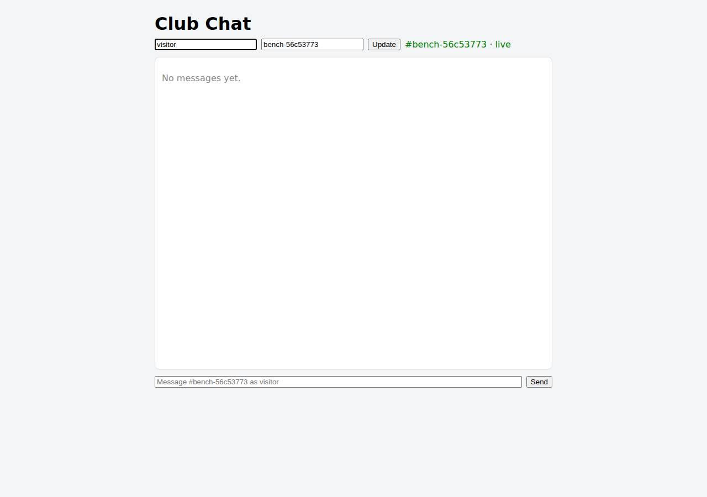

# ⚠️ Real-Time Collaborative App on Vercel with Opus 5.5 (trial 1)

**partial** (failed at human): 10/13 checks passed (77%).

- URL: https://adb-94zby-realtime-web.vercel.app (from deployment.json)
- Estimated hosting: Light use: $0.00/month, Busy: $20.00/month (the agent estimated $0.00)
- Agent: Claude Code 2.1.296, model `claude-opus-5-5`, effort medium, HIPAA organization
- Resource prefix: `adb-94zby-realtime`

| | Build | Deploy | Total |
|---|---|---|---|
| Status | completed | completed | |
| Time | 2m 39s | 3m 57s | 14m 42s |
| Turns | 13 | 12 | |
| Tokens | 545.1K | 955.9K | 3.25M |
| Agent cost | $0.51 | $0.44 | $1.65 |
| Shell commands | 12 | 10 | |

App answered 0s after the agent finished deploying.

**Needed a human:** the no-credentials attempt didn't produce a working public URL, so the cloud's credentials were provided and the agent redeployed (that attempt took 8m 06s, 1.75M tokens, $0.71).

## Screenshots

**The chat UI, opened on the room the verifier's clients chatted in** (https://adb-94zby-realtime-web.vercel.app/?room=bench-56c53773)

## What was built

- Runtime: Node.js
- Frameworks: Next.js, React
- Libraries: Upstash Redis SDK
- Hosting: Vercel project (Next.js), Vercel Functions
- Code: 470 lines in 13 files (JavaScript 452, Markdown 43, JSON 39, Shell 18)
- Dependencies: 4 npm, 0 Python
- Deploy config: none

### Stack fit

**59/100**, from the same independent review, judged against the app's requirements rather than a preferred stack.

STACK.md reasons soundly: Next.js route handlers with SSE and Upstash Redis Streams fits Vercel and the spec. But the build shipped without the shared store, and its poll-in-a-loop streaming is costly on Hobby and free-tier quotas, so the deployed stack only partly fits.

| Criterion | Weight | Score | Rationale |
|---|---|---|---|
| Fit for the job | 40 | 5/10 | Next.js with SSE and Redis Streams is a well-reasoned design for Vercel, and the Redis path was verified locally. But what is live uses an in-memory store that loses messages across instances and resets history, so the deployed stack doesn't yet meet the delivery or persistence requirements. |
| Proportion | 30 | 7/10 | A single Next.js app plus one Redis client is about as lean as the requirements allow. The in-memory fallback is reasonable for local development, but in production it is a stand-in that only appears to work. |
| Platform fit | 30 | 6/10 | SSE is the right choice given that Vercel can't host WebSocket servers, and bounded 55 s streams with Last-Event-ID resume suit function time limits. But keeping functions alive to poll storage every 150-500 ms works against per-use function and Redis billing. |

## Human steps

3 step(s), about 8 min of a person's time. **Blocked:** the deploy couldn't finish without them.

- **Sign up for an account and verify the email address** (~3 min): prerequisite: account setup
- **Create an API token and hand it to the agent** (~2 min): prerequisite: account setup
- **Install a Marketplace integration and accept its terms in a browser** (~3 min): agent: In a browser signed in to the Vercel team, open https://vercel.com/ai-deploy-bench/~/integrations/accept-terms/upstash?source=cli and accept the Upstash for Redis Marketplace terms. Then run scripts/deploy.sh (uses VERCEL_TOKEN/VERCEL_TEAM_ID): it installs Upstash Redis 'adb-94zby-realtime-redis' (f; tool output: ng Upstash for Redis by Upstash under ai-deploy-bench { "status": "action_requ

## Security and compliance review

**80/100**, from an independent Claude Code review (`claude-opus-5-5`, high effort, HIPAA organization, $0.48) of the process, the code, the hosting plan and the live app.

The deployment is clean on secrets, exposure and transport: no credentials in source or upload, only the app's routes reachable, and HTTPS with HSTS. Inputs are validated and output is escaped. The main weaknesses are that production runs on a per-instance in-memory store, because the Redis integration was blocked on terms acceptance (live fan-out drops messages and history isn't durable), and that endpoints have no rate limiting. Smaller issues: unpinned dependencies without a lockfile, and some missing security headers.

| Criterion | Weight | Score | Rationale |
|---|---|---|---|
| Secrets handling | 25 | 9/10 | The source has no credentials. The Redis URL and token are read from integration-injected env vars (lib/store.js:6-7), the Vercel token came from $VERCEL_TOKEN and is redacted in the transcripts, and .vercelignore keeps .env and .env.local (with the CLI's VERCEL_OIDC_TOKEN) out of the upload. One minor point: the token is passed as a --token argument, which other processes on the machine can see. |
| Deployment provenance | 20 | 7/10 | A pinned Vercel CLI (npx vercel@65.3.1) uploaded the agent's own local tree, and Vercel built it from source, so production matches the reviewed code. Dependencies use caret ranges (next ^16.4.3, @upstash/redis ^1.40.0), no lockfile is among the delivered sources, and the deploy isn't tied to any commit. |
| Terms compliance | 15 | 7/10 | A Hobby plan suits this personal hobby-club app. But every open browser tab holds a streaming function that polls in a loop, so the Hobby usage caps (paused when exceeded) are a real risk. The planned Upstash free tier would also be used up quickly by 500 ms polling. I'm not certain of the exact current quota numbers. |
| Least privilege | 15 | 9/10 | Only one Vercel project with serverless functions was created: no public data stores, containers or extra credentials. The public endpoints are exactly the ones the spec requires. |
| Transport security | 10 | 8/10 | HTTPS only, with a valid certificate, HTTP→HTTPS 308 and HSTS (preload). The agent could have set CSP, X-Content-Type-Options and frame-protection headers in next.config but didn't. |
| Attack surface | 10 | 9/10 | Probes for .env, .env.local, .git/config, package.json, .vercel/project.json, source files and deployment.json all return 404, and errors return short JSON with no stack traces. Only the X-Powered-By: Next.js banner is extra. |
| Application security | 5 | 6/10 | Input validation is solid (room regex, 1-50 char user, 1-1000 char text, 400 on bad or null JSON), and React escapes message text, so stored HTML doesn't execute. There is no rate limiting or cap on rooms or SSE connections. In the deployed in-memory mode, messages are lost across instances and history is lost on cold starts. |

Findings:

- **medium** · deployment · Production runs on per-instance in-memory store: messages lost between instances, history not durable: lib/store.js:112 falls back to MemoryStore when KV_REST_API_URL/TOKEN are absent. deploy.md: Marketplace installs returned integration_terms_acceptance_required, and the public-URL SSE test failed with 'AssertionError: got 8' / 'got 5' of 20 messages. deployment.json marks the Redis step as blocking. Fix: Accept the Upstash terms and run scripts/deploy.sh to attach Redis, or use a store that needs no Marketplace terms, before treating the app as production-ready.
- **low** · app · No rate limiting or resource caps on public endpoints: app/api/rooms/[room]/[action]/route.js:21-34 accepts unlimited POSTs, and any room name creates a new in-memory list of up to 500 messages (lib/store.js:90-96). Each SSE connection polls every 150 ms for 55 s (route.js:62-78). POST /api/rooms/rvw-probe-7q/messages returned 201 with no throttle headers. Fix: Add per-IP rate limits (e.g. Vercel Firewall rate-limit rules or an Upstash ratelimit), cap the number of rooms and connections, and keep idle polling cheap.
- **low** · deployment · Always-on streaming and polling may exceed Hobby and Upstash free-tier quotas: route.js:5,8: maxDuration 60, and streams reconnect every 55 s indefinitely while a tab is open. RedisStore pollMs 500 (lib/store.js:49) means about 2 Redis commands per second per connection. The human step uses Upstash's 'free plan'. context.json: team plan hobby. Fix: Use a push-based fan-out (e.g. Redis pub/sub or a managed realtime service), or poll less often and back off when idle, so usage stays within Hobby and free-tier limits.
- **low** · deployment · Dependencies unpinned and no lockfile in the delivered sources: app/package.json: "next": "^16.4.3", "@upstash/redis": "^1.40.0", "react": "^19.2.0". app/ has no package-lock.json, so Vercel resolves versions at build time. Fix: Commit package-lock.json (so Vercel runs npm ci) and pin exact versions. Deploy from a git repository so each deployment maps to a commit.
- **low** · app · Missing CSP, X-Content-Type-Options and frame-protection headers: curl -sI https://adb-94zby-realtime-web.vercel.app/ shows strict-transport-security but no content-security-policy, x-content-type-options or x-frame-options. No next.config sets headers(). Fix: Add these headers through next.config.js headers() or vercel.json.
- **info** · app · X-Powered-By framework banner: Response header 'x-powered-by: Next.js' on GET / Fix: Set poweredByHeader: false in next.config.js.
- **info** · deployment · Vercel token passed on the command line: deploy.md and scripts/deploy.sh:8 run 'npx -y vercel@65.3.1 --token "$VERCEL_TOKEN"'. The value is redacted in the logs but appears in the process argument list. Fix: Rely on the VERCEL_TOKEN environment variable, which the CLI reads, instead of --token.
- **info** · app · Display names are unauthenticated (by design): POST body {"user":"reviewer",...} is accepted as-is (route.js:29-33). Anyone can post under any name, which the spec allows. Fix: Acceptable for a hobby club. Add lightweight sign-in if impersonation becomes a problem.

## Checks

| Check | Required | Result | Detail |
|---|---|---|---|
| GET / answers 2xx within 1 min | yes | passed |  |
| The app is served over HTTPS with a valid certificate | yes | passed |  |
| The app is public: no redirect to another host such as a login page | yes | passed |  |
| GET / serves the chat UI as HTML | yes | passed |  |
| deployment.json declares a supported transport (websocket or sse) | no | passed |  |
| Clients connect over sse | yes | passed |  |
| A message reaches another client in the same room within 5 s | yes | failed | bob did not receive alice's message within 5 s |
| The sender receives its own message too | no | passed |  |
| Messages never reach clients in other rooms | yes | failed | not run: depends on delivery |
| Five users posting at the same time all see every message within 10 s | yes | failed | messages not delivered (client: missing count): {'user0': 8, 'user1': 8, 'user2': 9, 'user3': 9, 'user4': 11} |
| GET /api/rooms/<room>/messages returns recent messages | yes | passed |  |
| Messages over 1000 characters are rejected | no | passed |  |
| The chat UI loads in a browser without errors | no | passed |  |

## Cloud resources

| Traffic | $/month | How it was priced |
|---|---|---|
| Light use | $0.00 | within Hobby's included usage |
| Busy | $20.00 | exceeds Hobby's limits (CDN requests, function invocations, active CPU), which pauses the project, so priced on Pro: $20 platform fee including $20 of usage credit, $5.75 of usage |

Each resource's list price, at the size it was provisioned and always on:

| Kind | Name | Plan | $/month | How it was priced |
|---|---|---|---|---|
| project | adb-94zby-realtime-web | — | $0.00 | no fixed fee; usage within the plan's included allowance |

Teardown: 1 deleted

## Agent's deploy summary

> The app is live at **https://adb-94zby-realtime-web.vercel.app**, but live delivery doesn't fully work yet. When several messages are posted at once, each listener misses many of them. Fixing that needs one browser step from a person.
>
> **What's deployed:** the Vercel project `adb-94zby-realtime-web` (`prj_lTKGhVzPEk9AAiLeCdvuEFWPgAVW`) in production, at $0/month. It uses Server-Sent Events, set as `"realtime": {"transport": "sse"}` in `deployment.json`. Each live stream closes after about 55 seconds because functions are capped at 60. Browsers reconnect automatically and resume where they left off.
>
> **Tested through the public URL:**
> - **Working:** the page at `/?room=…`, the `400` rejections for invalid messages, `201` on posting, and history returning the latest 50 messages, oldest first.
> - **Not working:** with 3 listeners and 20 messages posted at once, each listener got only 5 to 8 of them. Vercel spreads the load over several copies of the function, and without Redis each copy keeps its own messages in memory. For the same reason, history can differ between copies and is lost when a copy restarts.
>
> **Why Redis isn't attached:** adding Upstash Redis, Redis or Neon from the Vercel Marketplace all stopped with "integration terms acceptance required". Only a person can accept those terms in a browser. I also looked at Vercel's Runtime Cache as a store that needs no terms, but rejected it: it can drop entries at any time and has no safe way to handle simultaneous writes.
>
> **The one human step (blocking, also in `deployment.json`):**
> 1. Accept the Upstash terms at https://vercel.com/ai-deploy-bench/~/integrations/accept-terms/upstash?source=cli.
> 2. Run `scripts/deploy.sh`. It installs the free Upstash Redis `adb-94zby-realtime-redis`, connects it to the project and redeploys production.
>
> The app switches to Redis automatically once it's connected, with no code changes. The same tests passed locally against Redis, including delivery between two separate server instances.
>
> **Housekeeping:**
> - I created no credentials.
> - I deleted the old `.env`, since its claim link from the previous anonymous deployment is now obsolete.
> - A new `.vercelignore` keeps the env files and tests out of the upload.

## Shell commands during deploy

- `6s` `export CI=1 && V="npx -y vercel@65.3.1 --token $VERCEL_TOKEN --scope $VERCEL_TEAM_ID"; $V whoami 2>&1 | tail -1; $V link --yes --project adb-94zby-realtime-web 2>&1 | tail -3; cat .vercel/project.json`
- `12s` `export CI=1 && V="npx -y vercel@65.3.1 --token $VERCEL_TOKEN --scope $VERCEL_TEAM_ID"; $V integration add upstash/upstash-kv --help 2>&1 | sed -n '1,40p' | grep -i -E 'plan|metadata|region|--' | head `
- `16s` `export CI=1 && V="npx -y vercel@65.3.1 --token $VERCEL_TOKEN --scope $VERCEL_TEAM_ID"; $V integration add upstash/upstash-kv --name adb-94zby-realtime-redis --metadata primaryRegion=iad1 --no-env-pull`
- `24s` `export CI=1 && V="npx -y vercel@65.3.1 --token $VERCEL_TOKEN --scope $VERCEL_TEAM_ID"; $V integration list --all 2>&1 | tail -15; curl -s -H "Authorization: Bearer $VERCEL_TOKEN" "https://api.vercel.c`
- `43s` `export CI=1 && V="npx -y vercel@65.3.1 --token $VERCEL_TOKEN --scope $VERCEL_TEAM_ID"; $V integration discover 2>&1 | grep -i -E 'redis|kv|postgres|neon|supabase|mongo|nats|convex' | head`
- `49s` `export CI=1 && V="npx -y vercel@65.3.1 --token $VERCEL_TOKEN --scope $VERCEL_TEAM_ID"; for i in redis neon; do $V integration add $i --name adb-94zby-realtime-$i --no-env-pull 2>&1 | grep -E '"reason"`
- `58s` `printf '.env\n.env.*\nnode_modules\n.next\ntest\ndeployment.json\n' > .vercelignore && export CI=1 && V="npx -y vercel@65.3.1 --token $VERCEL_TOKEN --scope $VERCEL_TEAM_ID"; $V deploy --prod --yes 2>&`
- `1m 22s` `U=https://adb-94zby-realtime-web.vercel.app; curl -s -o /dev/null -w "%{http_code}\n" $U/; for i in 1 2; do BASE_URL=$U npm test 2>&1 | grep -E '✔|✖|got'; echo ---; done`
- `3m 34s` `cat > scripts/deploy.sh <<'EOF'`
- `3m 46s` `cat > deployment.json <<'EOF'`
